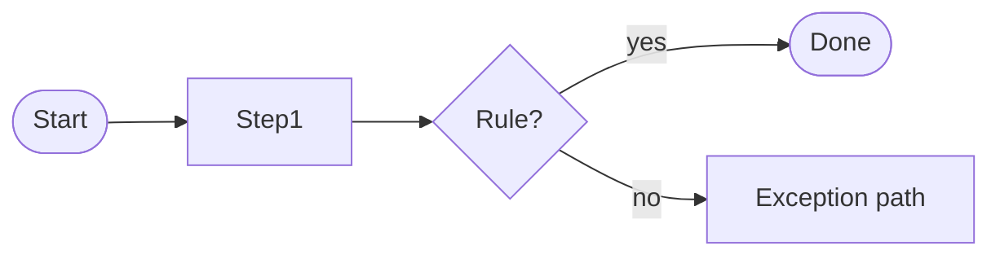

# Product Requirements Document: <Product name>

| Field | Value |
| ----- | ----- |
| Version | 0.1 |
| Status | Draft |
| Last updated | YYYY-MM-DD |
| Source | docs/ASSIGNMENT.md |

## 1. Problem statement
<What problem exists, for whom, and why it matters. 3-5 sentences.>

## 2. Goals & success metrics
| ID | Goal | Metric |
| -- | ---- | ------ |
| G-01 | | |

## 3. Personas
| Persona | Description | Primary needs |
| ------- | ----------- | ------------- |

## 4. Source constraints (verbatim from brief)
> "<quote>"

## 4a. Business rules & process flows
| ID | Business rule | Source |
| -- | ------------- | ------ |
| BR-01 | | brief / assumption A-xx |

## 5. User stories & acceptance criteria
### US-001: <title>  · Priority: Must
As a <persona>, I want <capability>, so that <benefit>.

- **AC-001.1**: Given <context>, when <action>, then <outcome>.
- **AC-001.2**: ...

## 6. Non-functional requirements
| ID | Category | Requirement |
| -- | -------- | ----------- |
| NFR-01 | Accessibility | WCAG 2.1 AA for all interactive elements |
| NFR-02 | Performance | |
| NFR-03 | Security | |

## 7. Assumptions
| ID | Ambiguity | Assumption | Rationale |
| -- | --------- | ---------- | --------- |
| A-01 | | | |

## 8. Out of scope
- 

## 9. Open questions
- 
