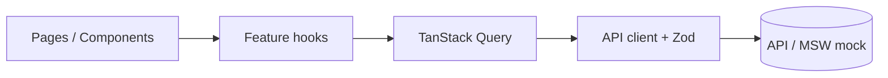

# Technical Requirements Document: <Product name>

| Field | Value |
| ----- | ----- |
| Version | 0.1 |
| PRD | docs/PRD.md |
| Last updated | YYYY-MM-DD |

## 1. Overview
<Summary of the technical approach in 3-5 sentences.>

## 2. Tech stack
| Concern | Choice | Why |
| ------- | ------ | --- |
| Build | Vite | |
| UI | React 18 + TypeScript (strict) | |
| Routing | React Router | |
| Styling | Tailwind CSS v4 | |
| Server state | TanStack Query | |
| Client state | Zustand | |
| Forms | React Hook Form + Zod | |
| Errors | react-error-boundary + route errorElement | |
| Component docs | Storybook 10 (CSF Next, a11y, MSW) | |
| Validation | Zod | |
| Testing | Vitest, React Testing Library, MSW, Playwright | |

## 3. Architecture


### 3.1 Folder structure
```
shared/api/       # Zod API contract used by web and API
server/src/
  app.ts  server.ts  config.ts  lib/  plugins/  db/
  modules/<feature>/{routes,service,repository,seed}.ts + tests
src/
  app/            # providers, router, layout
  features/<name>/{components,hooks,api,types.ts,index.ts}
  components/     # shared UI
  lib/            # http client, utils
  pages/          # thin route components
  stores/         # app-wide Zustand stores
  mocks/          # MSW handlers (dev, tests, Storybook)
  test/           # test setup & utilities
```

### 3.2 Routes
| Path | Page | Stories |
| ---- | ---- | ------- |

## 4. Data models & API contracts
### 4.1 Shared contract (`shared/api/*.ts`)
```ts
// Zod schema + inferred type per entity, request and response
```

### 4.2 REST endpoints
| Method | Endpoint | Request (params/query/body) | Response | Errors (status · code) | Stories / BRs |
| ------ | -------- | --------------------------- | -------- | ---------------------- | ------------- |

### 4.3 Database schema (SQLite)
```sql
-- STRICT tables, NOT NULL, CHECK constraints, foreign keys, indexes for filters/sorts
```

### 4.4 Business rules by layer
| BR | Enforced in API (service) | Mirrored in web (UX) | Test |
| -- | ------------------------- | -------------------- | ---- |

### 4.5 Seed data
<Dealerships, vehicle mix, ages relative to "today" that cover every bucket and boundary.>

## 5. State management
<Server state (TanStack Query): query keys, invalidation rules.
Client state (Zustand): list each store, its state shape, actions, and which components use it.
Local state: what stays in useState.>

## 6. Cross-cutting concerns
- Error handling & loading states
- Accessibility
- Security
- Performance

## 7. Architecture decisions (ADRs)
### ADR-001: <title>
- **Context**:
- **Decision**:
- **Alternatives**:
- **Consequences**:

## 8. Technical assumptions
| ID | Assumption | Rationale |
| -- | ---------- | --------- |
| TA-01 | | |

## 9. Traceability
| Story | Tasks | Test files |
| ----- | ----- | ---------- |

## 10. Implementation plan
### Phase 1 - Foundation & vertical slice
- [ ] **T-001** <title> · layer: api · S · depends-on: - · covers: AC-001.1
  - Files: 
  - Test plan: 

### Phase 2 - Core features
- [ ] **T-0xx** ...

### Phase 3 - Hardening (a11y, error states, E2E, docs)
- [ ] **T-0xx** ...

## 11. Risks
| Risk | Impact | Mitigation |
| ---- | ------ | ---------- |
