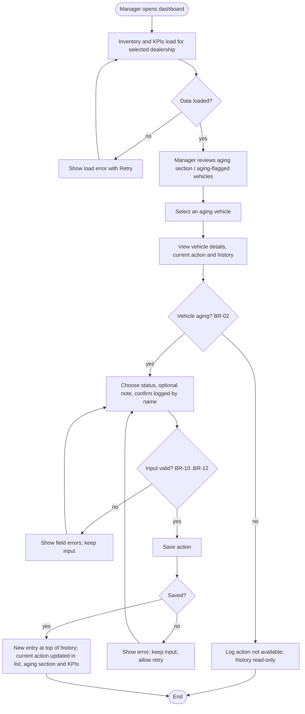
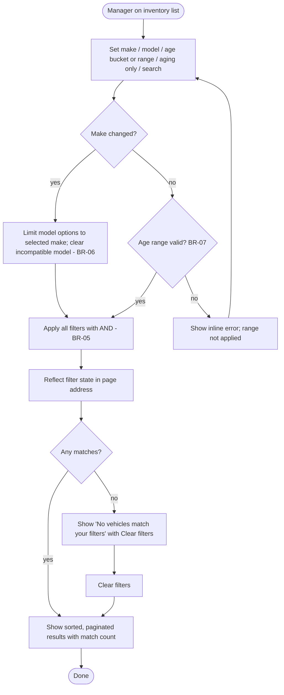

# Product Requirements Document: Intelligent Inventory Dashboard

| Field        | Value              |
| ------------ | ------------------ |
| Version      | 0.3                |
| Status       | Draft              |
| Last updated | 2026-10-07         |
| Source       | docs/ASSIGNMENT.md |

## 1. Problem statement

Dealership managers carry a large and constantly changing vehicle stock, and every day a vehicle sits
unsold it costs the dealership money (financing, depreciation, lot space). Today managers lack a
single, up-to-date view of what is in stock and, in particular, which vehicles have been sitting for
too long. Even when aging vehicles are spotted, decisions about them (price cuts, promotions,
transfers) are not recorded anywhere shared, so follow-up is lost. The Intelligent Inventory
Dashboard gives managers a filterable, current view of their stock, automatically flags aging
vehicles (in stock for more than 90 days), and lets them record and persist a proposed action for
each aging vehicle.

## 2. Goals & success metrics

| ID   | Goal                                                         | Metric                                                                                                                                                                      |
| ---- | ------------------------------------------------------------ | --------------------------------------------------------------------------------------------------------------------------------------------------------------------------- |
| G-01 | Give managers a current overview of their dealership's stock | 100% of in-stock vehicles of the selected dealership are listed; data shown is never older than 60 s (NFR-05)                                                               |
| G-02 | Let managers find specific vehicles quickly                  | A manager can narrow the list by make, model and age in at most 3 interactions; filter/sort/page results appear within 1 s (NFR-02)                                         |
| G-03 | Surface aging stock automatically and prominently            | 100% of vehicles with age > 90 days are flagged as aging, 0% of vehicles with age <= 90 days are flagged (BR-02); aging count is visible without scrolling on the dashboard |
| G-04 | Make decisions on aging stock trackable                      | 100% of saved actions are still visible after page reload, in another browser, and after a service restart (NFR-04)                                                         |
| G-05 | Drive follow-up on neglected aging stock                     | Number of aging vehicles with "No action" is visible at a glance (US-010)                                                                                                   |

## 3. Personas

| Persona            | Description                                                                                                                                                           | Primary needs                                                                                                                                |
| ------------------ | --------------------------------------------------------------------------------------------------------------------------------------------------------------------- | -------------------------------------------------------------------------------------------------------------------------------------------- |
| Dealership Manager | Responsible for the stock of one or more dealerships; accountable for stock turn and holding costs. Uses the dashboard on a desktop or tablet during the working day. | See current stock at a glance; find vehicles by make/model/age; know which vehicles are aging; record and review decisions on aging vehicles |

## 4. Source constraints (verbatim from brief)

> "Inventory Visualization: Display a filterable list of all vehicles in a dealership's inventory (e.g., filter by make, model, age)."

> "Aging Stock Identification: Automatically identify and prominently display "aging stock" (vehicles in inventory for >90 days)."

> "Actionable Insights: Allow a manager to log and persist a status or proposed action for each aging vehicle (e.g., "Price Reduction Planned")."

> "A Note on Ambiguity: These scenarios are designed to mimic real-world requirements, which can be ambiguous. If a requirement is unclear, please make a reasonable assumption and document it in your System Design Document."

Stakeholder decision (persistence): "Inventory data and manager actions are stored server-side and are shared across browsers/sessions and survive page reloads and service restarts."

## 4a. Business rules & process flows

### Business entities

| Entity               | Key attributes                                                                                           | Notes                                         |
| -------------------- | -------------------------------------------------------------------------------------------------------- | --------------------------------------------- |
| Dealership           | Dealership ID, name, currency, local time zone                                                           | Sample data has at least 2 dealerships (A-02) |
| Vehicle              | VIN, stock number, make, model, model year, trim, colour, mileage, list price, stock-in date, dealership | Only in-stock vehicles (A-05)                 |
| Action log entry     | Vehicle, action status, note (optional), logged by, logged at (timestamp)                                | Append-only history (BR-13)                   |
| Derived (not stored) | Days in inventory, aging flag, current action, KPIs                                                      | Computed from rules below                     |

### Business rules

| ID    | Business rule                                                                                                                                                                                                                                                                                                                                                                                                                                | Source                            |
| ----- | -------------------------------------------------------------------------------------------------------------------------------------------------------------------------------------------------------------------------------------------------------------------------------------------------------------------------------------------------------------------------------------------------------------------------------------------- | --------------------------------- |
| BR-01 | Days in inventory = number of whole calendar days between the vehicle's stock-in date and today's date in the dealership's local time zone. A vehicle stocked in today has age 0. Age is never negative.                                                                                                                                                                                                                                     | brief / assumption A-04           |
| BR-02 | A vehicle is **aging** if and only if days in inventory is strictly greater than 90. Age 90 = not aging; age 91 = aging. The threshold is fixed at 90 days.                                                                                                                                                                                                                                                                                  | brief / assumption A-04           |
| BR-03 | Aging status is derived automatically from BR-01/BR-02 every time data is shown; it cannot be set or overridden manually.                                                                                                                                                                                                                                                                                                                    | brief ("Automatically identify")  |
| BR-04 | The dashboard shows only vehicles currently in stock and belonging to the selected dealership; exactly one dealership is shown at a time.                                                                                                                                                                                                                                                                                                    | brief / assumption A-02, A-05     |
| BR-05 | All active filters combine with logical AND. A filter with no value applies no restriction.                                                                                                                                                                                                                                                                                                                                                  | assumption A-06                   |
| BR-06 | Model filter options are limited to models of the selected make (single selection) within the selected dealership's stock. With no make selected, all models are offered. If the make changes so a selected model no longer applies, that model selection is cleared.                                                                                                                                                                        | assumption A-06                   |
| BR-07 | Age buckets are inclusive: 0-30, 31-60, 61-90, and >90 (91 and above) days. A custom min-max age range is inclusive at both ends; min must be <= max and both must be whole numbers >= 0.                                                                                                                                                                                                                                                    | assumption A-06                   |
| BR-08 | Free-text search is a case-insensitive partial match against VIN, stock number, or model; leading/trailing spaces are ignored.                                                                                                                                                                                                                                                                                                               | assumption A-06                   |
| BR-09 | A new action can be logged only for an aging vehicle (BR-02). Any existing action history of a vehicle remains visible.                                                                                                                                                                                                                                                                                                                      | brief / assumption A-09           |
| BR-10 | Action status must be exactly one of: "Price Reduction Planned", "Marketing Promotion", "Transfer to Another Dealership", "Send to Auction/Wholesale", "Under Review".                                                                                                                                                                                                                                                                       | assumption A-09                   |
| BR-11 | The note is optional, at most 500 characters after trimming leading/trailing spaces.                                                                                                                                                                                                                                                                                                                                                         | assumption A-09                   |
| BR-12 | "Logged by" is required: 1-100 characters after trimming; a blank or whitespace-only value is rejected.                                                                                                                                                                                                                                                                                                                                      | assumption A-01                   |
| BR-13 | Action history is append-only: each save creates a new entry with a timestamp assigned when it is stored; entries are never edited or deleted. History is shown newest first.                                                                                                                                                                                                                                                                | assumption A-09                   |
| BR-14 | A vehicle's **current action** is its most recent log entry. A vehicle with no entries shows "No action".                                                                                                                                                                                                                                                                                                                                    | assumption A-09                   |
| BR-15 | KPIs are calculated over the whole in-stock inventory of the selected dealership (not the filtered list): Total vehicles = count; Aging count = count of aging vehicles; % aging = aging count / total x 100, rounded to 1 decimal place (0% when total is 0); Average days in stock = mean age rounded to the nearest whole day (shown as "-" when total is 0).                                                                             | assumption A-07                   |
| BR-16 | A vehicle **needs attention** if it is aging and its current action is "No action".                                                                                                                                                                                                                                                                                                                                                          | assumption A-08                   |
| BR-17 | Default sort is days in inventory descending (oldest first); ties are broken by stock number ascending.                                                                                                                                                                                                                                                                                                                                      | assumption A-06                   |
| BR-18 | Server-side validation enforces BR-09 to BR-12 regardless of what the user interface allows; invalid requests are rejected and nothing is stored.                                                                                                                                                                                                                                                                                            | NFR-03                            |
| BR-19 | The selected language (English or Vietnamese) changes presentation only: UI text, date and number formats. Stored data, API requests and responses, filter values, sorting and business rules are identical in both languages. Data entered by people or held in inventory (make, model, notes, "Logged by") is never translated; action statuses are stored as their canonical values (BR-10) and only their displayed label is translated. | stakeholder request (v0.3) / A-16 |

### Process flow: review aging vehicle and log action

### Process flow: filter inventory

## 5. User stories & acceptance criteria

Priority summary: Must = US-001 to US-007 and US-015 (added in v0.3 at the stakeholder's request); Should = US-008 to US-012; Could = US-013; Won't = US-014.

Unless stated otherwise, examples assume "today" is 2026-10-07 in the dealership's local time zone.

### US-001: View dealership inventory list · Priority: Must

As a Dealership Manager, I want to see a list of all vehicles currently in my dealership's stock, so that I have a single up-to-date overview of my inventory.

- **AC-001.1**: Given the selected dealership has in-stock vehicles, when the dashboard loads, then each vehicle is listed with VIN, stock number, make, model, model year, trim, colour, mileage, list price, stock-in date, days in inventory, aging indicator and current action. (BR-04)
- **AC-001.2**: Given dealership A has 12 vehicles and dealership B has 8, when dealership A is selected, then exactly 12 vehicles are available in the list (across pages) and none from dealership B appear. (BR-04)
- **AC-001.3**: Given vehicles with ages 10, 200 and 95 days, when the list loads without a sort selection, then they appear in the order 200, 95, 10. Given two vehicles with equal age, then the one with the lower stock number appears first. (BR-17)
- **AC-001.4**: Given the dealership has more than one page of vehicles (page size 25), when the list loads, then the first 25 vehicles are shown, the total count is displayed, and the manager can move to the next/previous page.
- **AC-001.5**: Given the selected dealership has no in-stock vehicles, when the dashboard loads, then the message "No vehicles in stock" is shown instead of the list.
- **AC-001.6**: Given the inventory cannot be loaded, when the dashboard loads, then an error message and a "Retry" action are shown; when "Retry" is used and loading succeeds, then the list is displayed.
- **AC-001.7**: Given a vehicle with list price 25990 in a GBP dealership and stock-in date 2026-06-01, when it is displayed, then the price shows as "£25,990" and the date in an unambiguous format such as "01 Jun 2026". (A-13)

### US-002: Filter the inventory list · Priority: Must

As a Dealership Manager, I want to filter the inventory by make, model, age and free text, so that I can quickly find the vehicles I care about.

- **AC-002.1**: Given vehicles of makes Ford and Toyota, when the manager selects make "Ford", then only Ford vehicles are listed and the match count updates.
- **AC-002.2**: Given make "Ford" is selected, when the manager opens the model filter, then only Ford models present in the dealership's stock are offered. Given model "Focus" is selected, when the make changes to "Toyota", then the model selection is cleared. (BR-06)
- **AC-002.3**: Given vehicles aged 30, 31, 60, 61, 90 and 91 days, when the manager selects bucket "31-60", then only the vehicles aged 31 and 60 are listed; when bucket ">90" is selected, then only the vehicle aged 91 is listed. (BR-07)
- **AC-002.4**: Given a custom age range min 45 and max 90, when applied, then vehicles aged 45 to 90 inclusive are listed. Given min 100 and max 50, when entered, then an inline validation message is shown and the range is not applied. (BR-07)
- **AC-002.5**: Given make "Ford" and bucket ">90" are both selected, when the list updates, then only Ford vehicles aged over 90 days are listed. (BR-05)
- **AC-002.6**: Given a vehicle with stock number "STK-1042" and VIN "1FADP3F2XJL123456", when the manager searches " stk-104 " or "123456", then that vehicle is listed. (BR-08)
- **AC-002.7**: Given filters are applied, when the manager reloads the page or opens the same page address in another browser tab, then the same filters are applied and the same results are shown.
- **AC-002.8**: Given filters match no vehicles, when the list updates, then the message "No vehicles match your filters" and a "Clear filters" action are shown; when "Clear filters" is used, then all filters are reset and the full list is shown.

### US-003: Automatically identify aging vehicles · Priority: Must

As a Dealership Manager, I want vehicles in stock for more than 90 days to be flagged automatically, so that I do not have to calculate vehicle age myself.

- **AC-003.1**: Given a vehicle with stock-in date 2026-10-07, when displayed, then days in inventory is 0. Given stock-in date 2026-07-09 (90 days ago), then days in inventory is 90 and the vehicle is **not** flagged as aging. (BR-01, BR-02)
- **AC-003.2**: Given a vehicle with stock-in date 2026-07-08 (91 days ago), when displayed, then days in inventory is 91 and the vehicle is flagged as aging. (BR-01, BR-02)
- **AC-003.3**: Given a vehicle aged 90 days yesterday, when the dashboard is viewed the next day, then the vehicle shows 91 days and is flagged as aging without any manual step. (BR-03)
- **AC-003.4**: Given an aging vehicle in the list, when displayed, then the aging flag includes a visible text label "Aging" (not colour alone) that is also exposed to assistive technologies. (NFR-01)
- **AC-003.5**: Given the dealership's local date differs from UTC date (e.g. late evening), when age is computed, then the dealership's local date is used. (BR-01)

### US-004: Prominent aging stock section · Priority: Must

As a Dealership Manager, I want aging stock shown prominently in its own area and filterable, so that it immediately draws my attention.

- **AC-004.1**: Given the dealership has 3 aging vehicles, when the dashboard loads, then a dedicated "Aging stock" section lists those 3 vehicles, oldest first, each with age and current action, without needing any filter. (BR-02, BR-14, BR-17)
- **AC-004.2**: Given the dealership has no aging vehicles, when the dashboard loads, then the aging section shows "No aging stock".
- **AC-004.3**: Given the "Aging only" toggle is switched on, when the list updates, then only vehicles aged 91 days or more are listed, and other active filters still apply. (BR-02, BR-05)
- **AC-004.4**: Given a vehicle in the aging section, when the manager selects it, then its details with current action and action history are opened.

### US-005: Inventory KPI summary · Priority: Must

As a Dealership Manager, I want headline figures about my stock, so that I understand the health of my inventory at a glance.

- **AC-005.1**: Given the dealership has 8 vehicles aged 10, 20, 30, 40, 90, 91, 120 and 200 days, when the dashboard loads, then the summary shows Total vehicles 8, Aging 3, % aging 37.5%, Average days in stock 75. (BR-15)
- **AC-005.2**: Given filters are applied to the list, when the list changes, then the KPI values do not change. (BR-15)
- **AC-005.3**: Given the dealership has 0 vehicles, when the dashboard loads, then the summary shows Total 0, Aging 0, % aging 0%, Average days "-". (BR-15)
- **AC-005.4**: Given the dashboard is viewed at a desktop resolution of 1280x800, when it loads, then the KPI summary including the aging count is visible without scrolling.

### US-006: Log an action for an aging vehicle · Priority: Must

As a Dealership Manager, I want to record a status or proposed action for an aging vehicle, so that decisions about aging stock are captured and shared.

- **AC-006.1**: Given an aging vehicle, when the manager opens it, then a "Log action" form is available offering exactly the statuses "Price Reduction Planned", "Marketing Promotion", "Transfer to Another Dealership", "Send to Auction/Wholesale", "Under Review", an optional note and a "Logged by" field. (BR-09, BR-10)
- **AC-006.2**: Given a vehicle aged 90 days or less, when the manager opens it, then no "Log action" form is available; any existing history is still shown. Given a request to log an action for such a vehicle reaches the service directly, then it is rejected and nothing is stored. (BR-09, BR-18)
- **AC-006.3**: Given the manager selects "Price Reduction Planned", enters note "Reduce by 5%" and logged by "Jane Smith", when they save, then a confirmation is shown, the entry appears at the top of the history with the status, note, "Jane Smith" and the save timestamp, and the vehicle's current action in the list and aging section becomes "Price Reduction Planned" without a manual refresh. (BR-13, BR-14)
- **AC-006.4**: Given no status is selected, or "Logged by" is empty or only spaces, when the manager tries to save, then a field-level error is shown, focus moves to the first invalid field and nothing is stored. Given a request with an empty or whitespace-only "Logged by" reaches the service directly, then it is rejected and nothing is stored. (BR-10, BR-12, BR-18)
- **AC-006.5**: Given a note of 500 characters, when saved, then it is accepted. Given a note of 501 characters, then the manager is prevented from saving and sees a message stating the 500 character limit; a request with 501 characters reaching the service directly is rejected. (BR-11, BR-18)
- **AC-006.6**: Given a request with a status not in the allowed list reaches the service, when processed, then it is rejected and nothing is stored. (BR-10, BR-18)
- **AC-006.7**: Given the save fails (e.g. service unavailable), when the manager saves, then an error message is shown, the selected status, note and name remain in the form, and the manager can retry. (A-11)
- **AC-006.8**: Given a note containing markup such as "<b>cut</b>", when it is displayed in history, then it is shown as literal text and not interpreted. (NFR-03)

### US-007: Persisted, shared action history · Priority: Must

As a Dealership Manager, I want logged actions to be kept and visible to anyone using the dashboard, so that decisions are not lost and colleagues can follow up.

- **AC-007.1**: Given an action was saved for a vehicle, when the page is reloaded, then the action is still shown as the vehicle's current action and in its history. (A-03, NFR-04)
- **AC-007.2**: Given an action was saved in one browser, when the dashboard is opened in a different browser or session, then the same action is shown. (NFR-04)
- **AC-007.3**: Given an action was saved, when the service is restarted and the dashboard reloaded, then the action is still shown. (NFR-04)
- **AC-007.4**: Given a vehicle has actions logged at 09:00 ("Under Review") and 11:00 ("Marketing Promotion"), when its history is viewed, then both entries are listed with the 11:00 entry first, and the current action is "Marketing Promotion". (BR-13, BR-14)
- **AC-007.5**: Given a vehicle has no logged action, when displayed, then its current action shows "No action". (BR-14)
- **AC-007.6**: Given a history entry exists, when the manager views it, then there is no way to edit or delete it. (BR-13)

### US-008: Switch dealership · Priority: Should

As a Dealership Manager responsible for more than one dealership, I want to switch between dealerships, so that I can review each one's stock separately.

- **AC-008.1**: Given at least 2 dealerships exist, when the dashboard loads with no dealership chosen, then the first dealership (alphabetically) is selected and a dealership selector lists all dealerships.
- **AC-008.2**: Given dealership A is selected, when the manager selects dealership B, then the list, aging section and KPIs show only dealership B's data and filters are reset. (BR-04)
- **AC-008.3**: Given dealership B is selected, when the page is reloaded or its address shared, then dealership B is still selected.

### US-009: Fresh data · Priority: Should

As a Dealership Manager, I want the dashboard to stay current without reloading, so that I can trust what I see.

- **AC-009.1**: Given the dashboard is open, when 60 seconds pass, then data is refreshed automatically without losing filters, sort, page or unsaved form input. (NFR-05)
- **AC-009.2**: Given the dashboard is open, when the manager uses "Refresh", then data is reloaded and a "Last updated" time is updated.
- **AC-009.3**: Given another user logs an action for a vehicle, when the next automatic or manual refresh happens, then the new current action is shown.

### US-010: Highlight aging vehicles needing attention · Priority: Should

As a Dealership Manager, I want to see which aging vehicles have no action logged, so that nothing aging is forgotten.

- **AC-010.1**: Given 3 aging vehicles of which 1 has no action, when the dashboard loads, then the summary shows "Needs attention: 1" and that vehicle is labelled "Needs attention" (text, not colour alone). (BR-16)
- **AC-010.2**: Given a "Needs attention" vehicle, when an action is logged for it, then the label is removed and the count decreases by 1 without a manual refresh. (BR-16)

### US-011: Sort the inventory list · Priority: Should

As a Dealership Manager, I want to sort the list by age, price or make/model, so that I can prioritise my review.

- **AC-011.1**: Given the list is displayed, when the manager sorts by price ascending, then vehicles are ordered by list price lowest first; toggling switches to descending.
- **AC-011.2**: Given sort by make/model, when applied, then vehicles are ordered alphabetically by make, then model.
- **AC-011.3**: Given a sort is chosen, when the page is reloaded, then the same sort is applied; the sort state is announced to assistive technologies.

### US-012: Remember "Logged by" name · Priority: Should

As a Dealership Manager, I want my name pre-filled when I log actions, so that logging is quick.

- **AC-012.1**: Given the manager saved an action as "Jane Smith", when they open the log form again in the same browser (also after reload), then "Logged by" is pre-filled with "Jane Smith" and remains editable. (BR-12)

### US-013: Export current view · Priority: Could

As a Dealership Manager, I want to export the filtered list, so that I can share it in meetings.

- **AC-013.1**: Given filters are applied, when the manager exports, then a CSV file containing exactly the filtered vehicles (all pages) with their age, aging flag and current action is downloaded.

### US-015: Use the dashboard in English or Vietnamese · Priority: Must (added v0.3)

As a Dealership Manager, I want to switch the dashboard between English and Vietnamese, so that I can work in the language I am most comfortable with.

- **AC-015.1**: Given a manager opens the dashboard for the first time in a browser (whatever the browser's language), when it loads, then all UI text is in English and the page language is declared as English. (A-16)
- **AC-015.2**: Given the dashboard is in English, when the manager selects "Tiếng Việt" in the language switcher, then all UI text (headings, table headers, labels, buttons, pagination, empty, loading and error messages, page title) changes to Vietnamese without a page reload, the page language is declared as Vietnamese, and current filters, sort, page and dealership are unchanged. Selecting "English" switches back. (BR-19)
- **AC-015.3**: Given the manager selected Vietnamese, when the page is reloaded or reopened in the same browser, then it opens in Vietnamese. (A-16)
- **AC-015.4**: Given Vietnamese is selected, when dates, timestamps and numbers are displayed, then dates use dd/mm/yyyy (e.g. "07/10/2026"), timestamps add 24-hour time (e.g. "07/10/2026 14:32"), and prices and mileage use Vietnamese number formatting while keeping the dealership's currency (GBP). In English the formats of AC-001.7 and NFR-08 are unchanged. (BR-19)
- **AC-015.5**: Given Vietnamese is selected, when vehicle data and action history are displayed, then make, model, trim, colour, notes and "Logged by" names appear exactly as stored, and an action stored as "Price Reduction Planned" is shown with its Vietnamese label. (BR-19)
- **AC-015.6**: Given a keyboard or screen-reader user, when they reach the language switcher, then it has an accessible name, is operable with the keyboard, and each language option is announced in its own language. (NFR-01)

### US-014: Configurable aging threshold · Priority: Won't (this release)

As a Dealership Manager, I want to change the aging threshold, so that it matches my dealership's policy.

- Not delivered; the threshold is fixed at 90 days (BR-02, A-04). Recorded for future consideration.

### Traceability: business rules to acceptance criteria

| BR    | Covered by                             |
| ----- | -------------------------------------- |
| BR-01 | AC-003.1, AC-003.2, AC-003.5           |
| BR-02 | AC-003.1, AC-003.2, AC-004.1, AC-004.3 |
| BR-03 | AC-003.3                               |
| BR-04 | AC-001.1, AC-001.2, AC-008.2           |
| BR-05 | AC-002.5, AC-004.3                     |
| BR-06 | AC-002.2                               |
| BR-07 | AC-002.3, AC-002.4                     |
| BR-08 | AC-002.6                               |
| BR-09 | AC-006.1, AC-006.2                     |
| BR-10 | AC-006.1, AC-006.4, AC-006.6           |
| BR-11 | AC-006.5                               |
| BR-12 | AC-006.4, AC-012.1                     |
| BR-13 | AC-006.3, AC-007.4, AC-007.6           |
| BR-14 | AC-004.1, AC-006.3, AC-007.4, AC-007.5 |
| BR-15 | AC-005.1, AC-005.2, AC-005.3           |
| BR-16 | AC-010.1, AC-010.2                     |
| BR-17 | AC-001.3, AC-004.1                     |
| BR-18 | AC-006.2, AC-006.4, AC-006.5, AC-006.6 |
| BR-19 | AC-015.2, AC-015.4, AC-015.5           |

## 6. Non-functional requirements

| ID     | Category                  | Requirement                                                                                                                                                                                                                                                                                            |
| ------ | ------------------------- | ------------------------------------------------------------------------------------------------------------------------------------------------------------------------------------------------------------------------------------------------------------------------------------------------------ |
| NFR-01 | Accessibility             | WCAG 2.1 AA for all interactive elements; all functions usable by keyboard only with visible focus; status information (aging, needs attention, errors) never conveyed by colour alone; form errors announced to assistive technologies.                                                               |
| NFR-02 | Performance               | With up to 5,000 vehicles per dealership, filter, sort and page changes show results within 1 s; initial dashboard load completes within 3 s on a typical office broadband connection.                                                                                                                 |
| NFR-03 | Security                  | All inputs (filters, action status, note, logged-by) are validated on both the user interface and the service; invalid input is rejected with a clear message. User-entered text is always displayed as plain text (no markup/script execution). No credentials or secrets are exposed to the browser. |
| NFR-04 | Reliability / persistence | Inventory data and manager actions are stored server-side and are shared across browsers/sessions and survive page reloads and service restarts. A confirmed save is never lost.                                                                                                                       |
| NFR-05 | Data freshness            | Data is loaded fresh on open, refreshed automatically at least every 60 s and on manual refresh; a manager's own saved changes are reflected immediately.                                                                                                                                              |
| NFR-06 | Usability                 | Filter, sort, page and dealership state are reflected in the page address (shareable/bookmarkable). Every list has loading, empty and error states. Destructive or lossy outcomes never occur silently (unsaved input is kept on error).                                                               |
| NFR-07 | Compatibility             | Latest two versions of major desktop and tablet browsers; layout usable from 768 px width upwards.                                                                                                                                                                                                     |
| NFR-08 | Localisation              | English (default) and Vietnamese UI (US-015). Prices in the dealership's currency with locale-appropriate separators. English dates in an unambiguous format (e.g. "07 Oct 2026"); Vietnamese dates as dd/mm/yyyy (e.g. "07/10/2026"); timestamps include 24-hour time.                                |
| NFR-09 | Data quality              | Sample data is realistic: at least 2 dealerships, multiple makes/models, and ages spanning all buckets including exactly 90 and 91 days, so all rules can be demonstrated.                                                                                                                             |
| NFR-10 | Testability               | Age and aging calculations are deterministic for a given "today" so boundary cases can be tested automatically.                                                                                                                                                                                        |

## 7. Assumptions

| ID   | Ambiguity                                                                                | Assumption                                                                                                                                                                                                                                                                                                               | Rationale                                                                                                                      |
| ---- | ---------------------------------------------------------------------------------------- | ------------------------------------------------------------------------------------------------------------------------------------------------------------------------------------------------------------------------------------------------------------------------------------------------------------------------ | ------------------------------------------------------------------------------------------------------------------------------ |
| A-01 | Who uses the system; is login needed?                                                    | Single persona "Dealership Manager". Authentication and roles are out of scope. Actions are attributed via a required free-text "Logged by" name, remembered per browser.                                                                                                                                                | Brief mentions only managers; authentication adds no value to the evaluated features but attribution keeps history meaningful. |
| A-02 | One or many dealerships?                                                                 | One dealership is shown at a time; data supports multiple dealerships; the manager switches via a selector. Sample data has at least 2 dealerships.                                                                                                                                                                      | Brief says "a dealership's inventory"; a selector is cheap and demonstrates correct scoping.                                   |
| A-03 | Where does data live; how is it persisted? (stakeholder answered)                        | Inventory data and manager actions are stored server-side and are shared across browsers/sessions and survive page reloads and service restarts. Inventory is seeded with realistic sample data.                                                                                                                         | Stakeholder decision; "persist" in the brief implies durability beyond one browser.                                            |
| A-04 | How is vehicle age measured; what exactly is ">90 days"?                                 | Age = whole calendar days from stock-in date to today in dealership local time. Aging = age > 90 (90 not aging, 91 aging). Threshold fixed at 90.                                                                                                                                                                        | Brief states ">90 days" literally; calendar days are the business-natural unit; local date avoids off-by-one around midnight.  |
| A-05 | Which vehicle attributes and which vehicles?                                             | Attributes: VIN, stock number, make, model, model year, trim, colour, mileage, list price, stock-in date, dealership. Only in-stock vehicles are shown; sold vehicles are out of scope.                                                                                                                                  | Standard dealer stock attributes; "inventory" means current stock.                                                             |
| A-06 | What filters/sorting are needed beyond the examples?                                     | Make, model (dependent on make), age buckets 0-30/31-60/61-90/>90 and/or min-max range, "aging only" toggle, free-text search on VIN/stock number/model. Filters combine with AND, reflected in the page address, with "Clear filters". Sort by age (default oldest first), price, make/model. Pagination (25 per page). | Brief lists make, model, age "e.g."; these are the common, low-cost extensions managers expect.                                |
| A-07 | What does "prominently display" mean?                                                    | KPI summary (total, aging count, % aging, average days) computed over the whole dealership stock, a dedicated aging stock section, and a non-colour-only "Aging" label in the main list.                                                                                                                                 | Gives three complementary levels of visibility; KPIs over whole stock avoid confusion when filters change.                     |
| A-08 | What makes the dashboard "intelligent"?                                                  | Rule-based insights: automatic aging detection, KPIs, and "Needs attention" highlighting of aging vehicles without an action. No machine learning or prediction.                                                                                                                                                         | Brief provides no data or requirement for prediction; rules are transparent and testable.                                      |
| A-09 | What is a "status or proposed action" and how is it stored?                              | Predefined list: "Price Reduction Planned", "Marketing Promotion", "Transfer to Another Dealership", "Send to Auction/Wholesale", "Under Review", plus optional note (max 500 chars). Each save appends a timestamped entry; latest = current action; none = "No action". New actions only for aging vehicles.           | Predefined values enable consistent reporting; history gives accountability; brief scopes actions to "each aging vehicle".     |
| A-10 | Expected data volume and speed?                                                          | Up to ~5,000 vehicles per dealership; list interactions within ~1 s.                                                                                                                                                                                                                                                     | Typical large-dealership stock with headroom.                                                                                  |
| A-11 | Behaviour on failures?                                                                   | Save failure shows an error and keeps input; load failure offers Retry; empty states for "no vehicles" and "no matches".                                                                                                                                                                                                 | Avoids silent data loss and dead ends.                                                                                         |
| A-12 | Target platforms and accessibility level?                                                | Modern desktop and tablet browsers; WCAG 2.1 AA; keyboard-only operable.                                                                                                                                                                                                                                                 | Managers work at desks and on the lot; AA is the common industry baseline.                                                     |
| A-13 | Language, currency, date format?                                                         | English and Vietnamese UI (A-16, US-015); prices in the dealership's currency; sample data uses UK dealerships priced in GBP (£); English dates such as "07 Oct 2026", Vietnamese dates dd/mm/yyyy.                                                                                                                      | Keyloop serves UK dealerships, so GBP is a realistic default; Vietnamese was added at the stakeholder's request (v0.3).        |
| A-14 | What does "real-time" mean?                                                              | Fresh on load, automatic refresh every 60 s (consistent with NFR-05), manual refresh, own changes reflected immediately. No push/streaming.                                                                                                                                                                              | Brief defines no event source; polling-level freshness meets the "overview" need.                                              |
| A-15 | Should actions for non-aging vehicles be possible?                                       | No new actions; existing history stays visible (e.g. if data is corrected).                                                                                                                                                                                                                                              | Literal reading of the brief ("for each aging vehicle") while not hiding recorded decisions.                                   |
| A-16 | Which languages, which default, and how is the choice kept? (stakeholder answered, v0.3) | English and Vietnamese only. The dashboard always opens in English on first use, regardless of browser language; a Vietnamese choice is remembered per browser (no account, so no server-side preference). Translating stored data (makes, models, notes, names) is out of scope.                                        | Stakeholder decision; a per-browser preference fits the no-authentication assumption A-01.                                     |

## 8. Out of scope

- Authentication, authorisation and user/role management (A-01)
- Creating, editing or removing vehicles; editing stock-in dates or prices
- Editing or deleting logged actions (history is append-only, BR-13)
- Sales, reservation and transfer workflows (an action records intent only; it does not execute a transfer or price change)
- Notifications, emails or reminders
- Integration with real dealer management or OEM systems; data is seeded sample data
- Machine-learning or predictive pricing recommendations (A-08)
- Configurable aging threshold (US-014, Won't)
- Sold / historical vehicles and trend reporting over time
- Mobile phone layouts below 768 px, offline use, languages other than English and Vietnamese, translation of stored data
- CSV export is optional (US-013, Could) and only delivered if time permits

## 9. Open questions

None are blocking; all are covered by assumptions and can be confirmed by the stakeholder later.

- Q-01: Should KPIs follow the active filters instead of the whole dealership stock? (Currently A-07: whole stock.)
- Q-02: Should managers be able to log actions for non-aging vehicles (e.g. pre-emptive price review)? (Currently A-15: no.)
- Q-03: Is the 90-day threshold the same for all dealerships and vehicle types (e.g. new vs used)? (Currently A-04: fixed 90 days for all.)
