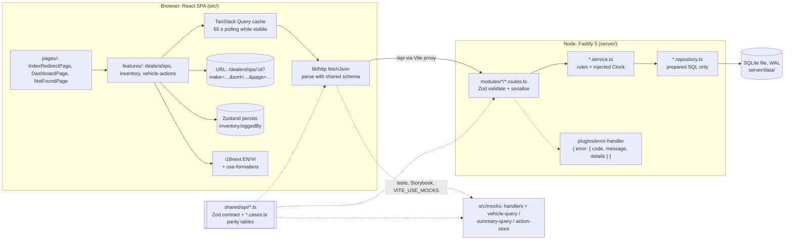
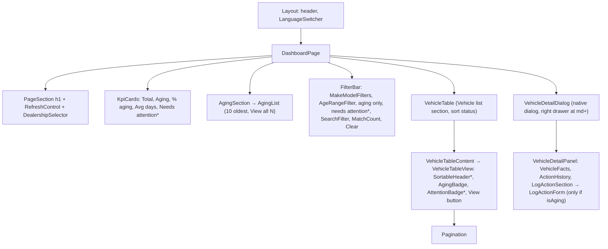
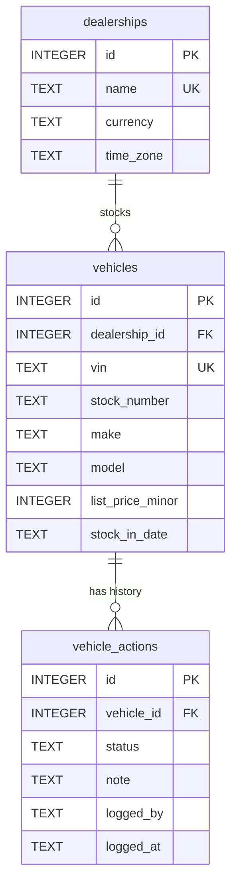
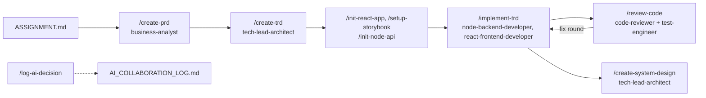

# System Design Document: Intelligent Inventory Dashboard

| Field   | Value                                                                                                                                     |
| ------- | ----------------------------------------------------------------------------------------------------------------------------------------- |
| Brief   | `docs/ASSIGNMENT.md` (Keyloop, domain "Supply")                                                                                           |
| Sources | `docs/PRD.md` v0.3, `docs/TRD.md` (ADR-001..009, TA-01..32), `docs/AI_COLLABORATION_LOG.md`, code on branch `feature/inventory-dashboard` |
| Code    | Phases 1-6 and the CSV export (US-013) on `feature/inventory-dashboard` (see §1.2)                                                        |
| Updated | 2026-10-11                                                                                                                                |

This document describes the code that exists, not the plan. Where the TRD and the code differ,
the code is described and the difference is listed in §6.5.

## 1. Overview

**Problem.** Dealership managers need a current view of their stock, need aging vehicles (in stock
for more than 90 days) to stand out without manual maths, and need a shared, durable record of
what they decided to do about each aging vehicle.

**Solution.** A React 19 + TypeScript single-page app (`src/`) on top of a Fastify 5 + SQLite API
(`server/`). The two share one Zod contract (`shared/api/`). The API is the single source of
business truth: it computes age in the dealership's time zone, the aging flag, the current action,
"needs attention", the KPIs, and all filtering, sorting and paging. The web app renders,
navigates, and validates input for UX. It never re-implements a business rule.

### 1.1 How to run

```bash
npm install
cp .env.example .env && cp server/.env.example server/.env
APP_TODAY=2026-10-07 npm run dev   # web http://localhost:5173, API http://127.0.0.1:3001, Swagger /api/docs
npm run validate                    # typecheck, lint, format check, web + API tests with coverage, perf
rm -rf server/data                  # reset: the next start migrates and reseeds
```

`APP_TODAY` pins the server clock, so the seeded vehicles land exactly on the 90/91-day boundaries.
Without it the seed is generated relative to the real "today". `README.md` has the full run
guide: demo walkthrough with `APP_TODAY`, reset, API table, troubleshooting.

### 1.2 Delivery status

| Phase                                     | Tasks                         | Status                                                                  |
| ----------------------------------------- | ----------------------------- | ----------------------------------------------------------------------- |
| 1 Foundation + vertical slice             | T-001..T-012                  | Committed (`d8bf28a`, `76fa3d9`)                                        |
| 1b English / Vietnamese                   | T-045..T-047                  | Committed (`bf5a91a`)                                                   |
| Pulled forward: form primitives, dropdown | T-017, T-033                  | Committed (`cf8c88e`)                                                   |
| 2 Filters, search, sort API, facets       | T-013..T-016, T-018..T-020    | Committed (`397e8de`, `2ec3efe`)                                        |
| 3 KPIs + aging section                    | T-021..T-024                  | Committed (`74a7698`, `44ff632`)                                        |
| 4 Log + persist actions                   | T-025..T-032                  | Committed (`2431bca`, `6e9822c`)                                        |
| 5 Should stories                          | T-034..T-037                  | Done, review fix round completed (§8.6)                                 |
| 6 Hardening                               | T-038..T-042                  | Done: a11y pass, states matrix, Storybook plays, README, Playwright E2E |
| Won't                                     | US-014 configurable threshold | Not planned (fixed 90 days)                                             |

## 2. Requirements summary

Full requirements: `docs/PRD.md` (15 stories, BR-01..BR-19, NFR-01..NFR-10).

### 2.1 The three brief requirements

| Brief requirement                                           | Where it is satisfied (API)                                                                                                                                                    | Where it is satisfied (UI)                                                                                                                       | Stories                          |
| ----------------------------------------------------------- | ------------------------------------------------------------------------------------------------------------------------------------------------------------------------------ | ------------------------------------------------------------------------------------------------------------------------------------------------ | -------------------------------- |
| 1. Filterable inventory list (make, model, age)             | `GET /api/dealerships/:id/vehicles` (filters, search, sort, paging in SQL); `GET /api/dealerships/:id/facets` (make → models)                                                  | `VehicleTable`, `FilterBar` (`MakeModelFilters`, `AgeRangeFilter`, `SearchFilter`, aging-only), `MatchCount`, `Pagination`, `DealershipSelector` | US-001, US-002, US-008, (US-011) |
| 2. Automatically identify and prominently show aging stock  | `isAging` / `daysInStock` derived per request from the dealership-local date (`vehicle-age.ts`); `GET .../summary`; list with `agingOnly=true&sort=age&order=desc&pageSize=10` | `AgingBadge` (text "Aging"), `KpiCards` (Aging, % aging), `AgingSection` (10 oldest + "View all N"), aging-only filter                           | US-003, US-004, US-005, (US-010) |
| 3. Log and persist a status / proposed action per aging car | `POST /api/vehicles/:id/actions` (201/400/404/422), `GET /api/vehicles/:id` (history); append-only `vehicle_actions` table with triggers                                       | `VehicleDetailDialog` (drawer), `LogActionForm`, `ActionHistory`; current action in table, aging section, KPIs                                   | US-006, US-007, (US-012)         |

### 2.2 Story status

| Story                                                  | Priority | Status                                                  |
| ------------------------------------------------------ | -------- | ------------------------------------------------------- |
| US-001..US-007 list, filter, aging, KPIs, log, persist | Must     | Done and committed                                      |
| US-015 English / Vietnamese                            | Must     | Done and committed                                      |
| US-008 switch dealership                               | Should   | Done and committed (pulled forward)                     |
| US-009 refresh / last updated                          | Should   | Done (Phase 5)                                          |
| US-010 needs attention                                 | Should   | Done (API Phase 2/3, UI Phase 5)                        |
| US-011 sort                                            | Should   | Done (API Phase 2, header UI Phase 5)                   |
| US-012 remember "Logged by"                            | Should   | Done (Phase 5)                                          |
| US-013 CSV export                                      | Could    | Done: client-side from the list API (PRD v0.4, ADR-010) |
| US-014 configurable threshold                          | Won't    | Not done by decision                                    |

### 2.3 Non-functional requirements (summary)

| NFR                 | Design response                                                                                                      |
| ------------------- | -------------------------------------------------------------------------------------------------------------------- |
| NFR-01 a11y (AA)    | Semantic table, text labels (never colour alone), one announcer per event type, explicit focus rules (§5.5), axe     |
| NFR-02 performance  | Server-side paging (25/page), composite indexes, date-range age filters; perf test at 5,000 vehicles (warm < 200 ms) |
| NFR-03 security     | Zod on every param/query/body, DB CHECKs, prepared SQL, no `dangerouslySetInnerHTML`, Helmet + CORS                  |
| NFR-04 persistence  | SQLite file (WAL), restart test and two-instance test                                                                |
| NFR-05 freshness    | 60 s polling while visible, refetch on focus, manual Refresh, invalidation after own writes                          |
| NFR-06 usability    | Dealership in path, filters/sort/page in the URL, four states per region, input kept on error                        |
| NFR-08 localisation | EN default + VI, locale-aware formatters, canonical data                                                             |
| NFR-10 testability  | Injected `Clock`, `APP_TODAY`, deterministic seeded PRNG                                                             |

## 3. Assumptions

The brief requires documented assumptions. All 16 PRD assumptions and all 32 technical assumptions
are listed (48 in total).

### 3.1 Product assumptions (PRD A-01..A-16)

| ID   | Assumption                                                                                                                                    | Rationale                                                                         | Impact if wrong                                                                                |
| ---- | --------------------------------------------------------------------------------------------------------------------------------------------- | --------------------------------------------------------------------------------- | ---------------------------------------------------------------------------------------------- |
| A-01 | One persona (Dealership Manager); no authentication or roles; actions attributed by a required free-text "Logged by" name                     | Auth adds nothing to the evaluated features; attribution keeps history meaningful | Need an identity provider, server-side user on each action, and dealership-level authorisation |
| A-02 | One dealership shown at a time; data supports many; switch via a selector; at least 2 dealerships in the seed                                 | Brief says "a dealership's inventory"                                             | Cross-dealership views would need aggregate endpoints and new KPIs                             |
| A-03 | Inventory and actions stored server-side, shared across browsers, survive reloads and restarts (stakeholder decision); inventory is seeded    | "Persist" implies durability beyond one browser                                   | If browser-only storage was enough, the API would be over-engineering                          |
| A-04 | Age = whole calendar days from stock-in date to today in dealership local time; aging = age > 90 (90 not aging, 91 aging); fixed threshold    | Brief says ">90 days" literally                                                   | Off-by-one at the boundary; G-03 (100% / 0% correct flags) fails                               |
| A-05 | Standard vehicle attributes; only in-stock vehicles                                                                                           | "Inventory" means current stock                                                   | Sold vehicles need a status column and filtering                                               |
| A-06 | Filters: make, dependent model, age buckets and/or range, aging only, search; AND logic; URL state; sort by age/price/make-model; 25 per page | Common, cheap extensions of the brief's "e.g."                                    | Missing filters are additive changes to the contract                                           |
| A-07 | "Prominent" = KPIs over the whole stock + dedicated aging section + text "Aging" label in the list                                            | Three complementary levels of visibility                                          | Different visual emphasis; KPIs-follow-filters is open question Q-01                           |
| A-08 | "Intelligent" = transparent rules (aging, KPIs, needs attention), no ML                                                                       | No data or requirement for prediction                                             | A pricing/prediction feature would be a new service and data source                            |
| A-09 | Five predefined statuses + optional note (≤ 500); each save appends; latest = current; none = "No action"; only for aging vehicles            | Consistent reporting and accountability                                           | Free-text statuses or edits would change schema CHECKs and BR-13                               |
| A-10 | Up to ~5,000 vehicles per dealership; interactions within ~1 s                                                                                | Large dealership with headroom                                                    | Much larger stock needs keyset paging and a server DB (§9)                                     |
| A-11 | Save failure keeps input; load failure offers Retry; distinct empty states                                                                    | No silent data loss or dead ends                                                  | -                                                                                              |
| A-12 | Modern desktop/tablet browsers; WCAG 2.1 AA; keyboard operable                                                                                | Industry baseline                                                                 | Phone layouts (< 768 px) not designed                                                          |
| A-13 | EN + VI UI; prices in dealership currency; UK dealerships in GBP; "07 Oct 2026" (EN), dd/mm/yyyy (VI)                                         | Keyloop serves UK dealers; VI added at stakeholder request                        | Other currencies work (per dealership), other locales need resources                           |
| A-14 | "Real-time" = fresh on load, auto refresh every 60 s, manual refresh, own changes immediate; no push                                          | Brief defines no event source                                                     | True real-time needs SSE/WebSocket fan-out (ADR-007)                                           |
| A-15 | No new actions for non-aging vehicles; existing history stays visible                                                                         | Literal reading of "for each aging vehicle"                                       | Q-02: remove one service check and one UI condition                                            |
| A-16 | English and Vietnamese only; always English on first use; VI choice remembered per browser; stored data never translated                      | Stakeholder decision; fits no-auth model                                          | Per-user language would need accounts                                                          |

### 3.2 Technical assumptions (TRD TA-01..TA-32)

| ID    | Assumption                                                                                                                                  | Rationale                                                       | Impact if wrong                                                       |
| ----- | ------------------------------------------------------------------------------------------------------------------------------------------- | --------------------------------------------------------------- | --------------------------------------------------------------------- |
| TA-01 | "Today" = `clock.now()` in the dealership's IANA time zone; `APP_TODAY` pins it (noon UTC)                                                  | BR-01, AC-003.5, NFR-10                                         | Late-evening off-by-one on aging flags                                |
| TA-02 | Make and model are single-select                                                                                                            | ACs only use one make; native `<select>` is accessible          | Multi-select = array params in the contract and URL                   |
| TA-03 | Prices are integer minor units in the dealership's currency, no conversion; whole amounts shown without decimals                            | ADR-005, AC-001.7                                               | Multi-currency reporting would need FX                                |
| TA-04 | Mileage in miles ("12,345 mi")                                                                                                              | UK dealerships                                                  | Per-dealership unit field                                             |
| TA-05 | UI page size 25; API accepts 1-100; a page past the end returns `items: []` with the real total and the web jumps to the last page          | AC-001.4                                                        | -                                                                     |
| TA-06 | Sort keys `age`/`price`/`makeModel`; default order age desc, others asc; every sort ends with `stock_number, id` ASC                        | Stable paging needs a total order                               | Duplicate or missing rows across pages                                |
| TA-07 | Bucket ids `0-30`, `31-60`, `61-90`, `over-90`; bucket, range and aging-only intersect; empty intersection = 0 results                      | BR-05, BR-07                                                    | -                                                                     |
| TA-08 | Search 1-100 chars after trim, escaped `LIKE` (ASCII case-insensitive); web debounces 300 ms                                                | BR-08; data is ASCII                                            | Non-ASCII data would need ICU collation or a normalised search column |
| TA-09 | Invalid or unknown URL params are dropped (URL replaced), not shown as an error; defaults omitted                                           | Robust hand-edited URLs                                         | Silent drop could hide a typo in a shared link                        |
| TA-10 | Switching dealership resets filters, sort and page                                                                                          | AC-008.2                                                        | -                                                                     |
| TA-11 | Aging section shows the 10 oldest aging vehicles with "View all N"                                                                          | Keeps KPIs and list above the fold                              | -                                                                     |
| TA-12 | `logged_at` is ISO-8601 UTC with ms; displayed in the dealership's time zone                                                                | Consistent with age                                             | Users in another zone may expect their own                            |
| TA-13 | `logged_at` comes from the injected clock; under `APP_TODAY` entries share an instant and order falls back to `id DESC`                     | Determinism without breaking BR-13                              | -                                                                     |
| TA-14 | Poll exactly every 60 s, only while the tab is visible                                                                                      | Resolved an NFR-05 vs A-14 wording conflict (fixed in PRD v0.2) | -                                                                     |
| TA-15 | Seed: 4 dealerships (360/220/150/0), fixed PRNG seed, dates relative to "today" at seed time                                                | NFR-09; York demonstrates empty states                          | Without `APP_TODAY` or a reseed, boundary ages drift with real days   |
| TA-16 | The open vehicle drawer is local page state, not in the URL                                                                                 | No AC needs deep links                                          | Deep links would add a `vehicle` search param                         |
| TA-17 | Empty or whitespace-only note stored as `NULL`                                                                                              | Note is optional                                                | -                                                                     |
| TA-18 | No auth, no rate limiting, single API instance                                                                                              | A-01                                                            | Must be added before any real deployment (§9)                         |
| TA-19 | Integer ids; `vehicleId` globally unique, so `/api/vehicles/:vehicleId` is not nested                                                       | Nest one level only                                             | -                                                                     |
| TA-20 | Statuses rendered in `ACTION_STATUSES` order as a radio group                                                                               | Five options visible at once                                    | -                                                                     |
| TA-21 | `agingPercent = Math.round(aging × 1000 / total) / 10`; `averageDaysInStock = Math.round(sum / total)` (half up)                            | BR-15; dividing first broke half-up (201/400 → 50.2)            | KPI off by 0.1 at half-way values                                     |
| TA-22 | Minimum age 0 adds no upper date bound, so future-dated rows (age clamped to 0) still appear in `0-30`                                      | Consistent with the "never negative" clamp                      | -                                                                     |
| TA-23 | Web-side rule logic limited to: hide form if `!isAging`, inline age-range check, form validation, all from shared schemas                   | ADR-001                                                         | -                                                                     |
| TA-24 | Stock numbers compare as text; seed uses fixed width (`STK-` + 4 digits)                                                                    | BR-17 does not define "lower"                                   | Variable-width real stock numbers would sort "STK-10" before "STK-9"  |
| TA-25 | Language in `localStorage` `inventory.language` (`en`/`vi`, anything else → `en`); updates `<html lang>` and title, never URL state         | A-16; links work in both languages                              | -                                                                     |
| TA-26 | VI formats: `dd/mm/yyyy`, `dd/mm/yyyy HH:mm`, `vi-VN` numbers ("25.990 £"); EN keeps a fixed month table                                    | AC-015.4, NFR-08                                                | -                                                                     |
| TA-27 | Make/model sort and facets ASCII case-insensitive (`COLLATE NOCASE`); filters exact; `false` booleans = no restriction; repeated keys → 400 | Found by a real API call (`["Tucson","i10"]`)                   | makeModel sort can't use its index (measured 15.5 ms at 5,000 rows)   |
| TA-28 | First debounced search commit pushes history; later commits replace; filter and sort changes push; canonicalisation replaces                | One Back leaves a search                                        | -                                                                     |
| TA-29 | "View all N aging vehicles" replaces the filters with only `agingOnly=true`                                                                 | The button said 19 but showed 3 with Ford active                | -                                                                     |
| TA-30 | "Blank" = nothing left after removing whitespace and Unicode format chars (e.g. U+200B); implemented once in `isBlankText` (shared)         | A name of only U+200B was accepted                              | -                                                                     |
| TA-31 | Refresh adds no live region; "Last updated" shows the **oldest** `dataUpdatedAt` of the visible sections                                    | Never overstate freshness (NFR-05)                              | -                                                                     |
| TA-32 | "Logged by" name kept in `localStorage` (`inventory.loggedBy`), no expiry; a display name, not a credential                                 | AC-012.1 with no auth                                           | Shared PCs show the previous user's name pre-filled (editable)        |

## 4. High-level architecture



| Component                      | Responsibility                                                                                                                                                                                                   |
| ------------------------------ | ---------------------------------------------------------------------------------------------------------------------------------------------------------------------------------------------------------------- |
| `shared/api/`                  | `actions.ts`, `dealerships.ts`, `vehicles.ts`, `common.ts`: every request, query, param and response schema; constants (`AGING_THRESHOLD_DAYS`, statuses, limits); `isBlankText`. `*.cases.ts`: parity scenarios |
| `server/src/app.ts`            | `buildApp(deps)`: Helmet, CORS (`CORS_ORIGIN`), Swagger at `/api/docs`, error handler, registers health, dealerships, inventory and actions routes under `/api`                                                  |
| `server/src/server.ts`         | Config, open DB, migrate, `seedIfEmpty`, listen, graceful shutdown (HTTP then DB)                                                                                                                                |
| `modules/dealerships`          | List (A-Z) and lookup (time zone, currency, 404)                                                                                                                                                                 |
| `modules/inventory`            | List, facets, summary, vehicle detail; `vehicle-age.ts` (age, aging, cutoff, filter → date range); deterministic seeder (`prng.ts`, `inventory.seed*.ts`)                                                        |
| `modules/actions`              | `POST` only. Service enforces BR-09 (422) and assigns the timestamp; repository has `insert` and `listByVehicle`, no UPDATE/DELETE                                                                               |
| `lib/dates.ts`, `lib/clock.ts` | `localDate`, `daysBetween`, `addDays`, `zonedTimeToInstant` on `YYYY-MM-DD`; `systemClock` / `fixedClock`                                                                                                        |
| `src/features/inventory`       | Queries, URL-state hooks, table, filters, KPIs, aging section, sort, refresh                                                                                                                                     |
| `src/features/vehicle-actions` | Detail query, drawer, history, log form, mutation, `loggedBy` store                                                                                                                                              |
| `src/features/dealerships`     | Dealership list query, `DealershipSelector`                                                                                                                                                                      |
| `src/mocks/`                   | MSW handlers that mirror the server's filtering, summary and action rules; checked against the real API by the parity tables                                                                                     |

Feature dependency direction: `vehicle-actions` → `inventory` (via `index.ts`: query keys) and
`inventory` → `dealerships`. The page owns the selected vehicle and passes `onSelectVehicle` down,
so `inventory` never imports `vehicle-actions`.

### 4.1 Request flow: log an action

```mermaid
sequenceDiagram
  actor M as Manager
  participant F as LogActionForm (RHF + zodResolver)
  participant H as useLogAction (useMutation)
  participant C as fetchJson
  participant R as actions.routes (Fastify + Zod)
  participant S as actions.service
  participant I as inventory.service.getVehicle
  participant A as actions.repository
  participant DB as SQLite
  M->>F: status, note, Logged by → Save
  F->>F: CreateActionBodySchema (trim, isBlankText, ≤ 500 code points)
  F->>H: mutateAsync(body)
  H->>C: POST /api/vehicles/42/actions
  C->>R: JSON body
  R->>R: VehicleParamsSchema + CreateActionBodySchema (400 VALIDATION_ERROR)
  R->>S: logAction(42, body)
  S->>I: getVehicle(42)
  I->>DB: vehicle + dealership time zone (404 NOT_FOUND)
  I-->>S: daysInStock, isAging from localDate(clock.now(), tz)
  S->>S: !isAging → 422 VEHICLE_NOT_AGING
  S->>A: insert({ note: blank→null, loggedBy trimmed, loggedAt: clock ISO })
  A->>DB: INSERT … RETURNING (no await between check and insert)
  R-->>C: 201 ActionEntry
  C->>C: ActionEntrySchema.parse
  H->>H: setLoggedBy(entry.loggedBy)
  H->>H: invalidate ['inventory', dealershipId] (list, aging, KPIs, facets)
  H->>H: await invalidate ['vehicles','detail',42]
  F-->>M: "Action saved" (role=status); new entry at top of history
```

On failure the form keeps all three inputs, shows the mapped message (`lib/error-messages.ts`)
and moves focus to the alert; there are no automatic retries because a POST is not idempotent.

## 5. Frontend design

### 5.1 Routing

| Path                         | Page                | Notes                                                                                                   |
| ---------------------------- | ------------------- | ------------------------------------------------------------------------------------------------------- |
| `/`                          | `IndexRedirectPage` | Loads dealerships, `<Navigate replace>` to the first A-Z; loading and error (Retry) states              |
| `/dealerships/:dealershipId` | `DashboardPage`     | Search params `make, model, ageBucket, minAge, maxAge, agingOnly, needsAttention, q, sort, order, page` |
| `*`                          | `NotFoundPage`      | Unknown dealership id renders an in-page "Dealership not found" with a link to `/`                      |

All routes are lazy (`react-router` v8 data router) under one `Layout` with a route
`errorElement` and a root `ErrorBoundary`.



`*` = added in Phase 5.

### 5.2 State placement

| State                                   | Home                                                 | Details                                                                                                                                   |
| --------------------------------------- | ---------------------------------------------------- | ----------------------------------------------------------------------------------------------------------------------------------------- |
| Server data                             | TanStack Query                                       | Keys below; polling via `lib/polling.ts` (`refetchInterval: 60_000`, not in background, refetch on focus)                                 |
| Dealership                              | URL path                                             | ADR-008; switching navigates to a new path, which resets filters                                                                          |
| Filters, sort, page                     | URL search params                                    | Parsed with the shared `VehicleListQuerySchema`; one owner of canonicalisation (`useCanonicalSearch`); `useInventorySearchParams` setters |
| Remembered "Logged by"                  | Zustand `useLoggedByStore` with `persist`            | Rehydrated value validated with the contract schema; written only after a successful save (Phase 5)                                       |
| `useUiStore` (`isSidebarOpen`)          | Zustand, scaffold example                            | Unused; kept by stakeholder decision (§10.5)                                                                                              |
| Language                                | i18next + `localStorage` `inventory.language`        | Not in the URL (TA-25)                                                                                                                    |
| Open vehicle, search draft, range draft | Local (`useVehicleSelection`, `useSearchDraft`, RHF) | Drafts are remounted by a reset key on Clear filters / dealership switch                                                                  |
| Form input                              | React Hook Form                                      | `defaultValues` only at mount, so polling never resets typed input                                                                        |

| Query key                              | Endpoint                                                          | Freshness                                                      | Invalidated by       |
| -------------------------------------- | ----------------------------------------------------------------- | -------------------------------------------------------------- | -------------------- |
| `['dealerships','list']`               | `GET /api/dealerships`                                            | stale 5 min, no polling                                        | -                    |
| `['inventory', id, 'vehicles', query]` | `GET .../vehicles`                                                | 60 s poll; placeholder only within the same dealership (BR-04) | log action (prefix)  |
| `['inventory', id, 'aging']`           | `GET .../vehicles?agingOnly=true&sort=age&order=desc&pageSize=10` | 60 s poll, no placeholder                                      | log action (prefix)  |
| `['inventory', id, 'summary']`         | `GET .../summary`                                                 | 60 s poll; no filters in key (AC-005.2)                        | log action (prefix)  |
| `['inventory', id, 'facets']`          | `GET .../facets`                                                  | stale 5 min, no polling                                        | log action (prefix)  |
| `['vehicles','detail', vehicleId]`     | `GET /api/vehicles/:id`                                           | 60 s poll (Phase 5)                                            | log action (awaited) |

### 5.3 Data validation and the API layer

- `fetchJson(url, Schema)` parses every response with the shared schema. A mismatch is an
  `HttpError`, never ignored.
- Forms use `zodResolver(CreateActionBodySchema)` and `AgeRangeFormSchema` from `shared/`, so the
  client check and the server check are the same code (BR-18 is still enforced on the server).
- URL params, `localStorage` (language, logged-by) and env (`lib/env.ts`) are Zod-validated too.
- `lib/error-messages.ts` maps `HttpError.code` (`VEHICLE_NOT_AGING`, `VALIDATION_ERROR`,
  `NOT_FOUND`, network, 5xx) to translated text. Raw errors are never shown.

### 5.4 Internationalisation (EN/VI)

- `i18next` + `react-i18next` with bundled `src/i18n/resources/{en,vi}.ts`; keys are type-checked
  (`i18next.d.ts`), and a parity test fails if `vi` lacks a key or has an empty value.
- Always English on first load (no detector), Vietnamese remembered per browser, `<html lang>` and
  `document.title` follow the language.
- Formatting goes through `useFormatters()` → `lib/format.ts` (`en-GB` / `vi-VN`). English months
  come from a fixed table (Chrome prints "Sept", Node "Sep").
- Data is never translated; action statuses stay canonical in the API and are displayed via
  `t('actionStatus.<value>')`.

### 5.5 Accessibility approach

**Single-announcer rule.** Each kind of change has exactly one polite announcer, and background
changes are silent:

| Event                                | Announcer                                                                           | Silent cases                                                                                  |
| ------------------------------------ | ----------------------------------------------------------------------------------- | --------------------------------------------------------------------------------------------- |
| Result set changes (filters, paging) | `MatchCount` (`role="status"`); on page-only changes it adds "Showing 26-50 of 360" | Keystrokes (debounced), 60 s polls and language switches (region remounted with the new text) |
| Sort change                          | Visually hidden status in the Vehicle list section, one-shot per click              | Reload, Back/Forward, filter or dealership round trips                                        |
| Refresh                              | None (TA-31): button label "Refreshing…", then the visible time                     | -                                                                                             |
| Save                                 | "Action saved" (`role="status"`) inside the form                                    | -                                                                                             |
| Errors                               | `ErrorState` / form alert (`role="alert"`)                                          | Failed background refetch shows a quiet stale hint, not an alert                              |

The pagination summary itself is visible but not live; `MatchCount` announces the range only when
the page alone changed (T-038). Full structure, contrast table and the manual screen-reader
checklist: `docs/ACCESSIBILITY.md`.

**Focus rules.**

- Navigation moves focus to the page `<h1>`, except a switch from `DealershipSelector`
  (`keepFocus` history state, Zod-validated), which leaves focus on the select.
- Clear filters focuses the filter region; "View all N aging vehicles" focuses the "Vehicle list"
  `h2` (`id="inventory-list"`, `tabIndex=-1`).
- Dialog: focus to the heading on open; Escape and Close restore focus to the trigger; if the
  trigger is gone (the row left a needs-attention view), focus goes to the "Vehicle list" `h2`.
- Save and Refresh use `aria-disabled` while busy (not `disabled`), so keyboard focus is not
  dropped by Chromium. A save error moves focus to the alert; an invalid submit focuses the first
  invalid field (RHF `shouldFocusError`).

**Other.** Semantic `<table>` with caption and `scope="col"`; sortable headers are `<button>`s in
`<th aria-sort>`; KPIs are a `<dl>`; "Aging" and "Needs attention" are text badges with
`aria-hidden` icons; rows are not clickable, each has a "View <stock no.>" button; form errors use
`aria-invalid` + `aria-describedby`; the table scrolls inside a focusable `group` named by its caption (no nested region, T-038);
the page has exactly three regions (Inventory summary, Aging stock, Vehicle list) plus a search
landmark; one `h1`, `h2` per section, no skipped levels; the skip link moves focus to `<main>`.

### 5.6 Error, loading and empty states

Every query-driven region renders four states: `LoadingState` (skeleton, `aria-busy`),
`ErrorState` (alert + Retry → `refetch`), `EmptyState`, success. Empty states are distinct:
"No vehicles in stock" (dealership empty), "No vehicles match your filters" + Clear filters, and
"No aging stock". While refetching, the previous data stays visible. York Pop-up Showroom (0
vehicles) shows every empty state with the real API.

## 6. Data model & API contracts

### 6.1 SQLite schema (migration 1, `server/src/db/migrate.ts`)



| Table             | Key constraints (all tables `STRICT`, FKs on, WAL)                                                                                                                                                  |
| ----------------- | --------------------------------------------------------------------------------------------------------------------------------------------------------------------------------------------------- |
| `dealerships`     | `name` UNIQUE, 1-100; `currency` 3 upper-case letters; `time_zone` 1-64 (IANA, validated by the seeder via `Intl`)                                                                                  |
| `vehicles`        | `vin` UNIQUE, length 17; `UNIQUE (dealership_id, stock_number)`; length CHECKs on text; `model_year` 1990-2100; `mileage`, `list_price_minor` ≥ 0; `stock_in_date` must equal `date(stock_in_date)` |
| `vehicle_actions` | `status IN (5 canonical values)`; `note` NULL or 1-500; `logged_by` 1-100 and already trimmed; `logged_at` GLOB for exact `toISOString()` output (UTC, milliseconds)                                |

| Index / trigger                                                            | Purpose                                                              |
| -------------------------------------------------------------------------- | -------------------------------------------------------------------- |
| `idx_vehicles_dealer_stockin (dealership_id, stock_in_date, stock_number)` | Age filters as date ranges, default sort and tie-break, aging counts |
| `idx_vehicles_dealer_make_model (dealership_id, make, model)`              | Make/model filters and facets                                        |
| `idx_vehicles_dealer_price (dealership_id, list_price_minor)`              | Price sort                                                           |
| `idx_actions_vehicle_latest (vehicle_id, logged_at DESC, id DESC)`         | Current-action subquery (BR-14) and history order (BR-13)            |
| Triggers `vehicle_actions_no_update`, `vehicle_actions_no_delete`          | `RAISE(ABORT, 'vehicle_actions is append-only')`: defence in depth   |

Derived, never stored: `daysInStock`, `isAging`, `needsAttention`, `currentAction` (latest row),
KPIs. Age predicates become `stock_in_date` bounds computed by the service from the
dealership-local today (`addDays(today, -n)`), so SQL never computes "now".

### 6.2 REST endpoints

Every error body matches `ApiErrorSchema` `{ error: { code, message, details? } }`. Body-parse
failures (empty or malformed JSON, wrong content type) are also `400 VALIDATION_ERROR`.

| Method | Path                                      | Request                                                                            | Success                                                                                                          | Errors                                                                                  |
| ------ | ----------------------------------------- | ---------------------------------------------------------------------------------- | ---------------------------------------------------------------------------------------------------------------- | --------------------------------------------------------------------------------------- |
| GET    | `/api/health`                             | -                                                                                  | 200 `{ status, database, today }`                                                                                | 500                                                                                     |
| GET    | `/api/dealerships`                        | -                                                                                  | 200 `{ items }` sorted by name                                                                                   | 500                                                                                     |
| GET    | `/api/dealerships/:dealershipId/vehicles` | `VehicleListQuerySchema` (filters, `q`, `sort`, `order`, `page`, `pageSize` ≤ 100) | 200 `{ items, total, page, pageSize }`                                                                           | 400 `VALIDATION_ERROR` (e.g. min > max, `pageSize=101`, repeated key) · 404 `NOT_FOUND` |
| GET    | `/api/dealerships/:dealershipId/facets`   | -                                                                                  | 200 `{ makes: [{ make, models }] }`                                                                              | 400 · 404                                                                               |
| GET    | `/api/dealerships/:dealershipId/summary`  | - (any query ignored, BR-15)                                                       | 200 `InventorySummary` (`asOfDate`, totals, `agingPercent`, `averageDaysInStock \| null`, `needsAttentionCount`) | 400 · 404                                                                               |
| GET    | `/api/vehicles/:vehicleId`                | -                                                                                  | 200 `VehicleDetail` (list fields + `currency`, `timeZone`, `actions` newest first)                               | 400 · 404                                                                               |
| POST   | `/api/vehicles/:vehicleId/actions`        | `CreateActionBodySchema` `{ status, note?, loggedBy }`                             | **201** `ActionEntry`                                                                                            | 400 `VALIDATION_ERROR` · 404 · **422 `VEHICLE_NOT_AGING`** (`details.daysInStock`)      |
| -      | any unknown route                         | -                                                                                  | -                                                                                                                | 404 `NOT_FOUND`                                                                         |

No PUT, PATCH or DELETE exists for actions (BR-13). There is no separate aging endpoint: the aging
section reuses the list endpoint (one code path, one set of tests). Swagger UI at `/api/docs` is
generated from the same Zod schemas.

### 6.3 Business rules by layer

| Rule                               | Server (authoritative)                                                    | Web (UX only)                                     |
| ---------------------------------- | ------------------------------------------------------------------------- | ------------------------------------------------- |
| BR-01..03 age, aging               | `vehicle-age.ts` + `lib/dates.ts`, per request                            | Displays `daysInStock`, `isAging`                 |
| BR-04..08, 17 scope, filters, sort | SQL WHERE builder with named params, whitelist `ORDER BY`, escaped `LIKE` | URL state; age-range inline check (shared schema) |
| BR-09 aging-only actions           | Service → 422                                                             | Form hidden when `!isAging`                       |
| BR-10..12 status, note, name       | Shared schema (400) + `isBlankText` + DB CHECKs                           | Same schema via `zodResolver`; code-point counter |
| BR-13, 14 history, current action  | Insert-only repo + triggers; latest-row subquery                          | No edit/delete controls                           |
| BR-15, 16 KPIs, needs attention    | One summary statement; TA-21 rounding                                     | Formats; "-" for null average                     |
| BR-19 language                     | Not involved (canonical data)                                             | i18n presentation only                            |

### 6.4 Seed data

Deterministic (mulberry32, fixed seed, dates relative to the clock's today): Birmingham Central
Motors 360, Leeds Northside Cars 220, Manchester Quays Autos 150, York Pop-up Showroom 0. Every
stocked dealership has vehicles at exactly 0, 30, 31, 60, 61, 90, 91 days; `STK-1042` /
`1FADP3F2XJL123456` exists (AC-002.6); histories include the 09:00/11:00 pair (AC-007.4),
`<b>cut</b>` (AC-006.8), a 500-char note, and one non-aging vehicle with history (A-15).

### 6.5 Where the TRD and the code differ

| TRD says                                                                      | Code does                                                                                                                                                                                                                                                                                                     |
| ----------------------------------------------------------------------------- | ------------------------------------------------------------------------------------------------------------------------------------------------------------------------------------------------------------------------------------------------------------------------------------------------------------- |
| §5 key table has no aging key; "every inventory query sets `refetchInterval`" | `inventoryKeys.aging(id)` exists (Phase 3 note); facets are **not** polled (stale 5 min); vehicle detail **is** polled (Phase 5)                                                                                                                                                                              |
| §5 "Last updated shows the latest `dataUpdatedAt`"                            | Shows the oldest (TA-31 superseded §5)                                                                                                                                                                                                                                                                        |
| §6 Observability: actions service logs `{ actionId, vehicleId, status }`      | No such log. Only pino request logs, the startup log (`applied`, `seeded`, `today`) and shutdown                                                                                                                                                                                                              |
| §1/§5 "only client-side state is the logged-by name"                          | The scaffold's `useUiStore` is also present (unused, kept by decision)                                                                                                                                                                                                                                        |
| §4.3 `logged_at GLOB '…T*Z'`                                                  | Stricter GLOB for exactly `toISOString()` output with milliseconds                                                                                                                                                                                                                                            |
| §4.1 params use `z.coerce.number()`                                           | `intParam()` helper: canonical digits only (e.g. `"1e2"`, `" 1"` rejected)                                                                                                                                                                                                                                    |
| §3.1 folder list                                                              | Components are split further (`VehicleTableContent/View`, `vehicle-columns`, `AgingList`, `MakeModelFilters`, `SearchFilter`, `MatchCount`, `VehicleDetailPanel` …), plus `routes/health.ts`, `inventory.parity.test.ts`, `inventory.perf.test.ts`, `src/mocks/{vehicle-query,summary-query,action-store}.ts` |

## 7. Key design decisions & trade-offs

| ADR | Decision                                                                       | Alternatives                                                            | Why chosen                                                                                   | Trade-off                                                                                            |
| --- | ------------------------------------------------------------------------------ | ----------------------------------------------------------------------- | -------------------------------------------------------------------------------------------- | ---------------------------------------------------------------------------------------------------- |
| 001 | Derived fields, filtering, sorting, paging on the server                       | Ship whole inventory and filter in the browser; compute age client-side | One rule implementation; ~1.5 MB per poll avoided at 5k vehicles; browser tz ≠ dealership tz | Round trip per filter change; MSW mocks must mirror the rules (hence parity tables)                  |
| 002 | Dealership-local "today", calendar-date arithmetic, age filters as date ranges | SQL `julianday('now')`; stored nightly age; `date-fns-tz`/Temporal      | DST-proof, deterministic with a fixed clock, index-friendly                                  | Each dealership needs a time zone                                                                    |
| 003 | Append-only `vehicle_actions`; current action = latest row                     | Denormalised `current_action` column; event sourcing                    | One source of truth; can't contradict history; triggers back it                              | Latest-row subquery per vehicle (indexed)                                                            |
| 004 | One shared Zod contract for routes, client, URL state, MSW fixtures            | OpenAPI codegen; hand-written types per side; separate URL schema       | No build step; drift fails at compile time and in route tests                                | Schemas must stay expressible by `jsonSchemaTransform`; mock _logic_ can still drift (parity tables) |
| 005 | Money as integer minor units                                                   | `REAL` pounds; integer whole pounds                                     | No float errors; unit in the name                                                            | Formatting step on the client                                                                        |
| 006 | Native `<dialog>` as a right-side drawer at md+                                | Radix / Headless UI / React Aria; hand-rolled `div role=dialog`         | Zero dependencies, native top layer, inert background, Escape; drawer keeps the list visible | jsdom lacks `showModal` (stubbed), so real focus behaviour needs a browser check                     |
| 007 | Freshness via 60 s polling, not push                                           | SSE / WebSocket; shorter interval                                       | Data changes rarely; no event source; zero server fan-out                                    | Another user's change appears within 60 s or on Refresh                                              |
| 008 | Dealership in the path, filters in search params                               | `?dealershipId=`; Zustand/localStorage                                  | Bookmarkable; dealership switch resets filters for free                                      | Invalid ids go through the 404 path                                                                  |
| 009 | `i18next` + `react-i18next`, bundled EN/VI, typed keys, no detector            | react-intl; Lingui; hand-rolled context; language detector              | Light, typed, plural/interpolation support; English default per A-16                         | Main chunk 130 kB gzip (ADR's 10-15 kB estimate not measured separately)                             |

**ADR-010 (added with PRD v0.4): CSV export generated in the browser.** At the stakeholder's
request the API only returns data: the Export button fetches every page of the existing list
endpoint with the current filters and sort (`pageSize=100`, 4 at a time, all-or-nothing), parses
each page with the shared schema, and builds an RFC 4180 file (UTF-8 BOM, CRLF, formula-injection
guard on text cells) that is downloaded through a Blob URL. Alternative rejected: a server
`text/csv` endpoint. Trade-off: up to 50 requests for 5,000 vehicles, and a row whose filter
membership changes mid-export may be duplicated or missed (TA-34).

### 7.1 Deliberately not done

| Not done                              | Why                                                                                                              |
| ------------------------------------- | ---------------------------------------------------------------------------------------------------------------- |
| Authentication, roles, rate limiting  | A-01, TA-18: no value for the evaluated features; "Logged by" gives attribution. First thing for production (§9) |
| ML / predictive pricing               | A-08: no data or requirement; rules are transparent and testable                                                 |
| Push updates (SSE/WebSocket)          | ADR-007: polling meets "overview" freshness                                                                      |
| CSV export (US-013)                   | Could priority; optional T-043/T-044 not reached                                                                 |
| Configurable aging threshold (US-014) | Won't; single constant `AGING_THRESHOLD_DAYS`                                                                    |
| ORM / query builder                   | Skill rule: plain SQL + repositories keeps queries visible and reviewable; 3 tables                              |
| Postgres, Docker                      | SQLite is durable with zero ops for a single instance; repositories isolate SQL for a later move                 |
| Dialog/UI component library           | ADR-006; one dialog                                                                                              |
| `date-fns`                            | `Intl` covers tz "today" and formatting with 0 KB                                                                |
| Virtualised table                     | Server-side paging at 25 rows                                                                                    |
| Sidebar / extra navigation            | Stakeholder decision; one page                                                                                   |
| Editing/deleting actions              | BR-13 append-only; corrections are a new entry                                                                   |

## 8. Quality strategy

### 8.1 Test pyramid

| Level              | Where                                                                                        | What it proves                                                                                                                                             |
| ------------------ | -------------------------------------------------------------------------------------------- | ---------------------------------------------------------------------------------------------------------------------------------------------------------- |
| Contract           | `shared/api/*.test.ts`                                                                       | Boundaries: 500/501 note after trim, blank / zero-width names, `pageSize` 100/101, `stringbool`, min > max                                                 |
| API unit           | `lib/dates.test.ts`, `vehicle-age.test.ts`, `*.service.test.ts`                              | 0/90/91 days, 23:30Z in London = next day, DST 2026-03-29 / 2026-10-25, leap day, future date clamp, rounding                                              |
| API route          | `*.routes.test.ts` via `createTestApp` + `app.inject()` + factories                          | Every endpoint 2xx parsed by the shared schema, 400/404/422, "nothing stored" row counts, read-back                                                        |
| DB                 | `schema.test.ts`, `connection.test.ts`, `server/test/persistence.test.ts`                    | CHECKs, triggers, file reopen with real startup + seeding, two app instances on one DB file (AC-007.2)                                                     |
| Parity             | `inventory.parity.test.ts` (API) + `src/mocks/*.test.ts` (MSW) over `shared/api/*.cases.ts`  | MSW mock behaves like the API                                                                                                                              |
| Perf               | `inventory.perf.test.ts`, isolated run (`test:perf`)                                         | 5,000 vehicles: cold < 750 ms, warm < 200 ms (measured: warm 4-6 ms, deepest makeModel page 15.5 ms)                                                       |
| Web component/hook | Vitest + RTL + user-event + MSW, role/label queries                                          | Four states per region, URL state, form validation, focus, announcements, EN and VI                                                                        |
| Storybook          | All components and feature states, `play` interactions; a11y addon `test: 'error'`           | 109 stories run in real Chrome: all plays pass, 0 axe violations (T-040)                                                                                   |
| Real browser       | Headless Chrome via `puppeteer-core` (scratchpad only, not a repo dependency) + axe-core     | Layout, real Intl, real focus, end-to-end against the real API                                                                                             |
| E2E                | Playwright (`e2e/`, 12 tests, real API + seed, `APP_TODAY` pinned, fresh temp DB, own ports) | Journey (filter → log → reload), dealership switch, non-aging, language, axe EN/VI/drawer, keyboard, AC-005.4 viewport at 1280x800, lost-filter race guard |

Current numbers (from `npm run validate` runs recorded in the collaboration log):

| State                                        | Web tests | API tests | Perf | Source                         |
| -------------------------------------------- | --------- | --------- | ---- | ------------------------------ |
| Phase 4 fix round, as committed in `6e9822c` | 615       | 369       | 7    | Log, Phase 4 fix-round outcome |
| Phase 5 working tree, before review fixes    | 674       | 369       | 7    | Log, Phase 5 (passed twice)    |
| Phase 5 after the review fix round           | 699       | 369       | 7    | 3 green runs (agent 2, me 1)   |
| Phase 6 (a11y, states matrix, race fix)      | 762       | 369       | 7    | `validate` green; E2E 12/12    |

Coverage thresholds 80/80/80/70 (lines/functions/statements/branches) are enforced in both
workspaces by `npm run validate`; the last explicitly recorded percentages were 99.6% (web) and
98.9% (API) statements at the Phase 1 fix round. CI (`.github/workflows/ci.yml`) runs `validate`,
`build`, `build-storybook`, then the Playwright suite on bundled Chromium (report uploaded).

### 8.2 Parity tables: why they exist

ADR-001 puts the rules on the server, but web tests run against MSW, so the mock re-implements
filtering, KPIs and action validation. If the mock drifts, web tests pass while the real app
breaks. Each table is a list of input → expected output scenarios run against **both** the real
API (`app.inject`) and the MSW handler.

| Table               | Scenarios                                        | What it found                                                                                                 |
| ------------------- | ------------------------------------------------ | ------------------------------------------------------------------------------------------------------------- |
| `vehicles.cases.ts` | 40                                               | 3 mock-only divergences on the first run: JS Unicode case folding vs SQLite's ASCII-only `LIKE`/`NOCASE`      |
| `summary.cases.ts`  | 11, then extended with `.x5` and float-trap rows | Mutation matrix: server catches 8/8, mock 6/8; the 2 needing date logic are flagged `serverOnly`, not claimed |
| `actions.cases.ts`  | 27 → 46, now through the real MSW handler        | Body validation, blank text, 422 path                                                                         |

Limit learned: parity cannot catch a bug both sides copied from the spec. The TA-21 rounding bug
was in the TRD itself (§10.4).

### 8.3 Real-browser verification

Every phase ended with the orchestrator driving headless Chrome against the real API
(`APP_TODAY=2026-10-07`, file DB): DOM dumps, screenshots, axe-core (WCAG 2.0 A/AA + 2.1 AA),
768 px overflow checks, focus checks, restart checks. axe reported 0 violations in EN and VI with
the drawer open and closed. Evidence in `docs/screenshots/`: `dashboard-1280x800-{en,vi}.png` (KPI
bottom at y=239 of 800, AC-005.4), `vehicle-drawer-log-action-en.png`,
`vehicle-drawer-validation-vi.png`.

### 8.4 Accessibility

jsx-a11y lint, axe in Playwright on the real app (EN, VI, drawer open: 0 violations), the a11y addon
on all 109 stories in Chrome, automated landmark/heading/Tab-order tests, and a contrast test on the
real colour tokens (4 failing pairs found and fixed). Details and the manual checklist:
`docs/ACCESSIBILITY.md`. Not done: a real screen-reader (VoiceOver/NVDA) pass.

### 8.5 Security

| Concern          | Control                                                                                                                 |
| ---------------- | ----------------------------------------------------------------------------------------------------------------------- |
| Input validation | Zod on params, query, body (max lengths, enums, canonical integers, repeated keys rejected); DB CHECKs as a second line |
| SQL injection    | Prepared statements with named params; `ORDER BY` from a whitelist map; `LIKE` input escaped                            |
| XSS              | React text rendering only, no `dangerouslySetInnerHTML`; `<b>cut</b>` verified literal in Chrome                        |
| Errors           | Uniform error body; 500 never leaks internals; response schemas filter output                                           |
| Headers / CORS   | `@fastify/helmet`; CORS limited to `CORS_ORIGIN`                                                                        |
| Secrets          | None exist; `VITE_*` holds only the API base URL and the mock switch; `server/.env` gitignored                          |
| PII              | "Logged by" in `localStorage` (TA-32); names and notes are not logged by the server                                     |

### 8.6 Current status and known issues

Phases 5 and 6 are done. Status of the findings raised along the way and the remaining caveats:

| Severity | Finding                                                                                                                                                                                                                                                                                       | Source             |
| -------- | --------------------------------------------------------------------------------------------------------------------------------------------------------------------------------------------------------------------------------------------------------------------------------------------- | ------------------ |
| Fixed    | MAJOR: the sort was re-announced after Back then Forward and after a dealership round trip (AC-011.3). The agent believed it fixed; its test only covered Back after a filter change. Now a one-shot request keyed by dealership; verified in Chrome (Back → Forward leaves the status empty) | code-reviewer      |
| Fixed    | MAJOR: a search-draft race (since Phase 2) could drop keystrokes under load ("stk-10" became "stk10"). Missed by 5 earlier reviews. `useSearchDraft` now remembers its own pending commits; deterministic manual-clock tests; verified in Chrome at 6x CPU throttling ("stk-104" intact)      | code-reviewer      |
| Fixed    | The 60 s poll is now exercised with fake timers (nothing before 60 s; summary, aging, list and open vehicle detail once; typed input and URL kept), plus a hidden-tab test (no poll, one refetch on focus). Both tests fail with a 30 s interval or background polling                        | test-engineer      |
| Fixed    | AC-005.4 is now automated: `e2e/viewport.spec.ts` asserts the KPI region bottom ≤ 800 px and all 5 cards in view at 1280x800, EN and VI (measured y=239)                                                                                                                                      | test-engineer      |
| Caveat   | `MatchCount` silences polls by remounting the live region, which relies on common screen-reader behaviour; not tested with VoiceOver/NVDA                                                                                                                                                     | Phase 2 review     |
| Fixed    | Nested region removed (list is a `section` with an `h2`; table scroll is a `group`); paging announced once by `MatchCount` (T-038)                                                                                                                                                            | Phase 2/3 review   |
| Fixed    | E2E found that two quick filter changes dropped the first one: writers now build on the router's current location (TA-33). Guarded by `e2e/quick-filters.spec.ts`, verified by mutation                                                                                                       | Playwright (T-042) |
| Fixed    | Found in T-038/T-039: facets raised an alert on a failed background refresh; the drawer body was not keyboard-scrollable; 4 colour pairs below AA                                                                                                                                             | web agent          |
| Caveat   | TA-33 relies on React Router's `UNSAFE_DataRouterContext`; re-run the unit and E2E guards on any React Router upgrade                                                                                                                                                                         | orchestrator       |
| Accepted | The MSW mock keeps the last value of a repeated query key (the API returns 400)                                                                                                                                                                                                               | Phase 1 review     |

## 9. Scalability & future improvements

| Growth                   | What changes                                                                                                                                                                                                                                           |
| ------------------------ | ------------------------------------------------------------------------------------------------------------------------------------------------------------------------------------------------------------------------------------------------------ |
| 10x data per dealership  | Already server-side paged and indexed. Next: keyset pagination for deep pages, a normalised search column (or trigram index) instead of leading-wildcard `LIKE`, a `make_model` sort index with the right collation, cached summary per dealership-day |
| 10x users                | SQLite has one writer and a sync driver: move to Postgres. Only repositories and migrations change (replace `julianday`, `GLOB`, `STRICT`, triggers with Postgres equivalents). Run several stateless API instances behind a load balancer             |
| 10x dealerships / groups | Indexes are dealership-scoped, so queries stay bounded. Add authorisation by dealership, a group-level overview endpoint, and per-dealership aging thresholds (US-014)                                                                                 |
| Freshness                | Polling cost grows with users: ETag/`If-None-Match` on summary and list, then SSE per dealership when a real event source (DMS feed) exists                                                                                                            |
| Auth, audit              | OIDC login; server-assigned user on each action instead of free-text "Logged by"; audit of reads/exports; rate limiting                                                                                                                                |
| Team size                | The contract in `shared/` and the parity tables let web and API teams work independently; consider OpenAPI publishing from Swagger for external consumers                                                                                              |
| Observability            | Structured action logs (the TRD's planned `{ actionId, vehicleId, status }` info log), metrics on request latency, client error reporting instead of `console.error`                                                                                   |

**Remaining work:**

1. A real screen-reader pass (VoiceOver + Safari, NVDA + Firefox/Chrome) using the checklist in
   `docs/ACCESSIBILITY.md`, especially that 60 s polls stay silent.
2. A Vietnamese copy review by a native-speaker product owner.
3. Cross-browser E2E (Firefox, WebKit) in CI.

## 10. AI-assisted development process

### 10.1 Setup: agents and skills (`.claude/`)

The workflow is spec-driven: each step consumes the previous document, so every decision is
traceable to `docs/`.



| Agent                      | Role                                                     | Tools / preloaded rules                   |
| -------------------------- | -------------------------------------------------------- | ----------------------------------------- |
| `business-analyst`         | PRD: stories, BRs, ACs, assumptions                      | No Bash; writes docs only                 |
| `tech-lead-architect`      | TRD, ADRs, this document                                 | Both best-practice skills                 |
| `node-backend-developer`   | `server/` + `shared/` tasks, TDD                         | `node-api-best-practices`                 |
| `react-frontend-developer` | `src/` tasks, TDD                                        | `react-best-practices`                    |
| `test-engineer`            | Coverage of ACs, flakiness, mutation checks              | Both skills                               |
| `code-reviewer`            | Read-only review (correctness, security, a11y, contract) | Both skills; Read/Grep/Bash only, no Edit |

| Skill                                                | Why it exists                                                                                               |
| ---------------------------------------------------- | ----------------------------------------------------------------------------------------------------------- |
| `create-prd`, `create-trd`, `create-system-design`   | Templates force IDs (US/AC/BR/A/TA/T), traceability and ADR format                                          |
| `init-react-app`, `setup-storybook`, `init-node-api` | Scaffold from a `reference.md` **generated from files verified in a throwaway project**, not from AI memory |
| `implement-trd`                                      | Routes tasks by `layer` to the right agent, runs the quality gate, ticks checkboxes, ends with review       |
| `review-code`                                        | Quality gate + structured review, including a hard-coded-string check and AI-code smells                    |
| `create-component`                                   | Component + test + story in one consistent shape                                                            |
| `log-ai-decision`                                    | Fixed entry format: goal, output, validation, human decision, corrections                                   |
| `react-best-practices`, `node-api-best-practices`    | Rules preloaded into every agent, so conventions are not re-negotiated per task                             |

### 10.2 Orchestration pattern

- **Vertical slices, layer-based delegation.** Each feature goes contract → API → web. Tasks carry
  a `layer` tag; `implement-trd` sends `shared`/`api` to the backend agent and `web` to the
  frontend agent.
- **Waves.** Independent work runs in parallel only on **disjoint files** (e.g. Phase 4 wave 1:
  backend contract + endpoints while the web agent built `Dialog`). Dependent work waits (Phase 2
  web waited for the contract). Phase 5 ran one agent sequentially because all four tasks touched
  `en.ts`/`vi.ts` and shared components.
- **Verification after every wave by the orchestrator** (§10.3), never trusting the agent's own
  "done".
- **End of phase:** `code-reviewer` and `test-engineer` in parallel, read-only. Each finding is
  re-checked against the code before acting; some were explained rather than fixed (a reviewer's
  own probe test inflating the count, a stale read).
- **Fix rounds:** two agents on disjoint files, a failing test first for each behaviour fix, then
  the orchestrator verifies again.
- **Interruptions:** when an agent stalled (session limit in Phase 3, 600 s silence under load in
  Phase 5), the working tree was checked for consistency and the same agent resumed with
  instructions to re-check what was already done.

### 10.3 Verification methods

| Method                   | Example                                                                                                                                 |
| ------------------------ | --------------------------------------------------------------------------------------------------------------------------------------- |
| Quality gate             | `npm run validate` after every wave; builds and Storybook build at phase ends; CI repeats it                                            |
| Reading critical code    | Date maths (UTC epoch days, DST-safe), dynamic WHERE builder, latest-action subquery, no `await` between aging check and insert         |
| Real API calls           | Swept all 730 seeded vehicles: 90 never aging, 91 always; 422 on 90-day STK-1045 with 0 rows stored; restart keeps actions              |
| Real browser             | Headless Chrome + puppeteer-core at 1280x800 and 768 px; focus, layout, Intl output, persistence after restart                          |
| Mutation checks          | Break the code, confirm a test fails, restore byte-identical (e.g. TA-29 clear marker; agents' 90-as-aging mutation failed 5 tests)     |
| Parity tables            | Same scenarios against API and MSW (§8.2)                                                                                               |
| axe-core                 | Live page, EN and VI, drawer open                                                                                                       |
| Spec checks              | Script parsed all TRD tasks: valid layers, no unknown/forward deps, no cycles; every Must AC referenced                                 |
| Arithmetic re-derivation | PRD boundary dates and KPI example recomputed; TA-21 fix checked for 0 mismatches against exact half-up for every pair up to n = 10,000 |

### 10.4 Concrete corrections of AI output

| #   | What the AI produced                                                                                                                                                                                                                                                                                                                                                                  | Caught by                                                                                                                                                | Decision                                                                                                                                                                                                                               |
| --- | ------------------------------------------------------------------------------------------------------------------------------------------------------------------------------------------------------------------------------------------------------------------------------------------------------------------------------------------------------------------------------------- | -------------------------------------------------------------------------------------------------------------------------------------------------------- | -------------------------------------------------------------------------------------------------------------------------------------------------------------------------------------------------------------------------------------- |
| 1   | Scaffold skills written from memory: ESLint assumed (create-vite ships oxlint), ESLint 10 (breaks jsx-a11y), `react-router-dom`, deprecated `mswLoader`                                                                                                                                                                                                                               | Orchestrator: full scaffold run in a throwaway folder                                                                                                    | `reference.md` regenerated from verified files; ESLint 9, `react-router`, CSF Next                                                                                                                                                     |
| 2   | lint-staged config that fails any commit touching an ESLint-ignored file                                                                                                                                                                                                                                                                                                              | Orchestrator: real commits in a throwaway repo                                                                                                           | Added `--no-warn-ignored`; pinned lint-staged 16 instead of forcing a git upgrade                                                                                                                                                      |
| 3   | PRD: BR-12 server-side rule had no AC; GBP silently assumed                                                                                                                                                                                                                                                                                                                           | Orchestrator review of the PRD                                                                                                                           | AC-006.4 extended; A-13 made explicit                                                                                                                                                                                                  |
| 4   | Dates formatted "Sept" in Chrome while Node tests saw "Sep"                                                                                                                                                                                                                                                                                                                           | Real-browser check (T-012)                                                                                                                               | Fixed month table + test for all 12 months                                                                                                                                                                                             |
| 5   | Table columns with VIN first: "Aging" and "Current action" cut off at 1280 px                                                                                                                                                                                                                                                                                                         | Real-browser screenshot (T-012)                                                                                                                          | Columns reordered, actionable fields first                                                                                                                                                                                             |
| 6   | `keepPreviousData` showed the previous dealership's rows after a switch (BR-04)                                                                                                                                                                                                                                                                                                       | code-reviewer (Phase 1)                                                                                                                                  | Placeholder only within the same dealership                                                                                                                                                                                            |
| 7   | Seeder logged actions on vehicles exactly 90 days old (BR-09), and the seed test lacked the assertion                                                                                                                                                                                                                                                                                 | code-reviewer (Phase 1)                                                                                                                                  | Seeder fixed, assertion added; only the intentional A-15 vehicle has non-aging history                                                                                                                                                 |
| 8   | Facets sorted `["Tucson","i10"]`                                                                                                                                                                                                                                                                                                                                                      | Backend agent's own real curl check                                                                                                                      | `COLLATE NOCASE`, TA-27                                                                                                                                                                                                                |
| 9   | MSW mock used JS Unicode case folding; SQLite folds ASCII only                                                                                                                                                                                                                                                                                                                        | Parity table (first run)                                                                                                                                 | Mock fixed; server is the source of truth                                                                                                                                                                                              |
| 10  | KPI rounding `Math.round(a / n * 1000) / 10` (201/400 → 50.2). **Origin: the TRD's own TA-21**, copied by both sides, so parity could not catch it                                                                                                                                                                                                                                    | code-reviewer and test-engineer independently (Phase 3)                                                                                                  | Fixed at the source (TA-21: multiply first) and on both sides; verified exhaustively to n = 10,000                                                                                                                                     |
| 11  | "View all 19 aging vehicles" kept other filters and showed 3                                                                                                                                                                                                                                                                                                                          | Orchestrator, reading the agent's reported decision (T-024)                                                                                              | TA-29: the button replaces filters with `agingOnly=true`                                                                                                                                                                               |
| 12  | Perf flake "fixed" by loosening budgets to 1 s / 500 ms; test timeout raised to 5 s                                                                                                                                                                                                                                                                                                   | code-reviewer called both masking; tester measured 4-7x slowdowns                                                                                        | Isolated perf run (cold < 750 ms, warm < 200 ms); root causes fixed, timeout back to 3 s                                                                                                                                               |
| 13  | A name of only U+200B accepted; character counter in UTF-16 units (300 emoji → "600 / 500" but saved); `disabled` Save dropped keyboard focus                                                                                                                                                                                                                                         | code-reviewer (Phase 4)                                                                                                                                  | TA-30 `isBlankText` shared by API, form, mock; code-point counter; `aria-disabled`                                                                                                                                                     |
| 14  | Sort announcement "fixed" for Back, but still re-announced on Back→Forward                                                                                                                                                                                                                                                                                                            | code-reviewer (Phase 5)                                                                                                                                  | Fixed in the Phase 5 fix round: a one-shot announcement request keyed by dealership                                                                                                                                                    |
| 15  | Search draft race present since Phase 2, dropping keystrokes under load                                                                                                                                                                                                                                                                                                               | code-reviewer from a loaded `validate` log                                                                                                               | Fixed in the Phase 5 fix round: a one-shot announcement request keyed by dealership                                                                                                                                                    |
| 16  | URL writers built the next URL from the last render's query: two quick filter changes dropped the first (`?ageBucket=over-90`, no make). Present since Phase 2, invisible to jsdom tests                                                                                                                                                                                              | Playwright E2E against the real app (T-042)                                                                                                              | Writers read the router's current location (TA-33); red-first unit tests; dedicated E2E guard                                                                                                                                          |
| 17  | Orchestrator's first E2E "regression guard" (removing the helper's wait) still passed with the bug reintroduced: Playwright's gap between two actions lets React re-render on an idle machine                                                                                                                                                                                         | Orchestrator's own mutation check                                                                                                                        | New `quick-filters.spec.ts` dispatches both changes in one browser task; fails with the mutation (`?ageBucket=over-90`), passes with the fix                                                                                           |
| 18  | **Orchestrator's mistakes:** (a) brief asked for a centred dialog, contradicting ADR-006; (b) TRD note overstated a mutation result ("caught on both sides"); (c) parallel reviewer + tester wrote to the same `coverage/` dir; (d) an unformatted TRD edit silently stopped `validate` at the format check; (e) T-012 ticked before it was logged; (f) error message hard-coded "90" | (a) frontend agent flagged the conflict; (b) test-engineer; (c) both agents' `validate` failed; (d) re-reading output; (e) code-reviewer; (f) own review | (a) ADR kept, brief was wrong; (b) note corrected, `serverOnly` rows; (c) private `--coverage.reportsDirectory` for parallel agents; (d) formatted, check now part of the routine; (e) logged; (f) interpolates `AGING_THRESHOLD_DAYS` |

### 10.5 Human (stakeholder) decisions

| Decision                                                                                    | Effect                                                        |
| ------------------------------------------------------------------------------------------- | ------------------------------------------------------------- |
| Persistence: a real Node.js backend with seeded data (the one blocking PRD question)        | A-03, the whole `server/` workspace and `/init-node-api`      |
| Add Vietnamese; always default to English                                                   | PRD v0.3 (US-015, BR-19, A-16), ADR-009, Phase 1b             |
| Dealership dropdown now instead of editing the URL                                          | T-017 and T-033 pulled forward from Phase 5                   |
| Commit granularity: commit verified Phase 1 web before i18n; one commit per layer per phase | Reviewable history (`feat(api)…`, `feat(web)…` with task ids) |
| Keep the scaffold's `useUiStore` (recommendation was to remove it)                          | Kept unused; no sidebar                                       |
| No sidebar                                                                                  | Single-page layout                                            |
| Pause Phase 5 mid fix round to write this document first                                    | Docs committed first (`b676e27`); fix round resumed after     |

Decisions the orchestrator took and recorded (not the stakeholder): keep ADR-006 over its own
brief, TA-29, TA-31, TA-32, isolated perf budgets, accepting STK-1042 at £10,990 (AC-001.7 keeps its
own fixture).

### 10.6 Limitations and what is not verified

- **Vietnamese copy** was reviewed by the developer (two wording fixes), not by a native-speaker
  product owner.
- **Screen readers:** no VoiceOver or NVDA pass. The announcer model (remounted live regions for
  silent polls) relies on common behaviour.
- **AC-005.4** is automated in Chrome only (Playwright); other browsers are not run.
- **The 60 s poll** is tested with fake timers, but a timer-driven poll was not observed in a real
  browser.
- **jsdom dialog** is a stub; real focus behaviour was checked in Chrome only, not in Safari or
  Firefox.
- **Bundle size** of the i18n addition was not measured separately.
- **lint-staged hook** behaviour was proven in a throwaway repo; the local machine runs git 2.27.
- **This document's test numbers** come from recorded `validate` runs, not a run made while
  writing it.
