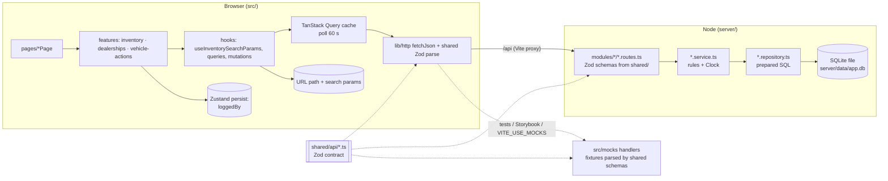
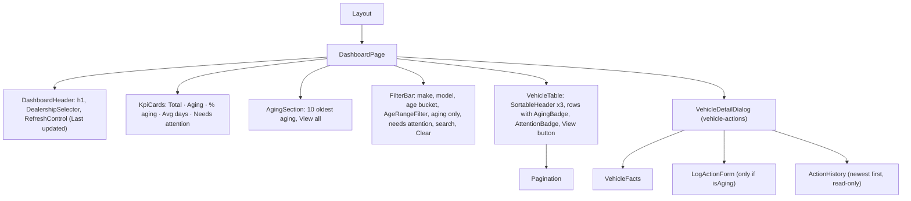
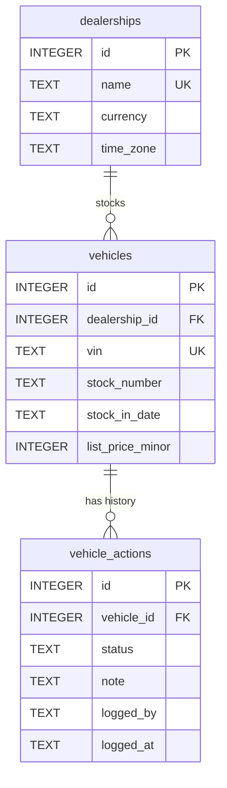
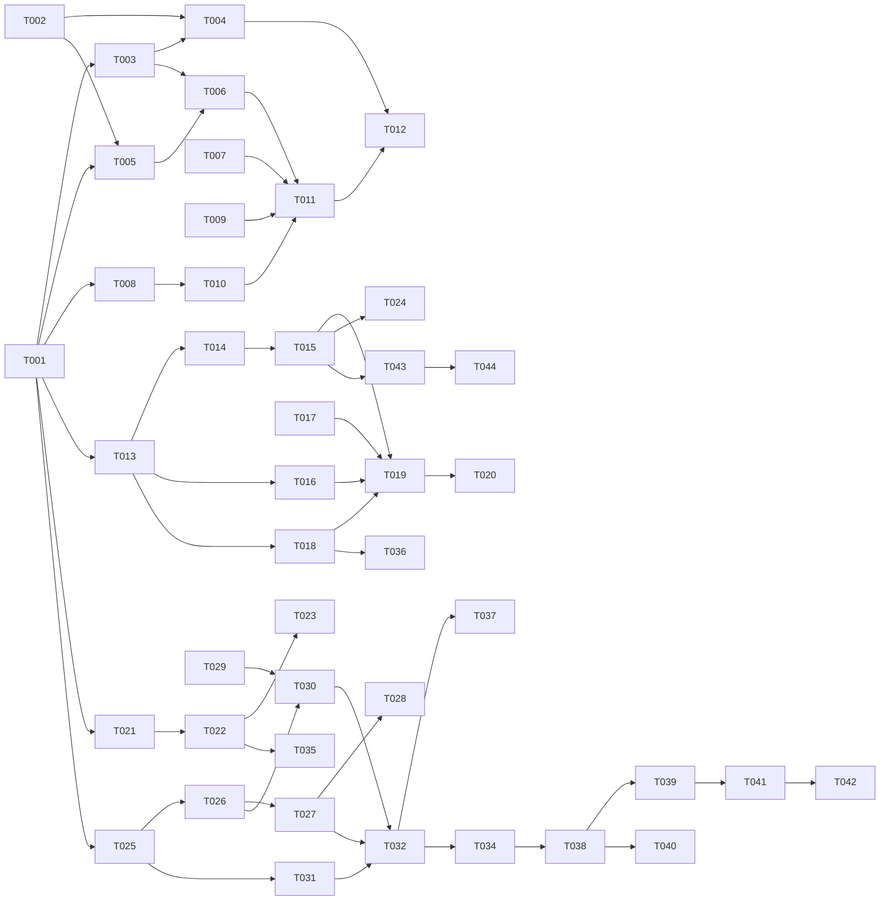

# Technical Requirements Document: Intelligent Inventory Dashboard

| Field        | Value                                                                                                                                                         |
| ------------ | ------------------------------------------------------------------------------------------------------------------------------------------------------------- |
| Version      | 0.1                                                                                                                                                           |
| PRD          | docs/PRD.md (v0.3, US-001..US-015, BR-01..BR-19, NFR-01..NFR-10)                                                                                              |
| Branch       | feature/inventory-dashboard                                                                                                                                   |
| Last updated | 2026-10-07                                                                                                                                                    |
| Conventions  | `react-best-practices` (web), `node-api-best-practices` (API/contract) skills. This TRD only records decisions and deviations; it doesn't restate the skills. |

## 1. Overview

The dashboard is a React SPA (`src/`) backed by a Fastify + SQLite API (`server/`), and the two
share one Zod contract (`shared/api/`). The **API is the single source of business truth**. It
computes days in stock in the dealership's local time zone, the aging flag, the current action,
needs-attention, KPIs, and all filtering, sorting, and pagination, so the web app stays fast at
5,000 vehicles per dealership (NFR-02) and can't drift from the rules (ADR-001). Action history is
an append-only table, and the current action is always derived from it (ADR-003). The web app
keeps server data in TanStack Query (60 s polling, previous data shown while refetching) and puts
shareable view state in the URL, parsed with the same shared query schema (ADR-004). Its only
client-side state is the remembered "Logged by" name (US-012). Delivery follows thin vertical
slices: contract, then API, then web for each feature. Phase 1 is runnable end to end.

## 2. Tech stack

The stack is already scaffolded (`/init-react-app`, `/init-node-api`). No new runtime
dependencies are planned. `@playwright/test` is added only by the optional task T-042.

| Concern        | Choice                                                              | Why                                                                                                                    |
| -------------- | ------------------------------------------------------------------- | ---------------------------------------------------------------------------------------------------------------------- |
| Build          | Vite 8 (`@` -> `src`, `@shared` -> `shared`, `/api` proxy -> :3001) | Already scaffolded. Fast HMR, and one alias config for app, tests, and Storybook                                       |
| UI             | React 19 + TypeScript strict (installed)                            | Installed version. `ref` is a regular prop, so no `forwardRef`                                                         |
| Routing        | `react-router` v8 data router, lazy routes                          | Approved. `errorElement` per route, and the URL holds view state (NFR-06)                                              |
| Styling        | Tailwind CSS v4 + `cn()`                                            | Approved. Tokens live in `src/index.css` `@theme` (adds aging/attention tones)                                         |
| Server state   | TanStack Query 5                                                    | Polling, `keepPreviousData`, and key-based invalidation cover US-009 and AC-006.3 with no custom code                  |
| Client state   | Zustand 5 (one persisted store: logged-by name)                     | Only US-012 needs client-only state that outlives a page load                                                          |
| Forms          | React Hook Form + `zodResolver(CreateActionBodySchema)`             | The same schema validates on the server (BR-18) and in the form                                                        |
| i18n           | `i18next` + `react-i18next` (EN default, VI), typed keys            | ADR-009. Presentation only (BR-19); API and stored values stay canonical                                               |
| Errors         | `react-error-boundary` (root) + route `errorElement`                | Already scaffolded                                                                                                     |
| Dates/money    | Native `Intl.DateTimeFormat` / `Intl.NumberFormat` (no `date-fns`)  | The only needs are tz-aware "today", formatting, and day arithmetic on `YYYY-MM-DD`. Intl covers these with 0 KB added |
| Dialog         | Native `<dialog>` wrapped by `src/components/Dialog.tsx`            | ADR-006                                                                                                                |
| Component docs | Storybook 10 (CSF Next, a11y, MSW)                                  | Already scaffolded. a11y addon set to `test: 'error'`                                                                  |
| API            | Fastify 5 + `fastify-type-provider-zod`, Swagger at `/api/docs`     | Already scaffolded. Route schemas are the shared Zod schemas                                                           |
| DB             | SQLite (`better-sqlite3`), STRICT tables, plain SQL repositories    | Already scaffolded. Durable across restarts (NFR-04) with zero ops                                                     |
| Validation     | Zod 4 (one instance shared by web and API)                          | One contract for request, response, URL, and storage                                                                   |
| Testing        | Vitest, RTL, user-event, MSW, `app.inject()`; Playwright optional   | Per the skills (§15 / §8)                                                                                              |

## 3. Architecture



**Server modules.** Routes call services and services call repositories (skill §2).

| Module                | Responsibility                                                                                                                    |
| --------------------- | --------------------------------------------------------------------------------------------------------------------------------- |
| `modules/dealerships` | List dealerships, look up a dealership by id (used by other services for time zone and currency, and for 404s)                    |
| `modules/inventory`   | Vehicle list (filters, sort, pages), summary KPIs, facets, vehicle detail with history, age rules (`vehicle-age.ts`), demo seeder |
| `modules/actions`     | Append an action (BR-09..BR-13). The repository has `insert` and `listByVehicle` only                                             |
| `lib/dates.ts`        | Pure, framework-free: `localDate(instant, timeZone)`, `daysBetween(a, b)`, `addDays(date, n)` on `YYYY-MM-DD` strings             |

**Web component tree (dashboard route).**



Feature dependency direction: `vehicle-actions` -> `inventory` (through `index.ts`: query keys,
`AgingBadge`) and `dealerships` <- `inventory`. Nothing imports in the reverse direction. The page
owns `selectedVehicleId` and passes `onSelectVehicle` down, so `inventory` never imports
`vehicle-actions`.

### 3.1 Folder structure

```
shared/api/
  common.ts         # existing: ApiErrorSchema, HealthResponseSchema
  dealerships.ts    # Dealership, list response, params
  actions.ts        # ACTION_STATUSES, CreateActionBody, ActionEntry, CurrentAction
  vehicles.ts       # constants, list query, list item/response, detail, summary, facets
  *.test.ts         # contract tests (run by root vitest; include widened in T-001)
server/src/
  app.ts            # + register dealerships, inventory, actions routes under /api
  lib/dates.ts      # tz "today" + calendar-day arithmetic
  db/migrate.ts     # + migration 1 (schema), never edited after apply
  db/seed.ts        # seeders = [inventorySeeder]
  modules/
    dealerships/{dealerships.routes,dealerships.repository}.ts + tests
    inventory/{inventory.routes,inventory.service,inventory.repository,vehicle-age,
               inventory.seed,inventory.seed-data,prng}.ts + tests
    actions/{actions.routes,actions.service,actions.repository}.ts + tests
server/test/
  helpers.ts        # existing createTestApp
  factories.ts      # insertDealership / insertVehicle({ ageDays }) / insertAction
  persistence.test.ts
src/
  app/              # router: "/" redirect, "/dealerships/:dealershipId", "*"
  pages/            # IndexRedirectPage, DashboardPage, NotFoundPage (HomePage removed)
  features/
    dealerships/    # api/, components/DealershipSelector, index.ts
    inventory/      # api/, hooks/useInventorySearchParams, components/{VehicleTable,
                    #   AgingBadge, AttentionBadge, Pagination, FilterBar, AgeRangeFilter,
                    #   KpiCards, AgingSection, RefreshControl, SortableHeader}, index.ts
    vehicle-actions/# api/, hooks/useLogAction, store.ts (loggedBy persist),
                    #   components/{VehicleDetailDialog, ActionHistory, LogActionForm}, index.ts
  components/       # Button (exists), Badge, Dialog, Field, Select, Checkbox, TextInput,
                    #   LoadingState, ErrorState, EmptyState (+ stories, tests)
  lib/              # format.ts (money/date/datetime/mileage), error-messages.ts
  mocks/            # fixtures.ts (builders parsed by shared schemas), handlers.ts
```

### 3.2 Routes

| Path                         | Page                                                                                                                               | Search params (validated by `VehicleListQuerySchema`)                                     | Stories           |
| ---------------------------- | ---------------------------------------------------------------------------------------------------------------------------------- | ----------------------------------------------------------------------------------------- | ----------------- |
| `/`                          | `IndexRedirectPage`: loads dealerships, `<Navigate replace>` to the first one alphabetically. Has loading and error (Retry) states | none                                                                                      | US-008 (AC-008.1) |
| `/dealerships/:dealershipId` | `DashboardPage`                                                                                                                    | `make, model, ageBucket, minAge, maxAge, agingOnly, needsAttention, q, sort, order, page` | US-001..US-012    |
| `*`                          | `NotFoundPage` (exists)                                                                                                            | -                                                                                         | -                 |

An unknown `dealershipId` (API 404) renders an in-page "Dealership not found" message with a link
to `/`. Each page sets `document.title` and moves focus to its `<h1>` (skill §8).

## 4. Data models & API contracts

### 4.1 Shared contract (`shared/api/*.ts`)

```ts
// shared/api/actions.ts
export const ACTION_STATUSES = [
  'Price Reduction Planned',
  'Marketing Promotion',
  'Transfer to Another Dealership',
  'Send to Auction/Wholesale',
  'Under Review',
] as const; // BR-10
export const NOTE_MAX_LENGTH = 500; // BR-11
export const LOGGED_BY_MAX_LENGTH = 100; // BR-12
export const ActionStatusSchema = z.enum(ACTION_STATUSES, { error: 'Select a status' });
export const CreateActionBodySchema = z.object({
  status: ActionStatusSchema,
  note: z.string().trim().max(NOTE_MAX_LENGTH, 'Note must be 500 characters or fewer').optional(),
  loggedBy: z
    .string()
    .trim()
    .min(1, 'Enter your name')
    .max(LOGGED_BY_MAX_LENGTH, 'Name must be 100 characters or fewer'),
}); // trim runs before min/max (Zod 4)
export const ActionEntrySchema = z.object({
  id: z.number().int().positive(),
  vehicleId: z.number().int().positive(),
  status: ActionStatusSchema,
  note: z.string().nullable(),
  loggedBy: z.string(),
  loggedAt: z.iso.datetime(), // UTC, assigned by server (BR-13)
});
export const CurrentActionSchema = ActionEntrySchema.pick({
  status: true,
  loggedBy: true,
  loggedAt: true,
});

// shared/api/dealerships.ts
export const DealershipSchema = z.object({
  id: z.number().int().positive(),
  name: z.string(),
  currency: z.string().length(3),
  timeZone: z.string(), // e.g. 'GBP', 'Europe/London'
});
export const DealershipListResponseSchema = z.object({ items: z.array(DealershipSchema) });
export const DealershipParamsSchema = z.object({
  dealershipId: z.coerce.number().int().positive(),
});

// shared/api/vehicles.ts
export const AGING_THRESHOLD_DAYS = 90; // BR-02 (US-014: fixed)
export const AGE_BUCKETS = ['0-30', '31-60', '61-90', 'over-90'] as const; // BR-07
export const SORT_KEYS = ['age', 'price', 'makeModel'] as const; // US-011
export const SORT_ORDERS = ['asc', 'desc'] as const;
export const PAGE_SIZE_DEFAULT = 25;
export const PAGE_SIZE_MAX = 100;
const MAX_AGE = 36_500;

// Base object kept separate: Zod 4 forbids .extend/.omit on refined objects (CSV reuses it).
export const VehicleFilterBaseSchema = z.object({
  make: z.string().trim().min(1).max(50).optional(),
  model: z.string().trim().min(1).max(50).optional(),
  ageBucket: z.enum(AGE_BUCKETS).optional(),
  minAge: z.coerce.number().int().min(0).max(MAX_AGE).optional(),
  maxAge: z.coerce.number().int().min(0).max(MAX_AGE).optional(),
  agingOnly: z.stringbool().optional(), // 'true'/'false' (not z.coerce.boolean)
  needsAttention: z.stringbool().optional(),
  q: z.string().trim().min(1).max(100).optional(), // BR-08
  sort: z.enum(SORT_KEYS).default('age'),
  order: z.enum(SORT_ORDERS).optional(), // default per key, TA-06
});
const ageRangeValid = (q: { minAge?: number; maxAge?: number }) =>
  q.minAge === undefined || q.maxAge === undefined || q.minAge <= q.maxAge;
const ageRangeIssue = {
  message: 'Minimum age must be less than or equal to maximum age',
  path: ['maxAge'],
};
export const VehicleListQuerySchema = VehicleFilterBaseSchema.extend({
  page: z.coerce.number().int().min(1).default(1),
  pageSize: z.coerce.number().int().min(1).max(PAGE_SIZE_MAX).default(PAGE_SIZE_DEFAULT),
}).refine(ageRangeValid, ageRangeIssue); // BR-07, AC-002.4
export const AgeRangeFormSchema = z
  .object({
    // web inline range form, same rule
    minAge: z.coerce.number().int().min(0).max(MAX_AGE).optional(),
    maxAge: z.coerce.number().int().min(0).max(MAX_AGE).optional(),
  })
  .refine(ageRangeValid, ageRangeIssue);

export const VehicleListItemSchema = z.object({
  id: z.number().int().positive(),
  dealershipId: z.number().int().positive(),
  vin: z.string().length(17),
  stockNumber: z.string(),
  make: z.string(),
  model: z.string(),
  modelYear: z.number().int(),
  trim: z.string(),
  colour: z.string(),
  mileage: z.number().int().nonnegative(), // miles (TA-04)
  listPriceMinor: z.number().int().nonnegative(), // pence (ADR-005)
  stockInDate: z.iso.date(),
  daysInStock: z.number().int().nonnegative(), // BR-01 (server-derived)
  isAging: z.boolean(), // BR-02/03
  needsAttention: z.boolean(), // BR-16
  currentAction: CurrentActionSchema.nullable(), // BR-14, null = "No action"
});
export const VehicleListResponseSchema = z.object({
  items: z.array(VehicleListItemSchema),
  total: z.number().int().nonnegative(),
  page: z.number().int().positive(),
  pageSize: z.number().int().positive(),
});
export const VehicleParamsSchema = z.object({ vehicleId: z.coerce.number().int().positive() });
export const VehicleDetailSchema = VehicleListItemSchema.extend({
  currency: z.string().length(3),
  timeZone: z.string(),
  actions: z.array(ActionEntrySchema), // newest first (BR-13)
});
export const InventorySummarySchema = z.object({
  asOfDate: z.iso.date(), // dealership-local "today"
  totalVehicles: z.number().int().nonnegative(),
  agingCount: z.number().int().nonnegative(),
  agingPercent: z.number().min(0).max(100), // 1 dp, 0 when total = 0
  averageDaysInStock: z.number().int().nonnegative().nullable(), // null -> "-" (BR-15)
  needsAttentionCount: z.number().int().nonnegative(), // BR-16
});
export const FacetsResponseSchema = z.object({
  makes: z.array(z.object({ make: z.string(), models: z.array(z.string()) })), // sorted A-Z
});
// + z.infer types for every schema; z.input<> for VehicleListQuery where the web needs raw params.
```

### 4.2 REST endpoints

Every error body matches `ApiErrorSchema`. `400 VALIDATION_ERROR` comes from the existing error
handler for any Zod failure in params, query, or body.

| Method | Endpoint                                                          | Request                                                    | Response                                | Errors (status · code)                                                                                            | Stories / BRs                                   |
| ------ | ----------------------------------------------------------------- | ---------------------------------------------------------- | --------------------------------------- | ----------------------------------------------------------------------------------------------------------------- | ----------------------------------------------- |
| GET    | `/api/health`                                                     | -                                                          | 200 `HealthResponse` (exists)           | 500 INTERNAL_ERROR                                                                                                | ops                                             |
| GET    | `/api/dealerships`                                                | -                                                          | 200 `DealershipListResponse` (name A-Z) | 500                                                                                                               | US-008, BR-04                                   |
| GET    | `/api/dealerships/:dealershipId/vehicles`                         | params `DealershipParams`; query `VehicleListQuery`        | 200 `VehicleListResponse`               | 400 VALIDATION_ERROR (e.g. pageSize 101, min > max, bad bucket) · 404 NOT_FOUND (dealership)                      | US-001..004, 010, 011; BR-01..08, 14, 16, 17    |
| GET    | `/api/dealerships/:dealershipId/summary`                          | params                                                     | 200 `InventorySummary` (whole stock)    | 400 · 404 NOT_FOUND                                                                                               | US-005, US-010; BR-15, BR-16                    |
| GET    | `/api/dealerships/:dealershipId/facets`                           | params                                                     | 200 `FacetsResponse`                    | 400 · 404 NOT_FOUND                                                                                               | US-002; BR-06                                   |
| GET    | `/api/vehicles/:vehicleId`                                        | params `VehicleParams`                                     | 200 `VehicleDetail` (incl. history)     | 400 · 404 NOT_FOUND                                                                                               | US-004 (AC-004.4), US-006, US-007; BR-13, BR-14 |
| POST   | `/api/vehicles/:vehicleId/actions`                                | params; body `CreateActionBody`                            | **201** `ActionEntry`                   | 400 VALIDATION_ERROR (status not in list, loggedBy blank, note > 500) · 404 NOT_FOUND · **422 VEHICLE_NOT_AGING** | US-006, US-007; BR-09..BR-13, BR-18             |
| GET    | `/api/dealerships/:dealershipId/vehicles.csv` _(optional, T-043)_ | query = `VehicleFilterBaseSchema` + age refine (no paging) | 200 `text/csv` attachment               | 400 · 404                                                                                                         | US-013                                          |

No `PUT`, `PATCH`, or `DELETE` exists for actions (BR-13, AC-007.6). There's no separate aging
endpoint: the aging section calls the vehicles endpoint with
`agingOnly=true&sort=age&order=desc&pageSize=10` (one code path, one set of tests). There's no
separate `GET /vehicles/:id/actions` either, because the detail response carries the history, so
the dialog needs a single query.

**Log action sequence (AC-006.3, AC-010.2):**

```mermaid
sequenceDiagram
  actor M as Manager
  participant F as LogActionForm (RHF + zodResolver)
  participant Q as useLogAction (TanStack mutation)
  participant R as actions.routes
  participant S as actions.service
  participant DB as SQLite
  M->>F: status, note, loggedBy -> Save
  F->>F: CreateActionBodySchema (client UX check)
  F->>Q: mutate(body)
  Q->>R: POST /api/vehicles/42/actions
  R->>R: Zod params/body (400 on failure)
  R->>S: logAction(42, body)
  S->>DB: vehicle + dealership tz (404 if missing)
  S->>S: today = localDate(clock.now(), tz); isAging? else 422 VEHICLE_NOT_AGING
  S->>DB: INSERT vehicle_actions (logged_at = clock.now() ISO UTC)
  R-->>Q: 201 ActionEntry
  Q->>Q: invalidate inventory(dealershipId) + vehicleDetail(42); loggedBy store set
  Q-->>M: "Action saved" (role=status); history, list, aging section, KPIs refetch
```

### 4.3 Database schema (SQLite)

This is migration `{ id: 1, name: 'inventory-schema' }`, appended to `migrations` in
`server/src/db/migrate.ts`.

```sql
CREATE TABLE dealerships (
  id         INTEGER PRIMARY KEY,
  name       TEXT NOT NULL UNIQUE CHECK (length(name) BETWEEN 1 AND 100),
  currency   TEXT NOT NULL CHECK (length(currency) = 3 AND currency = upper(currency)),
  time_zone  TEXT NOT NULL CHECK (length(time_zone) BETWEEN 1 AND 64)   -- IANA, validated by seeder via Intl
) STRICT;

CREATE TABLE vehicles (
  id               INTEGER PRIMARY KEY,
  dealership_id    INTEGER NOT NULL REFERENCES dealerships(id),
  vin              TEXT NOT NULL UNIQUE CHECK (length(vin) = 17),
  stock_number     TEXT NOT NULL CHECK (length(stock_number) BETWEEN 1 AND 20),
  make             TEXT NOT NULL CHECK (length(make) BETWEEN 1 AND 50),
  model            TEXT NOT NULL CHECK (length(model) BETWEEN 1 AND 50),
  model_year       INTEGER NOT NULL CHECK (model_year BETWEEN 1990 AND 2100),
  trim_level       TEXT NOT NULL CHECK (length(trim_level) BETWEEN 1 AND 50),
  colour           TEXT NOT NULL CHECK (length(colour) BETWEEN 1 AND 30),
  mileage          INTEGER NOT NULL CHECK (mileage >= 0),
  list_price_minor INTEGER NOT NULL CHECK (list_price_minor >= 0),
  stock_in_date    TEXT NOT NULL CHECK (date(stock_in_date) IS stock_in_date),  -- strict YYYY-MM-DD
  UNIQUE (dealership_id, stock_number)
) STRICT;
-- Age filter/sort (stock_in_date range), default sort tie-break, aging counts
CREATE INDEX idx_vehicles_dealer_stockin ON vehicles (dealership_id, stock_in_date, stock_number);
-- Make/model filter, make/model sort, facets
CREATE INDEX idx_vehicles_dealer_make_model ON vehicles (dealership_id, make, model);
-- Price sort
CREATE INDEX idx_vehicles_dealer_price ON vehicles (dealership_id, list_price_minor);

CREATE TABLE vehicle_actions (
  id         INTEGER PRIMARY KEY,
  vehicle_id INTEGER NOT NULL REFERENCES vehicles(id),
  status     TEXT NOT NULL CHECK (status IN ('Price Reduction Planned','Marketing Promotion',
               'Transfer to Another Dealership','Send to Auction/Wholesale','Under Review')),
  note       TEXT CHECK (note IS NULL OR length(note) BETWEEN 1 AND 500),
  logged_by  TEXT NOT NULL CHECK (length(logged_by) BETWEEN 1 AND 100 AND logged_by = trim(logged_by)),
  logged_at  TEXT NOT NULL CHECK (logged_at GLOB '[0-9][0-9][0-9][0-9]-[0-9][0-9]-[0-9][0-9]T*Z')
) STRICT;
-- "Latest action per vehicle" lookups (BR-14) and history ordering (BR-13)
CREATE INDEX idx_actions_vehicle_latest ON vehicle_actions (vehicle_id, logged_at DESC, id DESC);
-- Append-only defence in depth (BR-13): the repository has no UPDATE/DELETE, the DB refuses them too
CREATE TRIGGER vehicle_actions_no_update BEFORE UPDATE ON vehicle_actions
  BEGIN SELECT RAISE(ABORT, 'vehicle_actions is append-only'); END;
CREATE TRIGGER vehicle_actions_no_delete BEFORE DELETE ON vehicle_actions
  BEGIN SELECT RAISE(ABORT, 'vehicle_actions is append-only'); END;
```



**Key query shapes** (repository, prepared statements only):

- **Current action.** `LEFT JOIN vehicle_actions a ON a.id = (SELECT id FROM vehicle_actions WHERE vehicle_id = v.id ORDER BY logged_at DESC, id DESC LIMIT 1)`.
  This uses `idx_actions_vehicle_latest`.
- **Age predicates.** The service turns the filters into `stock_in_date` bounds: `ageInDays >= n`
  becomes `stock_in_date <= addDays(today, -n)`, and `ageInDays <= n` becomes
  `stock_in_date >= addDays(today, -n)`. Aging means `stock_in_date <= addDays(today, -91)`.
  The SQL never computes "now".
- **Sort.** The order comes from a whitelist map: `age` maps to `stock_in_date` (desc age = ASC
  date), `price` maps to `list_price_minor`, and `makeModel` maps to `make, model`. A
  `stock_number ASC, id ASC` tie-break is always appended (BR-17, TA-06).
- **Search.** `(vin LIKE :p ESCAPE '\' OR stock_number LIKE :p ESCAPE '\' OR model LIKE :p ESCAPE '\')`
  with `:p = '%' + escape(q) + '%'`. ASCII `LIKE` is case-insensitive (BR-08).
- **Summary.** `COUNT(*)`, `SUM(stock_in_date <= :agingCutoff)`,
  `SUM(max(0, julianday(:today) - julianday(stock_in_date)))`, and the needs-attention count
  (aging AND no action). All of these run in one statement. `julianday` on date-only strings is
  DST-free.

### 4.4 Business rules by layer

| BR    | Enforced in API (service)                                                                                                                | Mirrored in web (UX only)                                                                        | Test                                                                                                                 |
| ----- | ---------------------------------------------------------------------------------------------------------------------------------------- | ------------------------------------------------------------------------------------------------ | -------------------------------------------------------------------------------------------------------------------- |
| BR-01 | `localDate(clock.now(), tz)` + `daysBetween`, clamped at 0 (`vehicle-age.ts`, `lib/dates.ts`)                                            | Displays `daysInStock` only                                                                      | `server/src/lib/dates.test.ts`, `modules/inventory/vehicle-age.test.ts` (0, tz late evening, DST, leap, future date) |
| BR-02 | `isAging = age > AGING_THRESHOLD_DAYS`, aging cutoff date for SQL                                                                        | Shows `AgingBadge` when `isAging`                                                                | `vehicle-age.test.ts` (90/91), `inventory.routes.test.ts`                                                            |
| BR-03 | Derived on every request. Nothing stored, so no override is possible                                                                     | No control exists to set it                                                                      | `vehicle-age.test.ts` (clock +1 day turns 90 into 91), `inventory.routes.test.ts`                                    |
| BR-04 | All list, summary, and facet SQL is scoped by `dealership_id`. Unknown id gives 404                                                      | One dealership in the path                                                                       | `inventory.routes.test.ts` (12 vs 8), `DashboardPage.test.tsx`                                                       |
| BR-05 | All predicates are ANDed. Bucket, range, and agingOnly date bounds intersect                                                             | URL holds all filters together                                                                   | `inventory.routes.test.ts`, `vehicle-age.test.ts` (intersection)                                                     |
| BR-06 | Facets are computed from the dealership's stock                                                                                          | Model options come from facets for the selected make. Changing make clears an incompatible model | `inventory.routes.test.ts` (facets), `useInventorySearchParams.test.ts`, `FilterBar.test.tsx`                        |
| BR-07 | Bucket-to-range map (inclusive). Query refine rejects min > max with 400                                                                 | `AgeRangeFilter` shows an inline error and doesn't apply the range (shared `AgeRangeFormSchema`) | `vehicles.test.ts` (shared), `vehicle-age.test.ts`, `inventory.routes.test.ts`, `AgeRangeFilter.test.tsx`            |
| BR-08 | Schema trims `q`. LIKE with escape on VIN, stock number, and model                                                                       | Search input debounced 300 ms                                                                    | `inventory.routes.test.ts` (" stk-104 ", "123456", "%" literal)                                                      |
| BR-09 | `actions.service` checks `isAging` and throws `BusinessRuleError('VEHICLE_NOT_AGING')` (422)                                             | Form rendered only if `vehicle.isAging`                                                          | `actions.service.test.ts` (90 rejected, 91 accepted), `actions.routes.test.ts`, `VehicleDetailDialog.test.tsx`       |
| BR-10 | `ActionStatusSchema` (400) + DB CHECK                                                                                                    | Options rendered from `ACTION_STATUSES`                                                          | `actions.test.ts` (shared), `actions.routes.test.ts`, `schema.test.ts`, `LogActionForm.test.tsx`                     |
| BR-11 | Trim, then max 500 (400). Empty note stored as NULL. DB CHECK                                                                            | Same schema via zodResolver, plus a character counter                                            | `actions.test.ts` (500/501 after trim), `actions.routes.test.ts`, `LogActionForm.test.tsx`                           |
| BR-12 | Trim, then 1-100 (400). DB CHECK                                                                                                         | Same schema. Prefilled from the store (US-012)                                                   | `actions.test.ts`, `actions.routes.test.ts` (" "), `LogActionForm.test.tsx`                                          |
| BR-13 | Insert-only repository. `logged_at` comes from the server clock. Triggers block UPDATE/DELETE. History ordered `logged_at DESC, id DESC` | No edit or delete controls rendered                                                              | `schema.test.ts` (triggers), `actions.routes.test.ts` (order), `ActionHistory.test.tsx`                              |
| BR-14 | Latest-row join gives `currentAction`, or null                                                                                           | Null shows as "No action"                                                                        | `inventory.routes.test.ts` (09:00 vs 11:00, same timestamp falls back to id), `VehicleTable.test.tsx`                |
| BR-15 | Summary over the whole stock, ignoring filters. Rounding per TA-21. Empty stock gives 0 / 0 / 0 / null                                   | Query key has no filters. Null shows as "-"                                                      | `inventory.service.test.ts` (AC-005.1, AC-005.3), `KpiCards.test.tsx` (AC-005.2)                                     |
| BR-16 | `needsAttention = isAging && currentAction == null` per item. Count in summary. `needsAttention` filter                                  | `AttentionBadge` text label                                                                      | `inventory.routes.test.ts`, `KpiCards.test.tsx`, `useLogAction.test.tsx` (count drops)                               |
| BR-17 | Default `sort=age`, order desc, tie-break `stock_number ASC`                                                                             | No client sorting                                                                                | `inventory.routes.test.ts` (200, 95, 10; tie)                                                                        |
| BR-18 | All of BR-09..BR-12 are enforced in the API (schema + service + DB CHECK). Each rejection asserts 0 rows stored                          | Never relied on                                                                                  | `actions.routes.test.ts` (400/422 cases + row count)                                                                 |

### 4.5 Seed data

`modules/inventory/inventory.seed.ts` is deterministic: it uses a mulberry32 PRNG with a fixed
seed (no faker dependency) and generates every date relative to `localDate(clock.now(), tz)` at
seed time. `isSeeded` checks `SELECT 1 FROM dealerships LIMIT 1`.

| Dealership (A-Z = default order) | Currency / TZ       | Vehicles | Purpose                                                                                                                                  |
| -------------------------------- | ------------------- | -------- | ---------------------------------------------------------------------------------------------------------------------------------------- |
| Birmingham Central Motors        | GBP / Europe/London | 360      | Default dealership (AC-008.1). Full demo: every bucket, boundary ages, `STK-1042` / VIN `1FADP3F2XJL123456` (AC-002.6), action histories |
| Leeds Northside Cars             | GBP / Europe/London | 220      | Second dealership for scoping and switching (AC-001.2, AC-008.2)                                                                         |
| Manchester Quays Autos           | GBP / Europe/London | 150      | Smaller stock, still has every bucket                                                                                                    |
| York Pop-up Showroom             | GBP / Europe/London | 0        | Empty states in one click: AC-001.5, AC-004.2 ("No aging stock"), AC-005.3                                                               |

- **Ages.** Every stocked dealership has vehicles at exactly **0, 30, 31, 60, 61, 90, 91** days,
  plus 120, 200, and 365. The rest are spread about 30% / 25% / 20% / 25% across 0-30 / 31-60 /
  61-90 / >90 (max 400 days). That gives roughly 90 aging vehicles in Birmingham, which exceeds
  one page and demonstrates pagination.
- **Catalogue** (`inventory.seed-data.ts`): about 14 UK-market makes with 2-4 models each (Ford
  Fiesta/Focus/Puma/Kuga, Vauxhall Corsa/Astra/Mokka, VW Polo/Golf/T-Roc/Tiguan, BMW 1/3 Series/X1,
  Audi A1/A3/Q3, Mercedes-Benz A-Class/C-Class/GLA, Toyota Yaris/Corolla/C-HR/RAV4, Nissan
  Juke/Qashqai, Kia Picanto/Sportage/Niro, Hyundai i10/Tucson, Skoda Fabia/Octavia/Kodiaq,
  MINI Hatch/Countryman, Land Rover Discovery Sport/Range Rover Evoque). It also lists trims,
  colours, model years 2018-2026, mileage proportional to age of car, and prices from £7,990 to
  £54,990 ending in 90 or 95 (pence = pounds x 100). VINs are 17 characters without I/O/Q and
  unique. Stock numbers are `STK-1000+n`.
- **Action histories** (Birmingham, about 55% of aging vehicles; Leeds, about 40%) have 1-3
  entries each. They include:
  - one vehicle with "Under Review" at 09:00 and "Marketing Promotion" at 11:00 on the same day
    (AC-007.4)
  - one note with `<b>cut</b>` (AC-006.8)
  - one note of exactly 500 characters
  - one **non-aging** vehicle (age 45) with a history entry, to show history stays visible with
    no form (A-15, AC-006.2)

  The remaining aging vehicles have no action, so "Needs attention" is non-zero.

## 5. State management

**Server state (TanStack Query).** Keys live in each feature's `api/*.queries.ts`. Every inventory
query sets `refetchInterval: 60_000`, `refetchOnWindowFocus: true`, and
`placeholderData: keepPreviousData` (list only).

| Key factory                                                                  | Query                                                      | Invalidated by                                    |
| ---------------------------------------------------------------------------- | ---------------------------------------------------------- | ------------------------------------------------- |
| `dealershipKeys.list()` = `['dealerships','list']`                           | GET dealerships (staleTime 5 min, no polling)              | -                                                 |
| `inventoryKeys.vehicles(id, query)` = `['inventory', id, 'vehicles', query]` | main list, and aging section (`agingOnly`, `pageSize: 10`) | log action: `inventoryKeys.dealership(id)` prefix |
| `inventoryKeys.summary(id)` = `['inventory', id, 'summary']`                 | KPIs (no filters in key, so AC-005.2 holds)                | log action (prefix)                               |
| `inventoryKeys.facets(id)` = `['inventory', id, 'facets']`                   | facets                                                     | log action (prefix, harmless)                     |
| `vehicleKeys.detail(vehicleId)` = `['vehicles','detail', vehicleId]`         | dialog detail + history                                    | log action                                        |

The "Refresh" button calls `queryClient.refetchQueries({ queryKey: inventoryKeys.dealership(id) })`
plus the open detail. "Last updated" shows the latest `dataUpdatedAt` of the summary and list
queries (`RefreshControl`). Polling never touches form state, because the `LogActionForm` gets
`defaultValues` once at mount and is never fed query `values` (AC-009.1).

**URL state.** `useInventorySearchParams(dealershipId)` returns
`{ query, setFilter, setSort, setPage, clearFilters }`.

- It parses `useSearchParams()` with `VehicleListQuerySchema`. On failure it drops the offending
  keys and replaces the URL (TA-09).
- Every filter setter resets `page` to 1.
- `setFilter('make', x)` deletes `model` when `model` isn't among the facets for make `x` (BR-06).
- Defaults are left out of the URL, so URLs stay short.
- Switching dealership navigates to `/dealerships/:newId` with no search string, which resets the
  filters (AC-008.2).

**Client state (Zustand).**

| Store                                                    | Shape                                     | Used by                                                       | Notes                                                                                                                                                                                                                                                                                                                |
| -------------------------------------------------------- | ----------------------------------------- | ------------------------------------------------------------- | -------------------------------------------------------------------------------------------------------------------------------------------------------------------------------------------------------------------------------------------------------------------------------------------------------------------- |
| `useLoggedByStore` (`features/vehicle-actions/store.ts`) | `{ loggedBy: string; setLoggedBy(name) }` | `LogActionForm` (default value), `useLogAction` (`onSuccess`) | `persist` (localStorage key `inventory.loggedBy`, version 1) is **required by US-012/AC-012.1** ("also after reload"). On rehydrate, the value is validated with `CreateActionBodySchema.shape.loggedBy.safeParse`, and invalid values are dropped. The store is registered in the reset list in `src/test/setup.ts` |
| `useUiStore` (exists)                                    | unchanged                                 | not used by this feature                                      | Leave as is                                                                                                                                                                                                                                                                                                          |

**Local state.** `DashboardPage` holds `selectedVehicleId` (`useState`), which drives the dialog
(TA-16). `FilterBar` holds the search input draft before the debounce. `AgeRangeFilter` uses a
small RHF form until "Apply". Form input lives in React Hook Form.

## 6. Cross-cutting concerns

**Error handling and loading states.**

- Every query-driven region renders the four states (skill §5): `LoadingState` (skeleton with
  `aria-busy`), `ErrorState` (`role="alert"`, message from `lib/error-messages.ts`, Retry calls
  `refetch`; AC-001.6), `EmptyState`, and success. The empty states are distinct:
  - "No vehicles in stock" when the dealership total is 0 and there are no filters
  - "No vehicles match your filters" with "Clear filters" otherwise
  - "No aging stock" in the aging section
- While refetching, the previous data stays visible (`keepPreviousData`), and a subtle
  "Updating…" status appears.
- `lib/error-messages.ts` maps `HttpError.code` to text:
  - `VEHICLE_NOT_AGING`: "This vehicle is no longer aging; actions can't be logged."
  - `VALIDATION_ERROR`: "Some fields are invalid."
  - `NOT_FOUND`
  - network/5xx: "Couldn't reach the server. Try again."

  Raw errors are never shown.

- On a mutation error, the form keeps its input, and the alert sits inside the form (AC-006.7).
- On the server, `AppError` subclasses go through the existing error handler, and 500s never leak
  internals.

**Accessibility (WCAG 2.1 AA, NFR-01).**

- Semantic `<table>` with a `<caption>` and `scope="col"`. Sortable headers are `<button>`s inside
  `<th aria-sort>`. A polite live region announces "Sorted by price, ascending" (AC-011.3).
- `AgingBadge` and `AttentionBadge` are visible text ("Aging", "Needs attention") with an icon set
  to `aria-hidden`, never colour alone (AC-003.4, AC-010.1).
- KPI cards use `<dl>`.
- Each table row has a "View <stock number>" button. Rows aren't clickable `<tr>`s.
- The dialog uses native `showModal()`. Focus moves to the dialog heading, Escape closes it, and
  focus returns to the trigger, with an explicit fallback (ADR-006).
- Form errors use `aria-invalid` and `aria-describedby`, `shouldFocusError` moves focus to the
  first invalid field (AC-006.4), and the "Action saved" confirmation is `role="status"`.
- Pagination is in `<nav aria-label="Pagination">` with an `aria-live` "Showing 26-50 of 312".
- Focus rings use `focus-visible:ring-*`. Tokens are checked for 4.5:1 contrast. The table scrolls
  horizontally inside a focusable, labelled region at 768 px (NFR-07).
- The KPI row sits directly under the page header so it's visible at 1280x800 (AC-005.4).
- Verified by `eslint-plugin-jsx-a11y` (0 errors), Storybook a11y (`test: 'error'`), and a manual
  keyboard pass (T-038).

**Security (NFR-03).**

- Zod validates every param, query, and body with max lengths and enums. Unknown body keys are
  stripped.
- Prepared statements only. `ORDER BY` comes from a whitelist, and `LIKE` input is escaped.
- React text rendering only, never `dangerouslySetInnerHTML`, so `<b>cut</b>` renders literally
  (AC-006.8).
- Helmet, plus CORS limited to `CORS_ORIGIN`. No secrets exist. `VITE_*` holds only the API base
  URL.
- The CSV export (optional) prefixes cells that start with `= + - @` with `'` to block formula
  injection.
- `loggedBy` and `note` aren't written to logs.

**Performance (NFR-02).**

- Server-side paging with 25 rows per page, so virtualization isn't needed (skill §12 threshold
  is about 100 rows).
- Composite indexes cover each filter and sort (§4.3). Age is filtered by date range, so the index
  can be used.
- The one leading-wildcard `LIKE` scans at most one dealership (5,000 rows), which takes under
  10 ms.
- A perf smoke test (T-015) seeds 5,000 vehicles in memory and asserts list and summary each take
  under 200 ms (a generous bound to avoid flakiness).
- The search input is debounced (300 ms). Routes are lazy-loaded. No new web dependencies.

**Testing strategy.**

| Level              | Tool / location                                                                   | Scope                                                                                                                  |
| ------------------ | --------------------------------------------------------------------------------- | ---------------------------------------------------------------------------------------------------------------------- |
| Contract           | `shared/api/*.test.ts` (root vitest)                                              | Boundaries: 500/501 note after trim, whitespace `loggedBy`, statuses, `pageSize` 100/101, `stringbool`, min > max      |
| API unit           | `server/src/**/*.test.ts`, `fixedClock` / custom `Clock` instants                 | `dates`, `vehicle-age` (0/90/91, tz late evening, DST 2026-03-29 and 2026-10-25, leap day, future date), service rules |
| API route          | `createTestApp({ today, seeders })` + `app.inject()` + `server/test/factories.ts` | Each endpoint: 2xx parsed with the shared schema, 400/404/422, write then read back, "nothing stored" counts           |
| Persistence        | `server/src/db/connection.test.ts` (exists) + `server/test/persistence.test.ts`   | Reopen a tmp-file DB through a new app instance (AC-007.3)                                                             |
| Web component/hook | Vitest + RTL + MSW (`src/mocks` fixtures parsed by shared schemas)                | Four states per query, role/label queries, form validation, URL state, polling via `refetchQueries`                    |
| Storybook          | `*.stories.tsx`, a11y addon as gate                                               | Shared components (with their task) + KPI cards, badges, table states, aging section, form, dialog (T-040)             |
| E2E _(optional)_   | Playwright (T-042), real API with `APP_TODAY=2026-10-07`                          | Filter to aging, then log action, then reload (persists). Dealership switch resets filters                             |

Coverage thresholds stay at the skill defaults (80/80/80/70) for both workspaces.

**Observability.**

- Pino request logs (method, url, status, `reqId`, latency) are on by default.
- The actions service logs `{ actionId, vehicleId, status }` at `info`.
- Startup logs migrations and seeders applied, plus `today`.
- `/api/health` reports DB status and the effective `today`, which makes `APP_TODAY` demos
  auditable.
- On the web, unexpected errors are reported once in the `ErrorBoundary` `onError`
  (`console.error`). No telemetry service (out of scope).

**Scalability.**

- Sized for one instance plus SQLite (WAL, one writer). Writes are tiny, single-row inserts.
- Repositories isolate the SQL. Moving to Postgres would change the repositories and migrations
  only (the `julianday` and `GLOB` CHECKs would need equivalents).
- Dealership-scoped indexes keep queries bounded per dealership as the number of dealerships
  grows.

## 7. Architecture decisions (ADRs)

### ADR-001: Compute derived fields, filtering, sorting and pagination on the server

- **Context**: NFR-02 asks for 5,000 vehicles per dealership with 1 s interactions. BR-18 requires server-side rule enforcement. Age depends on the dealership time zone (BR-01).
- **Decision**: The API returns `daysInStock`, `isAging`, `needsAttention`, and `currentAction` per item, plus KPIs and facets. It filters, sorts, and paginates in SQL. The web never recomputes rules. It only uses `isAging` to hide the form.
- **Alternatives**:
  - (a) Ship the whole inventory and filter in the browser. That's simpler, but the payload is about 1.5 MB per poll at 5k vehicles, the rules get duplicated in TS for the web, and KPIs could drift.
  - (b) Compute age on the client from `stockInDate`. That uses the browser's time zone, not the dealership's, which breaks AC-003.5.
- **Consequences**: There's one rule implementation, tested at the API boundary. Each filter change is a round trip, which is fast locally and hidden by `keepPreviousData`. The MSW handlers can't fully emulate filtering, so web tests assert the request parameters and rendering, not the filtering logic.

### ADR-002: "Today" in the dealership time zone; age by calendar-date arithmetic; age filters as date ranges

- **Context**: BR-01 counts whole calendar days in the dealership's local time. Dividing milliseconds goes wrong around DST and midnight. Filtering on a computed age column can't use an index.
- **Decision**: `localDate(clock.now(), dealership.time_zone)` uses `Intl.DateTimeFormat('en-CA', { timeZone, year, month, day })` and returns `YYYY-MM-DD`. Then `daysBetween` = difference of UTC-midnight epoch days of two date strings, clamped at 0. Buckets, the min/max range, and `agingOnly` turn into `stock_in_date` bounds through `addDays(today, -n)`. Time comes only from the injected `Clock` (`APP_TODAY` pins it).
- **Alternatives**:
  - (a) SQL `julianday('now')`. That's UTC, not testable with a fixed clock, and ignores the time zone.
  - (b) Store `days_in_stock` and update it nightly. That's stale data and needs a scheduler (BR-03).
  - (c) `date-fns-tz` / Temporal. That's an extra dependency, or Temporal isn't available in Node 20 yet.
- **Consequences**: The code is deterministic and DST-proof, and the index can be used. A time zone is required per dealership (seeded as `Europe/London`). Boundary tests pin instants like `2026-10-07T23:30:00Z`, which is already 8 Oct in London (BST).

### ADR-003: Append-only `vehicle_actions`; current action derived from the latest row

- **Context**: BR-13 (append-only, newest first), BR-14 (latest = current), NFR-04 (a confirmed save is never lost).
- **Decision**: Use a single table. The repository exposes `insert` and `listByVehicle` only. The current action is the latest row by `logged_at DESC, id DESC` (the `id` breaks ties when timestamps are equal, for example under a fixed clock). SQLite triggers abort UPDATE and DELETE.
- **Alternatives**:
  - (a) A denormalized `current_action` column on `vehicles`. Reads are faster, but two writes must stay consistent, and it's redundant at this scale.
  - (b) Event sourcing with projections. Overkill.
- **Consequences**: One source of truth, so the current action can't contradict the history. The latest-row subquery is indexed. Corrections are made by appending a new entry, which matches the PRD.

### ADR-004: One shared Zod contract, also used for URL state and MSW fixtures

- **Context**: The contract has three consumers (API routes, the web client, MSW mocks), so drift is the main integration risk. NFR-06 puts view state in the URL.
- **Decision**: `shared/api/*.ts` defines params, query, body, and response schemas. Fastify validates and serializes with them. `fetchJson` parses responses with them. `useInventorySearchParams` parses `URLSearchParams` with `VehicleListQuerySchema`. The MSW fixtures are built by `Schema.parse(...)`. A contract change touches all of these in one task (skill §3).
- **Alternatives**:
  - (a) OpenAPI codegen from Swagger. Adds a build step and tooling.
  - (b) Hand-written types per side. They drift silently.
  - (c) A separate URL schema on the web. Two definitions of the same filters.
- **Consequences**: Type errors surface drift at compile time and route tests surface it at runtime. Shared schemas must avoid transforms that `jsonSchemaTransform` can't express (see Risks). Validation messages in `shared/` are user-facing English (acceptable: English-only, NFR-08).

### ADR-005: Money as integer minor units

- **Context**: The PRD shows whole-pound prices ("£25,990"), but floats are unsafe for money, and the currency is per dealership.
- **Decision**: `list_price_minor INTEGER` (pence) and `listPriceMinor` in the contract. The web formats with `Intl.NumberFormat('en-GB', { style: 'currency', currency, minimumFractionDigits: whole ? 0 : 2 })`.
- **Alternatives**:
  - (a) `REAL` pounds. Rounding errors.
  - (b) Integer whole pounds. Loses pence if the data ever needs it.
- **Consequences**: A clear unit in the name. AC-001.7 renders as "£25,990". Price sort uses an integer index.

### ADR-006: Native `<dialog>` for the vehicle detail panel (no dialog library)

- **Context**: AC-004.4 and US-006 need an accessible modal with focus trap and restore (skill §10). The approved libraries include no headless UI kit, and any new library would need an ADR.
- **Decision**: `src/components/Dialog.tsx` wraps `<dialog>` + `showModal()`, which gives a top layer, an inert background, Escape to close, and `::backdrop`. It's labelled with `aria-labelledby`, it focuses the heading on open, and it restores focus to `document.activeElement` (captured at open) on close as an explicit fallback. It's styled as a right-side drawer at `md+`.
- **Alternatives**:
  - (a) Radix Dialog / Headless UI / React Aria. Very robust, but they add a dependency, and a single dialog doesn't need it.
  - (b) A hand-rolled `div role="dialog"` with a focus trap. More code, and easy to get wrong.
- **Consequences**: Zero dependencies and browser-native semantics. jsdom doesn't fully implement `showModal`, so `src/test/setup.ts` adds a minimal stub (toggling `open`). Real focus behaviour is verified in Storybook (a11y addon) and the manual keyboard pass, and in Playwright if T-042 runs.

### ADR-007: Freshness via 60 s polling, not push

- **Context**: NFR-05, A-14, and US-009. The data changes rarely, and the brief has no event source.
- **Decision**: Use TanStack Query `refetchInterval: 60_000` (only while the tab is visible) plus `refetchOnWindowFocus`, a manual Refresh, and invalidation after the user's own mutations.
- **Alternatives**:
  - (a) SSE or WebSocket. Needs server fan-out and reconnect logic, which isn't justified here.
  - (b) A shorter interval. More load for no product need.
- **Consequences**: Another user's change appears within 60 s or on Refresh (AC-009.3), and the user's own changes appear immediately (AC-006.3).

### ADR-008: Dealership in the path; filters, sort and page in search params

- **Context**: AC-002.7, AC-008.3, and NFR-06 need bookmarkable state. AC-008.2 resets filters when the dealership changes. The tech owner suggested search params for all of it.
- **Decision**: `/dealerships/:dealershipId?make=…&page=…`. `/` redirects to the first dealership alphabetically.
- **Alternatives**:
  - (a) `?dealershipId=` as a search param. Works, but switching dealership would need code to strip the other params, and the dealership is the resource being viewed rather than a filter.
  - (b) Zustand or localStorage. Not shareable (violates NFR-06).
- **Consequences**: Switching is a plain `navigate()` to a new path, so the filter reset falls out naturally. Query keys include the dealership id. Any invalid `dealershipId` hits the API's 404 path.

### ADR-009: i18n with `i18next` + `react-i18next`, bundled EN/VI resources, no detector

- **Context**: The stakeholder added Vietnamese (PRD v0.3, US-015, A-16): English by default,
  Vietnamese when chosen, remembered per browser, with language-specific date and number
  formats. Stored data and the API must not change (BR-19).
- **Decision**: Use `i18next` 26 + `react-i18next` 17 with two statically bundled resource
  files (`src/i18n/resources/{en,vi}.ts`). Keys are type-checked through i18next's
  `CustomTypeOptions`, so a missing or misspelled key fails `tsc`. The active language is
  stored in `localStorage` (`inventory.language`, read and written in try/catch) and applied to
  `<html lang>`. There is no browser-language detector, because A-16 says to always open in
  English. Formatting stays in `src/lib/format.ts`, which takes a locale (`en-GB` | `vi-VN`).
  English output is unchanged, Vietnamese dates are `dd/mm/yyyy`, and the month table is kept
  for English. Action statuses are translated through `actionStatus.<canonical value>` keys,
  and the API keeps sending the canonical English values.
- **Alternatives**:
  - `react-intl`/FormatJS: full ICU support, but heavier, and its messages are less ergonomic
    with TypeScript.
  - Lingui: a compile/macro step, extra build tooling.
  - A hand-rolled React context: no interpolation or plural rules, and no ecosystem.
  - `i18next-browser-languagedetector`: not needed with an English default (A-16).
- **Consequences**:
  - Every user-visible string in `src/` goes through `t()`, with keys in both locales; a parity
    test fails if `vi` lacks a key in `en` or has an empty value.
  - Tests run in English (initialised in `src/test/setup.ts`), so existing assertions stay valid.
  - Two small locales add about 10-15 kB to the bundle and need no lazy loading.

## 8. Technical assumptions

PRD assumptions A-01..A-15 carry forward unchanged.

| ID    | Assumption                                                                                                                                                                                                                                              | Rationale                                                                                                                  |
| ----- | ------------------------------------------------------------------------------------------------------------------------------------------------------------------------------------------------------------------------------------------------------- | -------------------------------------------------------------------------------------------------------------------------- |
| TA-01 | "Today" = `clock.now()` in `dealerships.time_zone` (IANA). `APP_TODAY` pins the date (`fixedClock`, noon UTC). The tz is validated with `Intl` at seed time                                                                                             | BR-01, AC-003.5, NFR-10                                                                                                    |
| TA-02 | Make and model are **single-select** (one value each), even though BR-06 says "make(s)"                                                                                                                                                                 | AC-002.1/.2 only exercise one make. Native `<select>` keeps it simple and accessible                                       |
| TA-03 | Prices are integer minor units in the dealership's currency, with no conversion. Whole amounts display without decimals                                                                                                                                 | ADR-005, AC-001.7                                                                                                          |
| TA-04 | Mileage is stored and displayed in miles ("12,345 mi")                                                                                                                                                                                                  | UK dealerships (A-13)                                                                                                      |
| TA-05 | The UI uses page size 25. The API accepts `pageSize` 1-100 (default 25). A page past the end returns `items: []` with the real `total`, and the web then replaces `page` with the last page                                                             | AC-001.4, skill §4                                                                                                         |
| TA-06 | Sort keys are `age` / `price` / `makeModel`. When `order` is omitted: age gives desc, price and makeModel give asc. Every sort ends with `stock_number ASC, id ASC`                                                                                     | BR-17 only defines the default tie-break. Stable paging needs a total order                                                |
| TA-07 | Bucket ids are `0-30`, `31-60`, `61-90`, `over-90`. Bucket, custom range, and `agingOnly` can be combined and intersect (AND). An empty intersection gives 0 results, not an error                                                                      | BR-05, BR-07                                                                                                               |
| TA-08 | Search `q` is 1-100 chars after trim, matched with escaped `LIKE` (ASCII case-insensitive). The web debounces 300 ms                                                                                                                                    | BR-08. Data is ASCII                                                                                                       |
| TA-09 | Invalid or unknown URL params are dropped (URL replaced) rather than shown as an error page. Default values are left out of the URL                                                                                                                     | NFR-06 robustness for hand-edited URLs                                                                                     |
| TA-10 | Switching dealership resets filters, sort, and page                                                                                                                                                                                                     | AC-008.2                                                                                                                   |
| TA-11 | The aging section shows the 10 oldest aging vehicles, with a "View all N aging vehicles" button that sets `agingOnly=true` on the main list                                                                                                             | AC-004.1 is unbounded (about 90 aging in the seed). Keeps KPIs and the list above the fold                                 |
| TA-12 | `logged_at` is ISO-8601 UTC with milliseconds. It's displayed in the dealership time zone as "07 Oct 2026, 14:32"                                                                                                                                       | NFR-08 doesn't specify which time zone. The dealership's is consistent with age                                            |
| TA-13 | `logged_at` comes from the injected Clock. Under `APP_TODAY`, all new entries share the pinned instant, and ordering falls back to `id DESC`                                                                                                            | Determinism (NFR-10) without breaking BR-13 order                                                                          |
| TA-14 | The polling interval is exactly 60 s, and only while the tab is visible                                                                                                                                                                                 | Resolves the NFR-05 ("at least every 60 s") vs A-14 ("at most every 60 s") wording conflict                                |
| TA-15 | Seed: 4 dealerships (360/220/150/0 vehicles), fixed PRNG seed, dates relative to "today" at seed time. To keep exact boundary ages on later days, run with `APP_TODAY` or delete `server/data/` and reseed                                              | NFR-09, AC-001.5 demo                                                                                                      |
| TA-16 | The open vehicle dialog is local page state, not in the URL                                                                                                                                                                                             | No AC requires deep links to a vehicle. Keeps URL logic small                                                              |
| TA-17 | An empty or whitespace-only note is stored as `NULL`                                                                                                                                                                                                    | BR-11 makes the note optional                                                                                              |
| TA-18 | No auth, no rate limiting, single API instance                                                                                                                                                                                                          | A-01, out of scope                                                                                                         |
| TA-19 | Ids are integers. `vehicleId` is globally unique, so `/api/vehicles/:vehicleId` isn't nested under the dealership                                                                                                                                       | Skill §4: nest one level only                                                                                              |
| TA-20 | Status options are rendered in `ACTION_STATUSES` order as a radio group (5 options, visible at once)                                                                                                                                                    | AC-006.1, fewer clicks than a select                                                                                       |
| TA-21 | `agingPercent = Math.round(aging / total x 1000) / 10`. `averageDaysInStock = Math.round(sum / total)` (half up). Both are computed in the service from SQL sums                                                                                        | BR-15. 601 / 8 = 75.125 gives 75 (AC-005.1)                                                                                |
| TA-22 | A minimum age of 0 adds no upper date bound, so future-dated rows (age clamped to 0) still appear in `0-30`                                                                                                                                             | Keeps the filter consistent with the BR-01 "never negative" clamp                                                          |
| TA-23 | The web's "UX hint" logic is limited to: hide the form when `!isAging`, the inline age-range check, and form validation. All of these reuse shared schemas                                                                                              | ADR-001                                                                                                                    |
| TA-24 | Stock numbers compare as text in sorts and tie-breaks. They are fixed-width (`STK-` + 4 digits) in the seed, so text order equals numeric order                                                                                                         | Raised in the Phase 1 review; BR-17 says "lower stock number" without defining it. Fixed width keeps the behaviour correct |
| TA-25 | Language preference: key `inventory.language` in `localStorage`, values `en`/`vi`; anything else or a storage error gives `en`. Changing language updates `<html lang>` and `document.title` and does not touch URL state                               | A-16, AC-015.1/.3. URL state stays language-neutral so links work in both languages                                        |
| TA-26 | Vietnamese formats: dates `dd/mm/yyyy`, timestamps `dd/mm/yyyy HH:mm` (24 h, dealership time zone), numbers and currency via `Intl` `vi-VN` ("25.990 £", "12.345 mi"). The mileage unit stays "mi". English keeps the fixed month table ("07 Oct 2026") | AC-015.4, NFR-08                                                                                                           |

## 9. Traceability

| Story                                    | Tasks                                                                       | Test files                                                                                                                                                                                                                                                                      |
| ---------------------------------------- | --------------------------------------------------------------------------- | ------------------------------------------------------------------------------------------------------------------------------------------------------------------------------------------------------------------------------------------------------------------------------- |
| US-001 View inventory (Must)             | T-001, T-002, T-004, T-005, T-006, T-007, T-008, T-009, T-010, T-011, T-012 | `server/src/db/schema.test.ts`, `server/src/modules/inventory/inventory.routes.test.ts`, `inventory.seed.test.ts`, `src/lib/format.test.ts`, `src/features/inventory/components/VehicleTable.test.tsx`, `Pagination.test.tsx`, `src/pages/DashboardPage.test.tsx`               |
| US-002 Filter (Must)                     | T-013, T-014, T-015, T-016, T-017, T-018, T-019, T-020                      | `shared/api/vehicles.test.ts`, `server/src/modules/inventory/vehicle-age.test.ts`, `inventory.routes.test.ts`, `src/features/inventory/hooks/useInventorySearchParams.test.ts`, `FilterBar.test.tsx`, `AgeRangeFilter.test.tsx`                                                 |
| US-003 Aging flag (Must)                 | T-003, T-006, T-011                                                         | `server/src/lib/dates.test.ts`, `vehicle-age.test.ts`, `inventory.routes.test.ts`, `src/features/inventory/components/AgingBadge.test.tsx`, `VehicleTable.test.tsx`                                                                                                             |
| US-004 Aging section (Must)              | T-015, T-024, T-030                                                         | `inventory.routes.test.ts` (agingOnly), `src/features/inventory/components/AgingSection.test.tsx`, `src/features/vehicle-actions/components/VehicleDetailDialog.test.tsx`                                                                                                       |
| US-005 KPIs (Must)                       | T-021, T-022, T-023                                                         | `shared/api/vehicles.test.ts`, `server/src/modules/inventory/inventory.service.test.ts`, `inventory.routes.test.ts`, `src/features/inventory/components/KpiCards.test.tsx`                                                                                                      |
| US-006 Log action (Must)                 | T-025, T-027, T-029, T-030, T-031, T-032                                    | `shared/api/actions.test.ts`, `server/src/modules/actions/actions.service.test.ts`, `actions.routes.test.ts`, `src/components/Dialog.test.tsx`, `src/features/vehicle-actions/components/LogActionForm.test.tsx`, `VehicleDetailDialog.test.tsx`, `hooks/useLogAction.test.tsx` |
| US-007 Persisted history (Must)          | T-002, T-026, T-027, T-028, T-030                                           | `server/src/db/schema.test.ts` (triggers), `actions.routes.test.ts` (read-back, order), `server/test/persistence.test.ts`, `server/src/db/connection.test.ts`, `src/features/vehicle-actions/components/ActionHistory.test.tsx`                                                 |
| US-008 Switch dealership (Should)        | T-005, T-010, T-033                                                         | `server/src/modules/dealerships/dealerships.routes.test.ts`, `src/pages/IndexRedirectPage.test.tsx`, `src/features/dealerships/components/DealershipSelector.test.tsx`, `DashboardPage.test.tsx`                                                                                |
| US-009 Fresh data (Should)               | T-034                                                                       | `src/features/inventory/components/RefreshControl.test.tsx`, `DashboardPage.test.tsx` (refetch keeps URL state and form input)                                                                                                                                                  |
| US-010 Needs attention (Should)          | T-015, T-022, T-035, T-032                                                  | `inventory.routes.test.ts`, `inventory.service.test.ts`, `KpiCards.test.tsx`, `src/features/inventory/components/AttentionBadge.test.tsx`, `useLogAction.test.tsx`                                                                                                              |
| US-011 Sort (Should)                     | T-013, T-015, T-036                                                         | `inventory.routes.test.ts` (price/makeModel/asc/desc), `src/features/inventory/components/SortableHeader.test.tsx`, `useInventorySearchParams.test.ts`                                                                                                                          |
| US-012 Remember name (Should)            | T-037                                                                       | `src/features/vehicle-actions/store.test.ts`, `LogActionForm.test.tsx`                                                                                                                                                                                                          |
| US-013 CSV export (Could, optional)      | T-043, T-044                                                                | `server/src/modules/inventory/inventory.csv.test.ts`, `src/features/inventory/components/ExportButton.test.tsx`                                                                                                                                                                 |
| US-014 Configurable threshold (Won't)    | none. The threshold is the `AGING_THRESHOLD_DAYS` constant                  | `vehicle-age.test.ts` documents the fixed 90                                                                                                                                                                                                                                    |
| US-015 English / Vietnamese (Must, v0.3) | T-045, T-046, T-047                                                         | `src/i18n/i18n.test.ts` (parity, persistence, `<html lang>`), `src/lib/format.test.ts` (vi formats), `src/components/LanguageSwitcher.test.tsx`, `src/pages/DashboardPage.test.tsx` (switch keeps URL state)                                                                    |

## 10. Implementation plan

Estimates: **S** is about 1-2 h, **M** is about 3-4 h. No task exceeds half a day. Every task
passes the quality gate `npm run validate` (web + API typecheck, lint, format check, tests with
coverage thresholds; see CLAUDE.md). Phase ends also run `npm run build` and
`npm run build-storybook`. A contract change updates the routes, the web
consumer, the MSW handlers, and the tests in the same task.

### Phase 1 - Foundation & thin vertical slice (seeded DB to list with age + Aging label)

- [x] **T-001** Shared contract v1: dealerships, list query (paging + sort), list item/response, action statuses · layer: shared · S · depends-on: - · covers: AC-001.1, BR-10, BR-14
  - Files: `shared/api/dealerships.ts`, `shared/api/vehicles.ts` (constants, `VehicleFilterBaseSchema` with sort/order, `VehicleListQuerySchema` with page/pageSize, `VehicleListItemSchema`, `VehicleListResponseSchema`, params), `shared/api/actions.ts` (`ACTION_STATUSES`, `ActionStatusSchema`, `ActionEntrySchema`, `CurrentActionSchema`), `shared/api/*.test.ts`, `vite.config.ts` (test include adds `shared/**/*.test.ts`)
  - Test plan: pageSize 100 accepted and 101 rejected; page 0 rejected; coercion of `"2"`; default sort `age`; `currentAction: null` accepted; unknown status rejected.
- [x] **T-002** Migration 1: dealerships, vehicles, vehicle_actions, indexes, append-only triggers; test factories · layer: api · M · depends-on: - · covers: BR-10, BR-11, BR-12, BR-13, NFR-04
  - Files: `server/src/db/migrate.ts`, `server/src/db/schema.test.ts`, `server/test/factories.ts` (`insertDealership`, `insertVehicle({ ageDays | stockInDate })`, `insertAction`)
  - Test plan: migration applies once (idempotent); CHECKs reject a bad status, a 501-char note, a padded `logged_by`, a `2026-13-01` date, and a 16-char VIN; duplicate VIN and duplicate stock number per dealership are rejected, but the same stock number in another dealership is allowed; UPDATE and DELETE on `vehicle_actions` abort; FK enforced; `EXPLAIN QUERY PLAN` for the default list uses `idx_vehicles_dealer_stockin`.
- [x] **T-003** Date utilities and age rules (dealership-local today, calendar days, aging) · layer: api · S · depends-on: T-001 · covers: AC-003.1, AC-003.2, AC-003.3, AC-003.5, BR-01, BR-02, BR-03
  - Files: `server/src/lib/dates.ts` (+test), `server/src/modules/inventory/vehicle-age.ts` (`ageInDays`, `isAging`, `agingCutoffDate`) (+test)
  - Test plan: today 2026-10-07: 2026-10-07 gives 0, 2026-07-09 gives 90 and not aging, 2026-07-08 gives 91 and aging; clock +1 day turns 90 into 91 (AC-003.3); instant `2026-10-07T23:30:00Z` in Europe/London gives 2026-10-08 (AC-003.5); spans across 2026-03-29 and 2026-10-25 DST changes; leap day 2028-02-29; future stock-in date clamps to 0.
- [x] **T-004** Deterministic demo seeder (4 dealerships, boundary ages, histories) · layer: api · M · depends-on: T-002, T-003 · covers: NFR-09, AC-001.5, AC-002.6, AC-007.4, AC-006.8, A-15
  - Files: `server/src/modules/inventory/{prng.ts,inventory.seed-data.ts,inventory.seed.ts,inventory.seed.test.ts}`, `server/src/db/seed.ts` (`seeders = [inventorySeeder]`)
  - Test plan: same output across two runs with the same clock (deep-equal rows); each stocked dealership has ages {0, 30, 31, 60, 61, 90, 91}; York has 0 vehicles; `STK-1042` / `1FADP3F2XJL123456` exists; the 09:00/11:00 history exists; `seedIfEmpty` is a no-op on the second run; all rows satisfy the CHECKs.
- [x] **T-005** `GET /api/dealerships` (dealerships module, repository `findAll`/`findById`) · layer: api · S · depends-on: T-001, T-002 · covers: AC-008.1, BR-04
  - Files: `server/src/modules/dealerships/{dealerships.repository.ts,dealerships.routes.ts,dealerships.routes.test.ts}`, `server/src/app.ts`
  - Test plan: 200 with items sorted by name, parsed by `DealershipListResponseSchema`; an empty DB gives `items: []`.
- [x] **T-006** `GET /api/dealerships/:id/vehicles`: default sort, pagination, derived fields, current action · layer: api · M · depends-on: T-001, T-002, T-003, T-005 · covers: AC-001.1, AC-001.2, AC-001.3, AC-001.4, AC-003.1, AC-003.2, AC-007.4, AC-007.5, BR-01, BR-02, BR-04, BR-14, BR-17
  - Files: `server/src/modules/inventory/{inventory.repository.ts,inventory.service.ts,inventory.routes.ts}` + `inventory.service.test.ts`, `inventory.routes.test.ts`, `server/src/app.ts`
  - Test plan:
    - Dealerships A(12)/B(8): A total 12, no B ids.
    - Ages 10/200/95 come back in order 200, 95, 10; an equal age ties by stock number.
    - 30 vehicles: page 1 has 25 rows and total 30, page 2 has 5.
    - `currentAction` is the 11:00 entry over 09:00, and with the same timestamp the higher id wins; no actions gives null.
    - Unknown dealership gives 404 NOT_FOUND; `pageSize=101` and `dealershipId=abc` give 400.
- [x] **T-007** Formatting helpers (money, date, datetime, mileage) · layer: web · S · depends-on: - · covers: AC-001.7, NFR-08
  - Files: `src/lib/format.ts`, `src/lib/format.test.ts`
  - Test plan: `formatMoney(2599000,'GBP')` gives `£25,990` and `2599050` gives `£25,990.50`; `formatDate('2026-06-01')` gives `01 Jun 2026` (UTC-anchored, no off-by-one in any runner TZ); `formatDateTime(iso,'Europe/London')` includes the time; mileage `12,345 mi`.
- [x] **T-008** MSW fixtures and handlers for dealerships and vehicles (schema-parsed) · layer: web · S · depends-on: T-001 · covers: NFR-06 (testability)
  - Files: `src/mocks/fixtures.ts` (`buildDealership`, `buildVehicle`, `buildVehiclePage`, each `Schema.parse`d), `src/mocks/handlers.ts`
  - Test plan: `src/mocks/fixtures.test.ts` checks the fixtures parse; handlers honour `page`/`pageSize`/`agingOnly`; the existing `http.test.ts` still passes.
- [x] **T-009** Shared UI primitives: Badge, LoadingState, ErrorState (Retry), EmptyState; error-message mapping · layer: web · S · depends-on: - · covers: AC-001.5, AC-001.6, NFR-01, NFR-06
  - Files: `src/components/{Badge,LoadingState,ErrorState,EmptyState}.tsx` + `.test.tsx` + `.stories.tsx`, `src/lib/error-messages.ts` (+test), `src/index.css` (aging/attention tokens)
  - Test plan: ErrorState has `role="alert"` and Retry calls `onRetry`; Badge renders its text label; error mapping covers 422 `VEHICLE_NOT_AGING`, 400, 404, network, and unknown; stories show 0 a11y violations.
- [x] **T-010** Routing, dealerships query, index redirect, DashboardPage shell · layer: web · M · depends-on: T-005, T-008 · covers: AC-008.1, AC-008.3, BR-04
  - Files: `src/app/router.tsx`, `src/app/Layout.tsx` (max-w-7xl, title), `src/pages/{IndexRedirectPage,DashboardPage}.tsx` (+tests), remove `src/pages/HomePage.tsx` and update `src/app/App.test.tsx`, `src/features/dealerships/{api/dealerships.api.ts,api/dealerships.queries.ts,index.ts}`
  - Test plan: `/` redirects to the alphabetically first dealership; loading and error (Retry) states on redirect; `/dealerships/2` renders an h1 with the dealership name and `document.title`; an unknown id shows "Dealership not found"; unknown routes still reach NotFoundPage.
- [x] **T-011** VehicleTable with AgingBadge, current action, Pagination, and the four states · layer: web · M · depends-on: T-006, T-007, T-009, T-010 · covers: AC-001.1, AC-001.4, AC-001.5, AC-001.6, AC-001.7, AC-003.4, AC-007.5, BR-14
  - Files: `src/features/inventory/api/{inventory.api.ts,inventory.queries.ts}`, `src/features/inventory/components/{VehicleTable,AgingBadge,Pagination}.tsx` (+tests), `src/features/inventory/index.ts`, `src/pages/DashboardPage.tsx`
  - Test plan: all 13 columns rendered with formatted values; an aging row has the text "Aging", accessible by name; null action shows "No action"; "Showing 1-25 of 30" and Next updates `?page=2`; an empty dealership shows "No vehicles in stock"; a 500 shows an alert, and Retry with a successful response shows rows.
- [x] **T-012** Slice check: run API + web against the seeded DB · layer: full · S · depends-on: T-004, T-011 · covers: AC-001.1, AC-003.1, AC-003.2, NFR-04
  - Files: `docs/AI_COLLABORATION_LOG.md` (entry)
  - Test plan: `rm -rf server/data && APP_TODAY=2026-10-07 npm run dev`. Then confirm: `/` redirects to Birmingham; 360 total; first row is the oldest; the 90-day row is not aging and the 91-day row is; Swagger `/api/docs` lists the endpoints; restart keeps the data.

**Phase 1 implementation notes (deviations accepted during verification):**

- T-006 also implemented the sort whitelist (age, price, makeModel with TA-06 default orders and
  the `stock_number, id` tie-break). The T-001 contract already accepted `sort`/`order`, and
  ignoring them would have silently returned the wrong order. T-015 still owns filters, search,
  and the full sort tests.
- T-004 added `zonedTimeToInstant` to `server/src/lib/dates.ts` so seeded action times are
  dealership-local (TA-12). Stock numbers are unique across dealerships (STK-1000..STK-1729).
- T-003: `daysBetween` is signed, and the clamp at 0 lives in `ageInDays` (same behaviour as ADR-002).
- T-009: 5xx responses map to a dedicated "server problem" message (not "couldn't reach the
  server"), and `VEHICLE_NOT_AGING` explains the >90-day rule.
- T-011: extra files `VehicleTableView.tsx` (presentational), `hooks/usePageParam.ts` (page-only
  URL state, superseded by T-018), `components/PageSection.tsx`, and `lib/use-page-heading.ts`.
  ESLint now allows one `../` inside a feature (sibling `api/`/`hooks/` folders) but still forbids
  `../../` and deep imports into other features.
- T-012 (real browser, headless Chrome at 1280x800) found two defects that unit tests missed,
  and both are fixed:
  1. Chrome's en-GB ICU prints "Sept" while Node prints "Sep". `format.ts` now uses fixed
     3-letter month names, with a regression test for all 12 months.
  2. "Aging" and "Current action" were cut off at 1280 px behind 11 columns with VIN first. The
     columns were reordered so the actionable fields come first (stock no., make, model, year,
     days, aging, action, price, stock-in date, mileage, trim, colour, VIN).
- T-012 results: `/` redirects to Birmingham; 360 vehicles in 15 pages; 90 days is not aging
  and 91 is, in all dealerships (all 730 vehicles checked via the API); a restart keeps the
  data (`seeded: []` on the second start); Swagger lists the 3 endpoints.

### Phase 1b - Internationalisation EN/VI (US-015, added with PRD v0.3)

From here on, **every web task adds its user-visible strings to both `en` and `vi`** and
renders action statuses through `t('actionStatus.<value>')`. The code reviewer checks for
hard-coded UI strings.

- [x] **T-045** i18n foundation: i18next setup, typed EN/VI resources, persisted language, locale-aware formatting · layer: web · M · depends-on: T-011 · covers: AC-015.1, AC-015.3, AC-015.4, BR-19
  - Files: `package.json` (`i18next`, `react-i18next`), `src/i18n/{index.ts,language.ts,resources/en.ts,resources/vi.ts,i18next.d.ts}` (+ `i18n.test.ts`), `src/app/providers.tsx`, `src/main.tsx`, `src/test/setup.ts` (init `en`, reset language and storage after each test), `src/lib/format.ts` (+test: locale parameter, vi formats, en unchanged), `src/lib/use-formatters.ts` (formatters bound to the current language)
  - Test plan: first load gives `en` and `<html lang="en">` even with `navigator.language = 'vi-VN'`; a stored `vi` is restored; an invalid stored value or a storage error gives `en`; every `en` key exists in `vi` and no value is empty; vi gives `07/10/2026`, `07/10/2026 14:32` (London), `25.990 £` and `12.345 mi`; all en outputs are unchanged.
- [x] **T-046** Translate the existing UI (layout, pages, table, pagination, states, error messages, titles) · layer: web · M · depends-on: T-045 · covers: AC-015.2, AC-015.5, BR-19
  - Files: `src/app/{Layout,RouteError,ErrorFallback}.tsx`, `src/pages/*.tsx`, `src/features/inventory/components/*.tsx`, `src/features/dealerships/**`, `src/components/{LoadingState,ErrorState,EmptyState}.tsx`, `src/lib/{error-messages,use-page-heading}.ts`, `src/i18n/resources/*.ts`, `.storybook/preview.tsx` (locale toolbar), existing tests where needed
  - Test plan: existing English tests still pass; a Vietnamese render of VehicleTable shows translated headers, "Hiển thị 1-25 / 30", "Chưa có hành động" (No action) and the translated "Price Reduction Planned" label, while make, model and logged-by stay untranslated; error messages are mapped per language; the title is translated; there are no hard-coded strings left in the touched components (reviewer grep).
- [x] **T-047** LanguageSwitcher in the header · layer: web · S · depends-on: T-046 · covers: AC-015.2, AC-015.3, AC-015.6
  - Files: `src/components/LanguageSwitcher.tsx` (+test, +story), `src/app/Layout.tsx`, `src/pages/DashboardPage.test.tsx`
  - Test plan: has an accessible name; options "English" (`lang="en"`) and "Tiếng Việt" (`lang="vi"`); is keyboard operable; switching to vi translates the page without a reload, sets `<html lang="vi">` and stores the choice; URL search params and the dealership are unchanged; reloading (re-render with stored `vi`) opens in Vietnamese.

**Pulled forward (stakeholder request, after Phase 1b):** T-017 (form primitives) and T-033
(DealershipSelector) were done early, so dealerships can be switched from a dropdown instead of
by editing the URL. Choosing a dealership pushes `/dealerships/:id` with no search params (TA-10).
Focus stays on the select; navigation state `keepFocus` tells the page heading not to move focus.
Back/Forward and links still move focus to the h1. KPI and aging requests in T-033's test plan
will be asserted once T-023/T-024 exist.

### Phase 2 - Filters, sort & facets (US-002, API side of US-011)

- [ ] **T-013** Contract: full filter fields, age-range refine, facets response · layer: shared · S · depends-on: T-001 · covers: AC-002.3, AC-002.4, AC-002.6, BR-06, BR-07, BR-08
  - Files: `shared/api/vehicles.ts` (filters, `AgeRangeFormSchema`, `FacetsResponseSchema`), `shared/api/vehicles.test.ts`, `src/mocks/fixtures.ts`
  - Test plan: `agingOnly=false` gives false (`stringbool`, not coerce); min 100 / max 50 is rejected on `maxAge`; min = max is accepted; `q` " stk " is trimmed and an empty `q` rejected; an unknown `ageBucket` is rejected.
- [ ] **T-014** Age-filter translation (bucket/range/agingOnly to stock_in_date bounds) · layer: api · S · depends-on: T-003, T-013 · covers: AC-002.3, AC-002.4, AC-004.3, BR-05, BR-07
  - Files: `server/src/modules/inventory/vehicle-age.ts` (`ageFilterToDateRange`), `vehicle-age.test.ts`
  - Test plan: each bucket's inclusive bounds; 31-60 includes 31 and 60 and excludes 30 and 61; `over-90` starts at 91; range 45-90; bucket ∩ range ∩ agingOnly; an empty intersection gives `null` (no rows); min 0 adds no upper bound (TA-22).
- [ ] **T-015** Filtering, search and sorting in the vehicles endpoint (+ needsAttention filter, perf smoke) · layer: api · M · depends-on: T-006, T-013, T-014 · covers: AC-002.1, AC-002.3, AC-002.4, AC-002.5, AC-002.6, AC-004.3, AC-010.1, AC-011.1, AC-011.2, BR-05, BR-07, BR-08, BR-16, BR-17
  - Files: `inventory.repository.ts` (WHERE builder, sort whitelist, LIKE escape), `inventory.service.ts`, `inventory.routes.test.ts`, `inventory.perf.test.ts`
  - Test plan:
    - make=Ford gives only Ford, with the count updated; ages 30/31/60/61/90/91 behave per AC-002.3; Ford + over-90 combine (AND).
    - `q=" stk-104 "` and `q=123456` match; `q=%` matches literally.
    - `agingOnly` combines with make; `needsAttention=true` gives aging vehicles without an action.
    - price asc, then desc; makeModel A-Z.
    - min > max gives 400.
    - 5,000 vehicles: list and summary each take under 200 ms.
- [ ] **T-016** `GET /api/dealerships/:id/facets` · layer: api · S · depends-on: T-005, T-013 · covers: AC-002.2, BR-06
  - Files: `inventory.repository.ts`, `inventory.service.ts`, `inventory.routes.ts`, `inventory.routes.test.ts`
  - Test plan: makes and models are sorted and distinct; scoped to the dealership (no other dealership's makes); an empty dealership gives `makes: []`; unknown id gives 404.
- [x] **T-017** Form primitives: Field (label/hint/error wiring), TextInput, Select, Checkbox · layer: web · S · depends-on: - · covers: NFR-01, AC-006.4
  - Files: `src/components/{Field,TextInput,Select,Checkbox}.tsx` + tests + stories
  - Test plan: `getByLabelText` works; an error sets `aria-invalid` and `aria-describedby` to the error id; the error text is visible; stories show 0 a11y violations.
- [ ] **T-018** `useInventorySearchParams` hook (URL to typed query, setters, BR-06 clearing) · layer: web · M · depends-on: T-010, T-013 · covers: AC-002.2, AC-002.7, AC-002.8, AC-011.3, BR-06
  - Files: `src/features/inventory/hooks/useInventorySearchParams.ts` (+ `.test.ts`), `src/features/inventory/lib/search-params.ts` (`toSearchParams`, `fromSearchParams`)
  - Test plan (renderHook in a memory router): parses `?make=Ford&page=2`; invalid `pageSize=999` is dropped and the URL replaced; a filter change resets page to 1; changing make to Toyota clears `model=Focus`; `clearFilters` keeps the dealership; defaults are left out of the URL.
- [ ] **T-019** FilterBar: make/model (facets), age bucket, aging only, debounced search, match count · layer: web · M · depends-on: T-008, T-015, T-016, T-017, T-018 · covers: AC-002.1, AC-002.2, AC-002.3, AC-002.5, AC-002.6, AC-002.7, AC-004.3
  - Files: `src/features/inventory/components/FilterBar.tsx` (+test), `inventory.queries.ts` (facets), `src/mocks/handlers.ts` (facets handler), `DashboardPage.tsx`
  - Test plan: choosing Ford sends `make=Ford` (asserted on the MSW request) and the count text updates; the model options are only Ford's; switching to Toyota clears the model; aging-only toggles the param; typing " stk-104 " sends one debounced request (fake timers); reloading at the same URL restores the controls.
- [ ] **T-020** AgeRangeFilter with inline validation; "No vehicles match your filters" + Clear filters · layer: web · S · depends-on: T-019 · covers: AC-002.4, AC-002.8, BR-07
  - Files: `src/features/inventory/components/AgeRangeFilter.tsx` (+test), `VehicleTable.tsx`/`DashboardPage.tsx` empty-state branch
  - Test plan: 45-90 applies both params; 100/50 shows an inline error linked to the input with no request sent; an empty result with filters shows the message, and Clear filters resets the URL and shows rows.

### Phase 3 - Aging section & KPIs (US-004, US-005)

- [ ] **T-021** Contract: InventorySummary · layer: shared · S · depends-on: T-001 · covers: BR-15, BR-16
  - Files: `shared/api/vehicles.ts`, `shared/api/vehicles.test.ts`, `src/mocks/fixtures.ts`
  - Test plan: `averageDaysInStock: null` is allowed; `agingPercent` above 100 is rejected.
- [ ] **T-022** `GET /api/dealerships/:id/summary` (whole stock, rounding, needs-attention count) · layer: api · M · depends-on: T-006, T-021 · covers: AC-005.1, AC-005.2, AC-005.3, AC-010.1, BR-15, BR-16
  - Files: `inventory.repository.ts`, `inventory.service.ts` (+test), `inventory.routes.ts`, `inventory.routes.test.ts`
  - Test plan: ages 10..200 (AC-005.1) give 8 / 3 / 37.5 / 75; 0 vehicles give 0 / 0 / 0 / null; 3 aging, 1 without an action gives `needsAttentionCount` 1; a filter query string is ignored; `asOfDate` follows the tz; 2/3 rounds to 66.7.
- [ ] **T-023** KpiCards (Total, Aging, % aging, Avg days) with the four states · layer: web · M · depends-on: T-009, T-022 · covers: AC-005.1, AC-005.2, AC-005.3, AC-005.4
  - Files: `src/features/inventory/components/KpiCards.tsx` (+test), `inventory.queries.ts` (summary), `src/mocks/handlers.ts`, `DashboardPage.tsx`
  - Test plan: renders "37.5%" and "75"; null renders "-"; changing filters doesn't refetch the summary (request count stays the same); loading and error (Retry) states; `<dl>` terms are readable by role.
- [ ] **T-024** AgingSection (10 oldest aging, current action, "No aging stock", View all) · layer: web · M · depends-on: T-011, T-015, T-018 · covers: AC-004.1, AC-004.2, AC-004.3, BR-14, BR-17
  - Files: `src/features/inventory/components/AgingSection.tsx` (+test), `DashboardPage.tsx`
  - Test plan: requests `agingOnly=true&sort=age&order=desc&pageSize=10`; lists 3 vehicles oldest first with age and action; an empty result shows "No aging stock"; "View all 3 aging vehicles" sets `agingOnly=true` on the list; selecting an item calls `onSelectVehicle(id)`.

### Phase 4 - Actions, history & persistence (US-006, US-007)

- [ ] **T-025** Contract: CreateActionBody, VehicleDetail · layer: shared · S · depends-on: T-001 · covers: AC-006.1, AC-006.4, AC-006.5, AC-006.6, BR-10, BR-11, BR-12
  - Files: `shared/api/actions.ts`, `shared/api/vehicles.ts`, `shared/api/actions.test.ts`, `src/mocks/fixtures.ts`
  - Test plan: a 500-char note is accepted and 501 rejected (also 500 + surrounding spaces is accepted); `loggedBy` " " is rejected with "Enter your name"; 100 chars accepted and 101 rejected; an unknown status is rejected; trims are applied in the output.
- [ ] **T-026** `GET /api/vehicles/:vehicleId` (detail + history newest first) · layer: api · M · depends-on: T-006, T-025 · covers: AC-004.4, AC-007.4, AC-007.5, BR-13, BR-14
  - Files: `server/src/modules/actions/actions.repository.ts` (`insert`, `listByVehicle` only), `inventory.service.ts`, `inventory.routes.ts`, `inventory.routes.test.ts`
  - Test plan: 09:00 and 11:00 entries are listed 11:00 first, and the current action is "Marketing Promotion"; the detail includes `currency`/`timeZone`; no history gives `actions: []`; unknown id gives 404; `abc` gives 400.
- [ ] **T-027** `POST /api/vehicles/:vehicleId/actions` (BR-09..BR-13, 201/400/404/422) · layer: api · M · depends-on: T-026 · covers: AC-006.2, AC-006.3, AC-006.4, AC-006.5, AC-006.6, AC-007.1, AC-007.2, BR-09, BR-10, BR-11, BR-12, BR-13, BR-18
  - Files: `server/src/modules/actions/{actions.service.ts,actions.routes.ts,actions.service.test.ts,actions.routes.test.ts}`, `server/src/app.ts`
  - Test plan:
    - Service: a 90-day vehicle throws `VEHICLE_NOT_AGING` and a 91-day vehicle succeeds; `loggedAt` = clock instant; a blank note becomes null.
    - Routes: 201 body parses as `ActionEntry`, then GET detail and list show the new current action (read-back).
    - 400 for an empty status, whitespace `loggedBy`, a 501-char note, and an unknown status; 422 for a non-aging vehicle; 404 for an unknown vehicle. Each failure asserts that the `vehicle_actions` row count is unchanged.
    - `<b>cut</b>` round-trips verbatim.
- [ ] **T-028** Persistence across restart (file DB) · layer: api · S · depends-on: T-027 · covers: AC-007.3, NFR-04
  - Files: `server/test/persistence.test.ts`
  - Test plan: tmp-dir file DB, then `buildApp`, then POST an action, then close the app and DB; reopen, migrate, `buildApp` again, then GET detail contains the action; clean up the tmp dir.
- [ ] **T-029** Accessible Dialog component (native `<dialog>`) · layer: web · M · depends-on: - · covers: AC-004.4, NFR-01
  - Files: `src/components/Dialog.tsx` (+test, +stories), `src/test/setup.ts` (showModal/close stub if missing)
  - Test plan: `getByRole('dialog', { name })`; on open, focus is on the heading; Escape and the Close button call `onClose`; focus returns to the trigger; story has 0 a11y violations.
- [ ] **T-030** VehicleDetailDialog + ActionHistory, opened from the table and aging section · layer: web · M · depends-on: T-011, T-024, T-026, T-029 · covers: AC-004.4, AC-006.2, AC-006.8, AC-007.4, AC-007.5, AC-007.6, BR-09, BR-13, BR-14
  - Files: `src/features/vehicle-actions/{api/vehicle-detail.api.ts,api/vehicle-detail.queries.ts,index.ts}`, `components/{VehicleDetailDialog,ActionHistory}.tsx` (+tests), `VehicleTable.tsx` (View button), `DashboardPage.tsx`, `src/mocks/handlers.ts`
  - Test plan: "View STK-1042" opens a dialog showing the vehicle facts, the current action, and history newest first; `<b>cut</b>` shows as literal text; there are no edit or delete buttons; a non-aging vehicle has no "Log action" form but its history is visible; loading and error (Retry) states inside the dialog.
- [ ] **T-031** LogActionForm (RHF + zodResolver, a11y errors, counter) · layer: web · M · depends-on: T-017, T-025 · covers: AC-006.1, AC-006.4, AC-006.5, BR-10, BR-11, BR-12
  - Files: `src/features/vehicle-actions/components/LogActionForm.tsx` (+test)
  - Test plan: exactly 5 radio options in order; submitting empty shows field errors, focuses the status group, and doesn't call `onSubmit`; a whitespace name gives an error; 501 chars shows the "500 characters" message and blocks submit; 500 chars submits; errors use `aria-describedby`; submit is disabled while `isSubmitting`.
- [ ] **T-032** useLogAction mutation: invalidation, confirmation, error keeps input · layer: web · M · depends-on: T-027, T-030, T-031 · covers: AC-006.3, AC-006.7, AC-007.1, AC-010.2, BR-13, BR-14, BR-16
  - Files: `src/features/vehicle-actions/hooks/useLogAction.ts` (+ `.test.tsx`), `VehicleDetailDialog.tsx`, `src/mocks/handlers.ts` (POST handler appends to an in-memory fixture)
  - Test plan: save "Price Reduction Planned" / "Reduce by 5%" / "Jane Smith", then "Action saved" (`role=status`), the entry is at the top of the history, and the list row and aging section show the new action without a manual refresh (a refetch is triggered); needs-attention count drops by 1; a 503 shows an alert and all three inputs keep their values, and the retry succeeds; a 422 shows the mapped message.

### Phase 5 - Should stories (US-008..US-012, US-011 UI)

- [x] **T-033** DealershipSelector (switch resets filters; URL keeps selection) · layer: web · S · depends-on: T-010, T-017 · covers: AC-008.1, AC-008.2, AC-008.3, BR-04
  - Files: `src/features/dealerships/components/DealershipSelector.tsx` (+test, +story), `DashboardPage.tsx`
  - Test plan: lists all dealerships A-Z with the current one selected; choosing Leeds navigates to `/dealerships/2` with no search params; KPIs, aging, and list requests use id 2.
- [ ] **T-034** RefreshControl ("Last updated", manual Refresh) + 60 s polling config · layer: web · M · depends-on: T-023, T-024, T-032 · covers: AC-009.1, AC-009.2, AC-009.3, NFR-05
  - Files: `src/features/inventory/components/RefreshControl.tsx` (+test), `inventory.queries.ts` (`refetchInterval`, `refetchOnWindowFocus`, `keepPreviousData`), `vehicle-detail.queries.ts`, `DashboardPage.test.tsx`
  - Test plan: Refresh triggers the summary and list requests and updates "Last updated" (fake time); the query options declare `refetchInterval: 60000`; after a refetch the URL filters, page, and typed form input are unchanged; an MSW change from "another user" appears after Refresh.
- [ ] **T-035** Needs attention: KPI card, row/aging label, filter toggle · layer: web · S · depends-on: T-015, T-019, T-022, T-023 · covers: AC-010.1, AC-010.2, BR-16
  - Files: `src/features/inventory/components/{AttentionBadge.tsx,KpiCards.tsx,FilterBar.tsx,VehicleTable.tsx,AgingSection.tsx}` (+tests)
  - Test plan: "Needs attention: 1" is shown; only that row has the text label "Needs attention"; the toggle sets `needsAttention=true`; the label is gone after the log-action refetch (covered with T-032 fixtures).
- [ ] **T-036** Sort UI: sortable headers with aria-sort + live announcement · layer: web · M · depends-on: T-011, T-015, T-018 · covers: AC-011.1, AC-011.2, AC-011.3, BR-17
  - Files: `src/features/inventory/components/SortableHeader.tsx` (+test), `VehicleTable.tsx`
  - Test plan: clicking Price sends `sort=price&order=asc`, and clicking again sends desc; `aria-sort="ascending"` is on the `th`; the status region reads "Sorted by price, ascending"; reloading the URL restores the sort; the default Days header shows descending.
- [ ] **T-037** Remember "Logged by" (persisted Zustand store) · layer: web · S · depends-on: T-032 · covers: AC-012.1, BR-12
  - Files: `src/features/vehicle-actions/store.ts` (+ `store.test.ts`), `LogActionForm.tsx`, `useLogAction.ts`, `src/test/setup.ts` (reset list + `localStorage.clear()`)
  - Test plan: after a successful save as "Jane Smith", reopening the form shows it prefilled and editable; a rehydrated invalid value (" " or 500 chars) is ignored; a failed save doesn't store the name.

### Phase 6 - Hardening (a11y, states, Storybook, docs, optional E2E/CSV)

- [ ] **T-038** Accessibility pass (keyboard, focus, contrast, 768 px, above-the-fold KPIs) · layer: web · M · depends-on: T-020, T-030, T-033, T-034, T-035, T-036 · covers: NFR-01, NFR-07, AC-003.4, AC-005.4, AC-006.4
  - Files: touched components, `src/index.css`
  - Test plan: a keyboard-only walkthrough (documented checklist in the PR); jsx-a11y reports 0 errors; Storybook a11y reports 0 violations; a 1280x800 screenshot shows the KPIs; at 768 px the table scroll region is focusable and labelled; h1 focus on navigation.
- [ ] **T-039** States and error review (all queries: loading / error + Retry / empty / success; 404 dealership; 500 paths) · layer: full · S · depends-on: T-038 · covers: AC-001.5, AC-001.6, AC-002.8, AC-004.2, AC-005.3, AC-006.7, NFR-06
  - Files: `src/pages/DashboardPage.test.tsx`, `server/src/plugins/error-handler.test.ts` (if needed)
  - Test plan: a matrix test per region using MSW 500 / empty / slow; the API returns 500 with no internals; York (0 vehicles) shows all three empty states with the real API.
- [ ] **T-040** Storybook stories for feature components · layer: web · M · depends-on: T-038 · covers: NFR-01, AC-003.4, AC-005.1, AC-006.1
  - Files: `src/features/inventory/components/{KpiCards,AgingBadge,AttentionBadge,VehicleTable,AgingSection,FilterBar}.stories.tsx`, `src/features/vehicle-actions/components/{LogActionForm,VehicleDetailDialog}.stories.tsx`
  - Test plan: stories for Default/Loading/Empty/Error, plus Aging and Needs-attention rows; LogActionForm `play` covers a validation error and a successful submit; `npm run build-storybook` passes; a11y shows 0 violations.
- [ ] **T-041** README run instructions + docs sync · layer: full · S · depends-on: T-039 · covers: NFR-09, NFR-10
  - Files: `README.md`, `.env.example`, `server/.env.example`, `docs/AI_COLLABORATION_LOG.md`
  - Test plan: from a clean clone, `npm ci && npm run seed:api && npm run dev` works by following the README; it documents `APP_TODAY`, the reset (`rm -rf server/data`), Swagger, the demo dealerships, and the `better-sqlite3` rebuild tip; `npm run validate` is green.
- [ ] **T-042** _(optional)_ Playwright E2E: two critical journeys · layer: full · M · depends-on: T-041 · covers: AC-002.7, AC-006.3, AC-007.1, AC-008.2
  - Files: `package.json` (`@playwright/test`, `e2e` script), `playwright.config.ts` (webServer: API with `APP_TODAY` + tmp DB, then Vite), `e2e/*.spec.ts`
  - Test plan: (1) filter over-90 + Ford, open the oldest, log an action, reload, and the action persists along with the filters; (2) switch dealership and the filters reset.
- [ ] **T-043** _(optional)_ CSV export endpoint · layer: api · M · depends-on: T-015 · covers: AC-013.1
  - Files: `inventory.routes.ts`, `inventory.service.ts`, `server/src/modules/inventory/inventory.csv.ts` (+ `inventory.csv.test.ts`)
  - Test plan: same filters as the list, all pages; columns include age, aging, and current action; quoting of commas and quotes; formula-injection prefix; `Content-Disposition` attachment; 400 for min > max.
- [ ] **T-044** _(optional)_ Export button · layer: web · S · depends-on: T-043, T-019 · covers: AC-013.1
  - Files: `src/features/inventory/components/ExportButton.tsx` (+test)
  - Test plan: the link `href` contains the current filters without `page`/`pageSize`, and the button has an accessible name.

**Totals**: 47 tasks (44 core + 3 optional), including Phase 1b (T-045..T-047, added with PRD v0.3).

- By phase: P1 12 · P1b 3 · P2 8 · P3 4 · P4 8 · P5 5 · P6 7.
- By layer: shared 4 · api 13 · web 26 · full 4.

Main dependency paths are shown below; the graph is simplified, and the `depends-on` field of each
task is authoritative. It was machine-checked for unknown or forward references and cycles.



## 11. Risks

| Risk                                                                                                           | Impact                                                       | Mitigation                                                                                                                                                                        |
| -------------------------------------------------------------------------------------------------------------- | ------------------------------------------------------------ | --------------------------------------------------------------------------------------------------------------------------------------------------------------------------------- |
| Time zone or DST off-by-one in age (late evening, clock change, ms arithmetic)                                 | Wrong aging flags on boundaries (G-03 is a 100% / 0% metric) | ADR-002 date-only arithmetic. Boundary tests at `23:30Z` and across 2026-03-29 / 2026-10-25. No `Date` math in services outside `lib/dates.ts`                                    |
| Contract drift between API, web, and MSW mocks                                                                 | Tests pass against mocks while the real app breaks           | Shared schemas (ADR-004). Fixtures built with `Schema.parse`. Routes declare `response` schemas. The T-012 manual slice check, and optional Playwright against the real API       |
| `fastify-type-provider-zod` + Zod 4 handling of `z.stringbool`, `.refine`, and coercion in querystring/Swagger | 500 at startup or broken docs                                | Verified in T-013/T-015 route tests and Swagger load in T-012. Fallback: `z.enum(['true','false']).transform(...)` and the refine moved to the service (still 400 via `AppError`) |
| `better-sqlite3` native module install fails (Node version or ABI mismatch, no prebuilt binary)                | API won't start for a reviewer                               | `.nvmrc` pin. README troubleshooting (`npm rebuild better-sqlite3`, Xcode CLT). Already installs on the dev machine                                                               |
| SQLite concurrency (single writer, sync driver blocks the event loop)                                          | Lock errors or latency under load                            | WAL mode (exists). Inserts are single-row and microsecond-scale. Single instance (TA-18). Repositories isolate SQL for a later Postgres move                                      |
| Seeded boundary ages drift as real days pass                                                                   | Demo no longer shows exactly 90/91                           | `APP_TODAY` pin or reseed (TA-15, README). Tests use their own factories with `fixedClock`                                                                                        |
| jsdom lacks `HTMLDialogElement.showModal`, so dialog tests give false confidence                               | Focus bugs ship                                              | Minimal stub in the test setup, plus Storybook a11y, the manual keyboard pass (T-038), and optional Playwright                                                                    |
| ICU or Intl output differs across Node and browsers (en-GB "Sept", narrow no-break space in times)             | Flaky formatting tests                                       | Tests compare against the same `Intl` formatter or a regex. Fixtures avoid September. The format is centralized in `lib/format.ts`                                                |
| Polling or refetch resets the in-progress form                                                                 | Lost input (NFR-06)                                          | Form `defaultValues` only at mount, and the dialog keyed by `vehicleId`. Explicit test in T-034                                                                                   |
| Scope versus time (44 tasks)                                                                                   | Should stories or hardening squeezed                         | Must stories finish by the end of Phase 4. Optional tasks are marked. Phases are independently demoable                                                                           |

**PRD issues found (resolved by TAs; worth confirming with the stakeholder):**

1. NFR-05 says "at least every 60 s" while A-14 says "at most every 60 s". TA-14 uses exactly
   60 s. **Fixed in PRD v0.2** (A-14 now says every 60 s).
2. BR-06 says "selected make(s)" (multi-select), but the ACs only use a single make. TA-02 makes
   it single-select. **Fixed in PRD v0.2** (BR-06 now says single selection).
3. AC-004.1 doesn't bound the size of the aging section. TA-11 caps it at 10 with "View all".
4. BR-17 defines a tie-break only for the default sort. TA-06 applies `stock_number` to every
   sort.
5. NFR-08 doesn't say which time zone timestamps are shown in. TA-12 uses the dealership's.
6. BR-15 doesn't define the half-rounding mode. TA-21 rounds half up.
